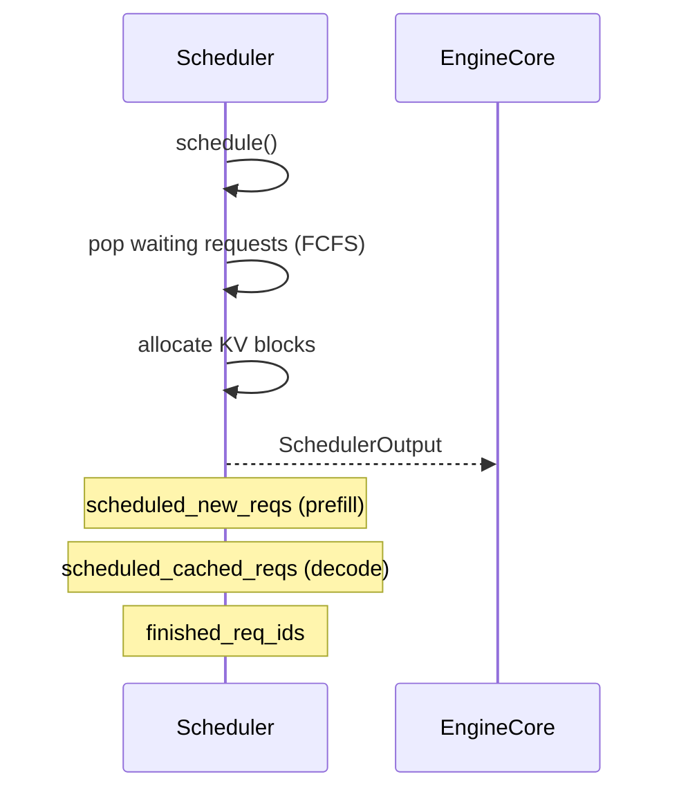

# C016: Scheduler Output Protocol

## Goal

Scheduler.schedule() returns structured `SchedulerOutput` instead of
`list[Request]`, establishing the Scheduler → Executor interface protocol.
FCFSRequestQueue replaces plain list waiting/running queues.

## New Features

- `v1/core/sched/request_queue.py` — RequestQueue(ABC) + FCFSRequestQueue (deque-based)
  ports vLLM V1's `v1/core/sched/request_queue.py:75`
- `v1/core/sched/scheduler.py` — Scheduler migrated, `schedule()` returns
  `SchedulerOutput` with:
  - `scheduled_new_reqs`: list[NewRequestData] — first-time requests
  - `scheduled_cached_reqs`: CachedRequestData — running request metadata
  - `num_scheduled_tokens`, `total_num_scheduled_tokens`
- `v1/core/sched/output.py` — enhanced from C015 placeholder with
  full field definitions aligned to vLLM V1 `v1/core/sched/output.py`
- EngineCore.step() uses `scheduler_output.scheduled_new_reqs` to identify
  prefill candidates; decode iterates `scheduler.running` as before
- Old `scheduler/scheduler.py` → bridge import to `v1.core.sched.scheduler`

## File Tree

```
my_vllm/v1/
├── core/
│   └── sched/
│       ├── __init__.py
│       ├── output.py              ← enhanced: full SchedulerOutput
│       ├── request_queue.py       ← NEW: FCFSRequestQueue
│       └── scheduler.py           ← NEW: schedule() → SchedulerOutput
├── engine/
│   ├── core.py                    ← updated: uses SchedulerOutput
│   ├── llm_engine.py
│   └── exceptions.py
├── request.py
├── outputs.py
└── utils.py
```

## Runtime Flow

```
EngineCore.step()
  │
  ├── scheduler_output = scheduler.schedule()    ← SchedulerOutput (new)
  │   ├── scheduled_new_reqs   ← first-time requests
  │   └── scheduled_cached_reqs ← running requests
  │
  ├── for req in scheduler.running:
  │     if req is new: _prefill(req)            ← per-request
  │     _decode_step(req)                       ← per-request
  │
  └── finish check / cleanup
```

## Runtime Flow



## Current Capability

- ✅ Scheduler → Executor interface protocol (SchedulerOutput)
- ✅ Scheduler and Executor interfaces stable
- ✅ FCFSRequestQueue with deque-based FCFS

## Current Limitation

- Still per-request execution (no batch) → C017
- KV still HF past_key_values → C018
- SchedulerOutput fields (block_ids, finished_req_ids) not yet populated → C018+

## Next Stage

C017: Execution Batch Framework — InputBatch + GPU batch forward
replaces per-request loops. Worker/Executor migrate to v1 paths.
