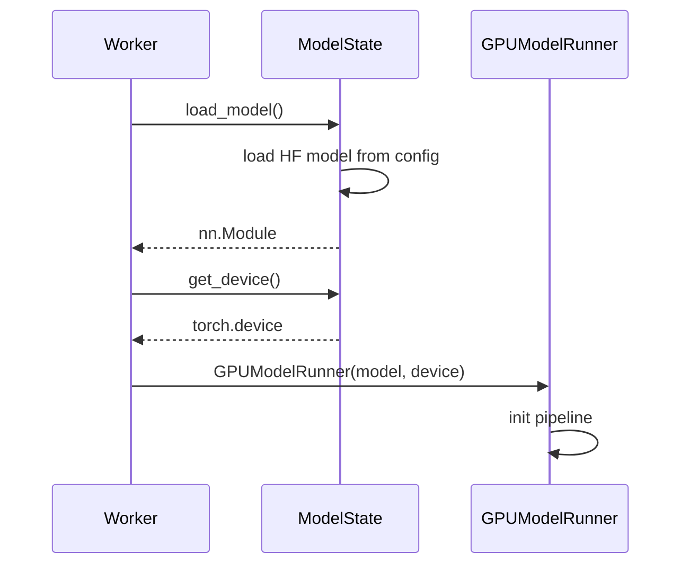

# C021: Model Initialization State

## Goal

Separate model loading and device initialization from Worker into
a dedicated ModelState abstraction, following vLLM V1's
`worker/gpu/model_states/` pattern.

## New Features

- `v1/worker/gpu/model_states/interface.py` — ModelState ABC:
  `load_model()`, `get_device()`, `get_dtype()`
- `v1/worker/gpu/model_states/default.py` — DefaultModelState:
  loads HF models via runtime/model_loader, manages device/dtype
- Worker now accepts `model_state: ModelState` for lifecycle;
  `_DirectModelState` wrapper preserves backward compat for
  `Worker(model, device)` calls
- Mirrors vLLM V1 worker/gpu/model_states/ architecture

## File Tree

```
my_vllm/v1/worker/gpu/
├── model_states/           ← NEW
│   ├── __init__.py
│   ├── interface.py        ← ModelState ABC
│   └── default.py          ← DefaultModelState
├── states.py
├── block_table.py
└── input_batch.py
my_vllm/v1/worker/
└── gpu_worker.py           ← updated: ModelState support
```

## Runtime Flow



## Current Limitation

- Attention still uses HF forward → C022 Attention Backend
- No weight-dtype conversion (model loaded as-is)
- No KV cache dtype configuration (always float16/bfloat16)

## Next Stage

C022: Attention Backend Interface — replaces direct HF model calls
with pluggable AttentionBackend.
