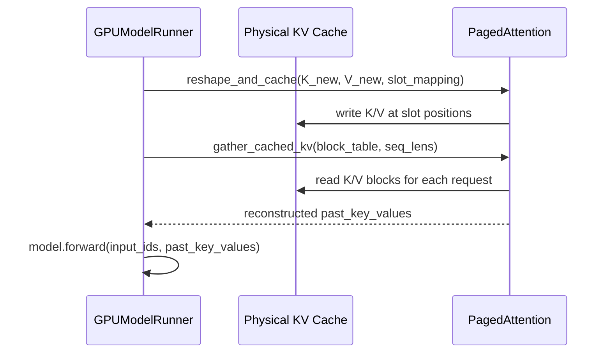

# C023: PagedAttention Runtime

## Goal

Replace HF `past_key_values` (Python tuples of per-layer tensors)
with a physical KV cache pool managed through block table-driven
gather/scatter operations — the Runtime now truly uses paged KV.

## New Features

- `v1/attention/backends/ops/paged_attn.py` — pure PyTorch
  PagedAttention operations:
  - `reshape_and_cache_pytorch(key, value, key_cache, value_cache,
    slot_mapping)` — writes K/V projections into the physical
    KV cache at block slots indexed by slot_mapping
  - `gather_cached_kv_pytorch(key_cache, value_cache, block_table,
    seq_lens, block_size)` — gathers K/V history for each request
    from the physical KV cache using the per-request block table
  - `paged_attention_forward_pytorch()` — full write+gather+attend
    pipeline (available for future per-layer hook integration)
- GPUModelRunner (C023 rewrite):
  - Pre-allocates physical KV cache pool:
    `kv_cache_k[num_layers, num_blocks, num_kv_heads, block_size, head_dim]`
    and matching value cache
  - Prefill: runs model.forward() with `use_cache=True`, then
    `_write_prefill_to_cache()` stores valid (non-padded) K/V
    into physical blocks via slot_mapping
  - Decode: `_decode_batch()` reconstructs `past_key_values` from
    the physical KV cache using block_table → passes to
    model.forward() → writes new decode K/V into physical cache
  - Handles `new_block_ids` from `CachedRequestData` — appends
    newly allocated blocks to the BlockTable before decode
  - Removed `_kv_caches: dict[str, KVCache]` dependency

## File Tree

```
my_vllm/v1/attention/backends/ops/  ← NEW
├── __init__.py
└── paged_attn.py                   ← reshape_and_cache + gather_cached_kv
my_vllm/v1/worker/
└── gpu_model_runner.py             ← C023: physical KV cache pool,
                                      _decode_batch(), _write_prefill_to_cache()
```

## Runtime Flow



## Current Limitation

- Prefill still uses HF model.forward() with padded batch tensors
  (no ragged prefill with block table-based attention)
- Decode reconstructs full `past_key_values` from physical cache
  each step — no per-layer hook intercept (model.forward() still
  computes attention internally using HF's past_key_values API)
- `paged_attention_forward_pytorch()` implemented but not wired
  into the model forward (requires per-layer hook or custom loop)
- No CUDA kernel — pure PyTorch scatter/gather is slow compared
  to `reshape_and_cache` / `paged_attention_varlen` custom ops

## Next Stage

C024: Sampling Pipeline — extract Sampler from GPUModelRunner
into `v1/sample/sampler.py` (nn.Module with greedy + top-k/top-p).
