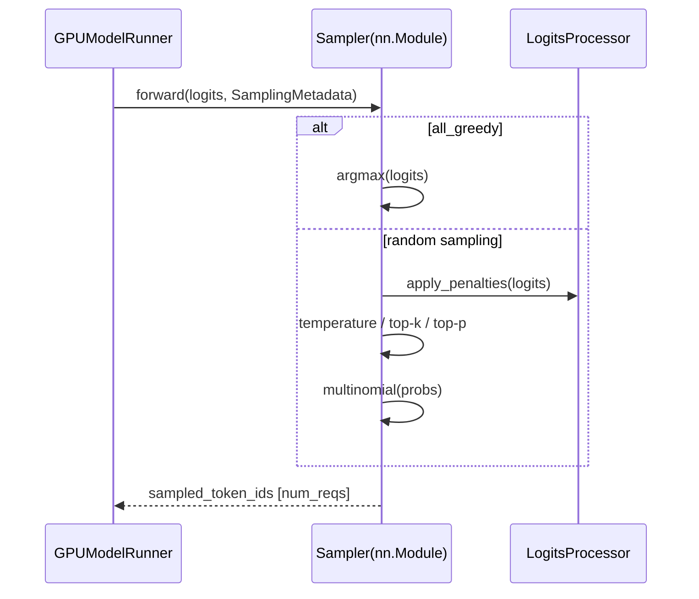

# C024: Sampling Pipeline

## Goal

Extract token sampling logic from GPUModelRunner into a dedicated
`Sampler` (nn.Module), following vLLM V1's `v1/sample/` module.

## New Features

- `v1/sample/sampler.py` — `Sampler(nn.Module)`:
  - `forward(logits, sampling_metadata)` → sampled tokens
  - Pipeline: penalties → greedy argmax (if all_greedy) →
    temperature → top-k → top-p → multinomial sample
  - Supports greedy, top-k, top-p, temperature
- `v1/sample/metadata.py` — `SamplingMetadata` dataclass:
  - `temperature`, `top_p`, `top_k` tensors per request
  - `all_greedy: bool` for fast greedy path
  - `repetition_penalties`, `frequency_penalties`, `presence_penalties`
  - `output_token_ids`, `prompt_token_ids` for penalty calculations
- `v1/sample/logits_processor.py` — penalty functions:
  - `apply_repetition_penalty` — scales logits of seen tokens
  - `apply_frequency_penalty` — penalizes by token frequency
  - `apply_presence_penalty` — flat penalty for seen tokens
- GPUModelRunner:
  - `self.sampler = Sampler()` replaces `greedy_sample()` function
  - Prefill and decode both batch logits → `self.sampler(logits, meta)`
  - `SamplingMetadata(all_greedy=True)` used for default greedy path
- `generation/sampler.py` — re-export `greedy_sample()` for backward
  compat (legacy methods still use it)

## File Tree

```
my_vllm/v1/sample/               ← NEW
├── __init__.py
├── metadata.py                  ← SamplingMetadata
├── logits_processor.py          ← apply_*_penalty functions
└── sampler.py                   ← Sampler (nn.Module)
my_vllm/v1/worker/
└── gpu_model_runner.py          ← updated: self.sampler = Sampler()
my_vllm/generation/
└── sampler.py                   ← backward compat re-export
```

## Runtime Flow



## Current Limitation

- Penalties applied per-request in Python loop (no vectorized
  GPU kernel)
- No logprobs computation yet (SamplerOutput.req_ids +
  logprobs_fields not wired)
- No min_p support (simplified top-p/top-k only)
- No Triton kernel for top-k/top-p (pure PyTorch)

## Next Stage

C025: Output Processing Pipeline — extract output processing
from EngineCore into OutputProcessor + Detokenizer.
