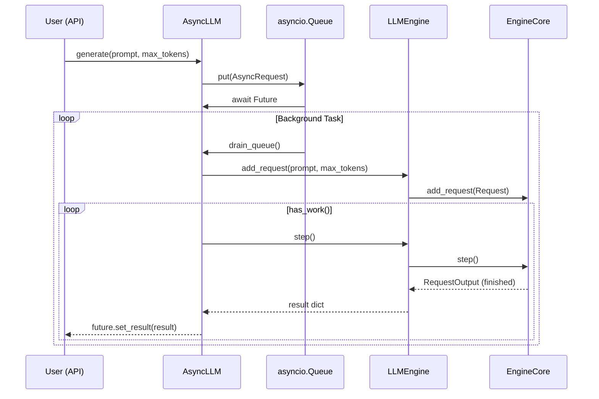

# C027: Async Runtime Scheduler

## Goal

Replace the polling-based `queue.Queue + asyncio.sleep` pattern in
AsyncLLM with a proper `asyncio.Queue` + background scheduling loop,
following vLLM V1's native async architecture.

## New Features

- `v1/engine/async_llm.py` — new AsyncLLM:
  - `AsyncRequest` dataclass: prompt + max_new_tokens + future
  - `asyncio.Queue[AsyncRequest]` replaces sync `queue.Queue`
  - `generate()` submits request to asyncio.Queue, awaits future
  - `run_loop()`: drains queue → steps engine → resolves finished
    request futures → yields via `asyncio.sleep(0)` (cooperative
    multitasking, not polling)
  - Waits for new requests on the asyncio.Queue with timeout
    instead of busy-looping with `asyncio.sleep(poll_interval)`
- `server/async_llm.py` — backward compat re-export
- `server/api_server.py` — imports from `v1/engine/async_llm`

## File Tree

```
my_vllm/v1/engine/
├── async_llm.py             ← NEW (C027): asyncio.Queue + background loop
├── input_processor.py
├── output_processor.py
├── detokenizer.py
├── core.py
└── llm_engine.py
my_vllm/server/
├── async_llm.py             ← bridge re-export
└── api_server.py            ← updated import path
```

## Before vs After

| | Before (polling) | After (C027) |
|---|---|---|
| Queue | `queue.Queue` (sync) | `asyncio.Queue` (async) |
| Wait | `asyncio.sleep(0.01)` busy loop | `asyncio.Queue.get()` with timeout |
| Submit | `_queue.put()` | `await _queue.put()` |
| Resolve | inline | per-request `asyncio.Future` |

## Runtime Flow



## Current Capability

- Single background step loop (no parallel scheduling)
- Futures resolved one-at-a-time in the step loop
- No streaming output support (futures resolve once finished)
- No cancellation / abort support

## Next Stage

C028: Executor Abstraction — add abstract Executor ABC and
MultiProcExecutor alongside existing UniProcExecutor.
