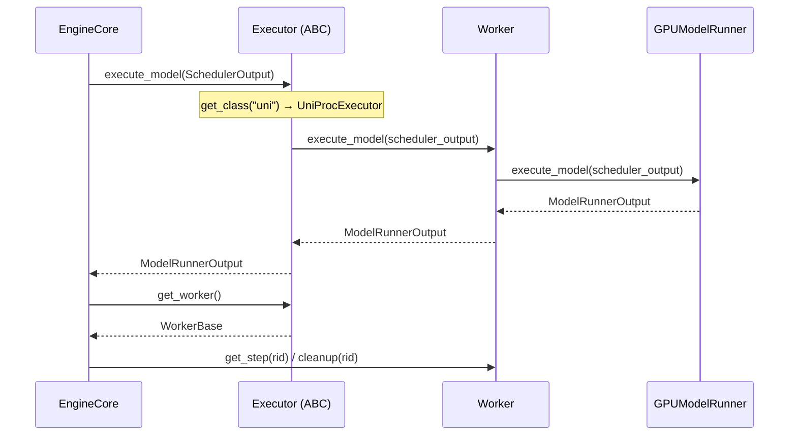

# C028: Executor Abstraction

## Goal

Enhance the Executor ABC and UniProcExecutor to provide a clean
extension point for future executor implementations (e.g.
multiprocess), following vLLM V1's `v1/executor/` pattern.

## New Features

- `v1/executor/abstract.py` — `Executor(ABC)`:
  - `get_class(backend)` factory method: selects executor by
    backend name ("uni" | "mp"); mp stub falls back to uni
  - `execute_model(SchedulerOutput) → ModelRunnerOutput` (existing)
  - `get_worker() → WorkerBase` (existing)
  - `initialize_cache(num_kv_blocks, block_size)` hook
  - `uses_ray: bool`, `supports_pp: bool` class flags
  - Full docstrings documenting the extension point
- `v1/executor/uniproc_executor.py` — `UniProcExecutor(Executor)`:
  - Private backing `_worker` with public `worker` property
  - Implements all ABC methods with proper documentation
  - `initialize_cache()` no-op (single-process shares cache)

## File Tree

```
my_vllm/v1/executor/
├── __init__.py
├── abstract.py              ← C028: factory method + initialize_cache
└── uniproc_executor.py      ← C028: property pattern, full ABC impl
```

## Runtime Flow



## Current Capability

- `Executor.get_class("mp")` returns UniProcExecutor stub
  (multiprocess executor not yet implemented — requires IPC
  serialization, worker processes, shared memory)
- No Ray/async executor support

## Next Stage

C029: Prefix Cache — add block hash-based prefix caching to
BlockPool.get_cached_block() and KVCacheManager.get_computed_blocks().
