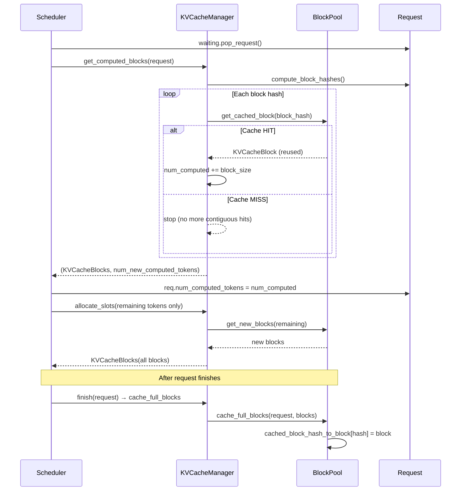

# C029: Prefix Cache

## Goal

Add block hash-based prefix caching so that requests with identical
prompt prefixes can reuse previously computed KV cache blocks,
following vLLM V1's prefix cache integration in BlockPool and
KVCacheManager.

## New Features

- `Request.compute_block_hashes()` (C029):
  - Lazy-computes per-block hashes from prompt token IDs
  - Hash = 8-byte signed big-endian encoding of `hash(tuple(tokens))`
  - Idempotent: cached in `self.block_hashes`
- `KVCacheManager.get_computed_blocks(request)`:
  - Walks request.block_hashes from the start
  - Calls BlockPool.get_cached_block(hash) for each
  - Returns (KVCacheBlocks, num_new_computed_tokens) for contiguous hit
  - Calls request.compute_block_hashes() lazily if needed
- `BlockPool` (C029 enhancements):
  - `reset_hash()` returns the old hash for cache cleanup
  - `free_blocks()` removes cached block from hash dict
  - `cache_full_blocks()` calls compute_block_hashes lazily
  - `enable_caching=True` set in EngineCore by default
- `Scheduler.schedule()` (C029):
  - Before allocating blocks, calls get_computed_blocks()
  - Sets req.num_computed_tokens for cache hits
  - Only allocates blocks for remaining (non-cached) tokens
  - `finish()` calls cache_full_blocks() on completed requests
  - Includes num_computed_tokens in NewRequestData

## File Tree

```
my_vllm/v1/
├── request.py                    ← C029: compute_block_hashes()
├── core/
│   ├── block_pool.py             ← C029: free removes cache, lazy hash compute
│   ├── kv_cache_utils.py         ← C029: reset_hash returns old hash
│   ├── kv_cache_manager.py       ← C029: get_computed_blocks()
│   └── sched/
│       └── scheduler.py          ← C029: prefix cache lookup in schedule()
└── engine/
    └── core.py                   ← BlockPool(enable_caching=True)
```

## Runtime Flow



## Current Capability

```
Request A: tokens=[1,2,3,...,16]
  → block_hashes[0] = hash((1,2,...,16))
  → scheduler schedules → prefill → finish
  → cache_full_blocks(Request A, blocks[0])
  → cached_block_hash_to_block[hash_A0] = block_0

Request B: tokens=[1,2,...,32]  (same prefix as A)
  → get_computed_blocks(Request B):
      block_hashes[0] == hash_A0 → HIT → num_computed = 16
      block_hashes[1] ≠ any cache → MISS → stop
  → scheduler: num_computed_tokens = 16
  → allocate_slots for remaining 16 tokens only
```

## Current Limitation

- Only scheduler/kv_cache_manager layer hashes are used;
  the GPUModelRunner does NOT yet skip already-computed tokens
  (KV reuse at GPU level requires chunked prefill — C030)
- Hash uses Python `hash()` which is NOT deterministic across
  processes (ok for single-process development)
- No LRU cache eviction based on memory pressure
- No canonical token ID sorting (different tokenization = different hash)

## Next Stage

C030: Chunked Prefill — token-budget-based prefill splitting in
Scheduler to interleave long prefills with running decode steps.
