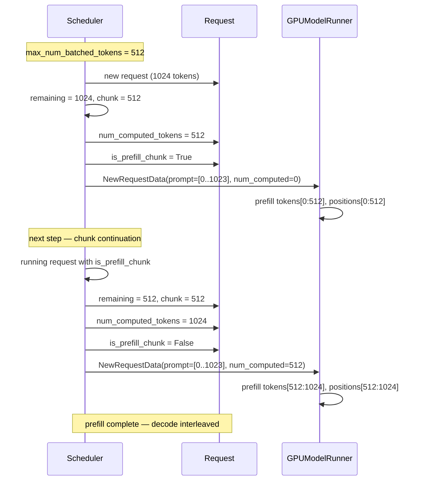

# C030: Chunked Prefill

## Goal

Add token-budget-based prefill splitting to the Scheduler so that
long prompts are processed in chunks interleaved with running decode
steps, following vLLM V1's chunked prefill scheduling strategy.

## New Features

- `Scheduler` (C030):
  - `max_num_batched_tokens` parameter (default 2048) — per-step
    token budget limiting prefill tokens
  - `schedule()`: before pulling new requests, checks running
    requests with `is_prefill_chunk = True` for chunk continuation
  - New requests with `remaining > token_budget` are split:
    only `min(remaining, budget)` tokens prefilled this step
  - `req.num_computed_tokens` tracks prefill progress;
    `req.is_prefill_chunk` flags incomplete prefill
  - `token_budget > 0` guards new request admission from waiting
    queue (prevents overscheduling)
- `GPUModelRunner._prefill_batch()` (C030):
  - Computes `effective_lens` per request from
    `prompt_len - num_computed_tokens`
  - Positions start at `num_computed_tokens` for chunked requests
  - Only uncached tokens are copied to `input_ids`; padded
    attention mask covers only the effective chunk
  - `_write_prefill_to_cache()` uses effective lengths for
    valid mask (only writes new chunk K/V)

## Runtime Flow

## Current Capability

- ✅ Long prompts split by token budget
- ✅ Chunk continuation across steps
- ✅ Budget shares between chunked and new requests
- ✅ GPUModelRunner handles effective prefill lengths

## Current Limitation

- Prefill chunks do NOT attend to previously cached KV (model
  forward processes only the current chunk tokens; previous
  chunk KV is in physical cache but not used during attention)
- No block-alignment requirement (chunks can start at any
  token position, not necessarily block boundary)
- No `long_prefill_token_threshold` — all prefills go through
  budget, not just "long" ones

## Next Stage

C031: Runtime Completeness Alignment — final alignment pass to
match C031 architecture: metrics relocation, serial_utils.py,
server upgrade, and any remaining component gap closures.
