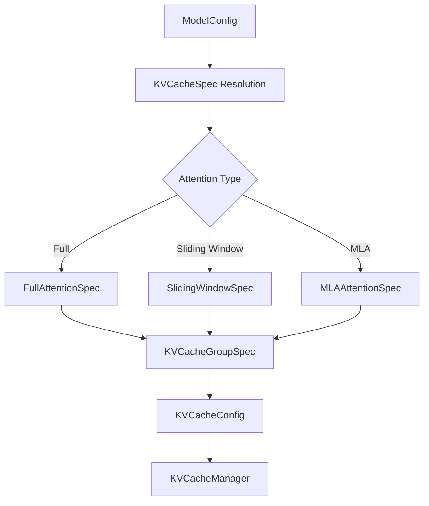

# C033: KV Cache Interface 完整化

## Goal

扩展 KVCacheSpec 类型体系，支持多种 attention 类型（Full Attention、Sliding Window、MLA），为多 attention 类型模型的 KV cache 管理提供类型基础。

## New Features

- `KVCacheSpec` — 基类，只保留 `block_size`，`page_size_bytes` 为抽象属性
- `AttentionSpec(KVCacheSpec)` — 增加 `num_kv_heads`、`head_size`、`dtype`
- `FullAttentionSpec(AttentionSpec)` — 增加 `head_size_v`（K/V 维度不同时）、`sliding_window`（可选）
- `SlidingWindowSpec(AttentionSpec)` — 增加 `sliding_window`（必选）、`head_size_v`
- `MLAAttentionSpec(FullAttentionSpec)` — 增加 `cache_dtype_str`（MLA 量化格式）
- `KVCacheGroupSpec` — `layer_names` + `kv_cache_spec`，将同 spec 类型的层分组
- `KVCacheConfig` — `num_blocks` + `kv_cache_groups`，模型级 KV cache 配置

## File Tree

```
my_vllm/
├── v1/
│   ├── kv_cache_interface.py    # ← 扩展: KVCacheSpec hierarchy + KVCacheGroupSpec + KVCacheConfig
│   ├── engine/
│   ├── core/
│   ├── worker/
│   ├── executor/
│   ├── attention/
│   ├── sample/
│   ├── metrics/
│   ├── request.py
│   └── outputs.py
├── config.py
├── model_executor/
├── distributed/
└── runtime/
```

## Runtime Flow



## Current Capability

- 类型体系完整定义：5 种 KV cache spec 类 + KVCacheGroupSpec + KVCacheConfig
- 不同 attention 类型的 KV cache 描述能力（Full / SWA / MLA）
- 层分组能力（同 spec 类型层聚合为一个 group）
- `page_size_bytes` 正确计算（K+V 打包尺寸）

## Current Limitation

- 仅类型定义，未被 Scheduler / KVCacheManager 实际使用
- 无 `KVCacheCoordinator`（C034 将引入）
- 无 `KVCacheTensor`（物理内存布局描述，后续阶段）
- 模型仍为 OPT-125m（Full Attention 单一类型）

## Next Stage

C034 — KV Cache Coordinator：根据 KVCacheGroupSpec 将 request 的 block 分配路由到不同类型的 KVCacheManager。
