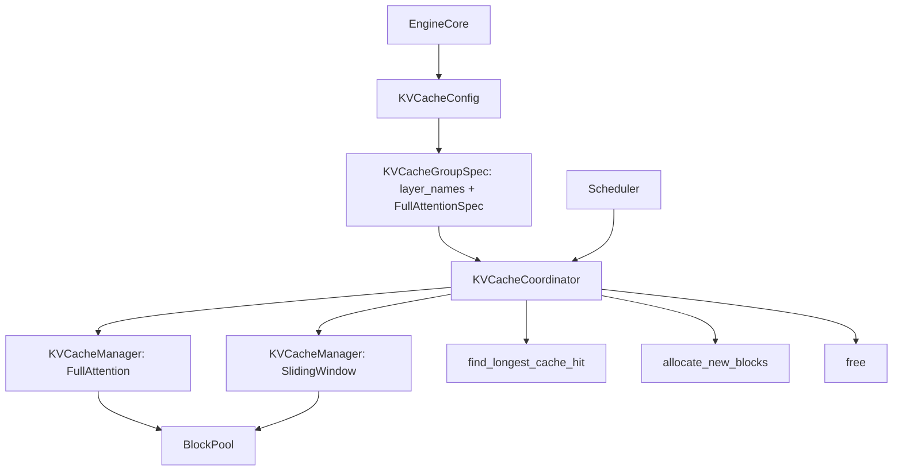

# C034: KV Cache Coordinator

## Goal

引入 KVCacheCoordinator 作为 Scheduler 与多个 KVCacheManager 之间的路由层。模型可能有多种 attention 类型（Full Attention + Sliding Window），每种类型需要独立的 KV cache group 管理。Coordinator 将 block 分配路由到正确的 per-type KVCacheManager。

## New Features

- `KVCacheCoordinator` — 包装多个 KVCacheManager 实例，一个 per KV cache group
- `find_longest_cache_hit()` — 跨所有 group 查找最长 prefix cache 命中，取交集
- `allocate_new_blocks()` — 为所有 group 分配 block，任一失败则整体失败
- `free()` — 释放所有 group 的 request blocks
- `get_computed_blocks()` / `allocate_slots()` — 后向兼容单 group 情况
- Scheduler 通过 `_get_cache_manager()` 解耦，接受 KVCacheCoordinator 或 KVCacheManager
- EngineCore 构建 KVCacheConfig → KVCacheGroupSpec → KVCacheCoordinator 链条

## File Tree

```
my_vllm/v1/
├── kv_cache_interface.py           # C033: 类型体系
├── core/
│   ├── kv_cache_coordinator.py     # ← 新增
│   ├── kv_cache_manager.py         # + get_computed_blocks_mgr()
│   ├── block_pool.py
│   ├── kv_cache_utils.py
│   └── sched/
│       ├── scheduler.py            # 使用 _get_cache_manager() 解耦
│       ├── output.py
│       └── request_queue.py
├── engine/
│   └── core.py                     # 构建 KVCacheConfig → KVCacheCoordinator
└── ...
```

## Runtime Flow



## Current Capability

- Scheduler 通过 KVCacheCoordinator 间接访问 KV cache，不再直接依赖 KVCacheManager
- 支持多 KV cache group（当前 OPT-125m 只有 1 个 FullAttention group）
- `find_longest_cache_hit` 正确计算跨 group 最小公共前缀
- 后向兼容：Scheduler 仍可接受 KVCacheManager（通过 `kv_cache_manager` kwarg）

## Current Limitation

- 仅 1 个 KV cache group（OPT-125m FullAttention），未测试多 group 路径
- 无 SlidingWindowManager / FullAttentionManager 子类型区分
- `find_longest_cache_hit` 简化实现，未处理 alignment/zoning/non-causal 等 vLLM 实际场景
- Coordinator 不是 ABC，未区分 Unitary/Hybrid/NoPrefixCache 子类

## Next Stage

C035 — BlockPool 生命周期升级：BlockHashToBlockMap（hash→list[block]），free_blocks() ref_cnt cascading release，垃圾回收驱逐逻辑。
