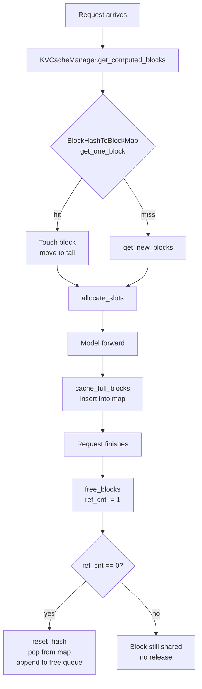

# C035: BlockPool lifecycle upgrade — BlockHashToBlockMap + GC

## Goal

C032 的 BlockPool 使用 `dict[bytes, KVCacheBlock]` (hash→block, 1:1) 做 prefix cache lookup，无法处理哈希碰撞下的多 block 共享。同时 `free_blocks()` 直接设置 ref_cnt=0，不支持共享 block 的引用计数级联释放。

C035 补齐生产级 block 池的两个核心能力：
- **BlockHashToBlockMap**: hash → list[block] (1:N)，处理碰撞/去重
- **GC free_blocks()**: ref_cnt cascading release（递减而非清零，ref_cnt>1 时只减不释放）

## New Features

- `BlockHashToBlockMap` 类：`get_one_block()`, `contain()`, `insert()`, `pop()` — 对齐 vLLM
- `free_blocks()` ref_cnt 级联释放：`ref_cnt -= 1`，仅 `ref_cnt == 0` 时真正归还 free queue
- `KVCacheBlockCopy(src_block_id, dst_block_id)` NamedTuple（为 C036 CoW 准备）

## File Tree

```
my_vllm/v1/
├── core/
│   ├── block_pool.py            ← BlockHashToBlockMap + 升级 free_blocks()
│   ├── kv_cache_utils.py        ← KVCacheBlockCopy NamedTuple
│   ├── kv_cache_manager.py
│   └── sched/
│       ├── scheduler.py
│       └── output.py
├── engine/
├── worker/
├── executor/
├── attention/
├── sample/
├── model_executor/
├── distributed/
├── metrics/
├── config.py
├── request.py
├── outputs.py
├── serial_utils.py
├── utils.py
└── kv_cache_interface.py
```

## Runtime Flow



## Current Capability

- ✅ BlockPool with LRU eviction (FreeKVCacheBlockQueue)
- ✅ BlockHashToBlockMap with collision support (hash → list[block])
- ✅ ref_cnt cascading release in free_blocks()
- ✅ KVCacheBlockCopy NamedTuple ready for CoW
- ✅ 19/19 BlockPool + prefix cache tests pass

## Current Limitation

- No Copy-on-Write: shared blocks written by one request **still pollute** the other (will be fixed in C036)
- No KV cache metrics (C054)
- No block-level reuse/residency/eviction tracking (C054)
- pref_f_cnt decrement is not yet cascading across children (C054c)

## Next Stage

C036: Prefix Cache Copy-on-Write — 两个 request 共享 prefix block 时，写入检测触发 CoW 复制，避免污染对方 KV cache。
