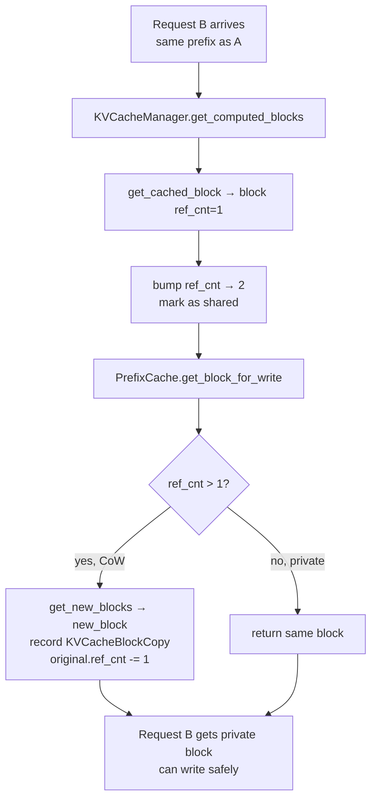

# C036: Prefix Cache Copy-on-Write

## Goal

两个 request 共享 prefix block 时，一个 request 的 KV 写入不能污染另一个的 KV cache。C029 已有 `cached_block_hash_to_block` 做 prefix cache lookup，但缺少 CoW 语义——共享块被直接复用，写操作会互相污染。

C036 新增 PrefixCache 类，在 `get_computed_blocks()` 检测共享块（ref_cnt > 1）时自动触发 Copy-on-Write：分配新块、记录拷贝、递减原块引用计数。

## New Features

- `v1/core/prefix_cache.py` — PrefixCache 类：`get_block_for_write()` CoW 逻辑
- `KVCacheManager.get_computed_blocks()` 集成 PrefixCache：bump ref_cnt on reuse → CoW clone
- `KVCacheBlockCopy(src_block_id, dst_block_id)` 记录拷贝元数据

## File Tree

```
my_vllm/v1/core/
├── block_pool.py         # BlockHashToBlockMap + BlockPool
├── kv_cache_utils.py     # KVCacheBlock, FreeKVCacheBlockQueue, KVCacheBlockCopy
├── kv_cache_manager.py   # PrefixCache 集成
├── prefix_cache.py       # (新增) PrefixCache CoW
└── sched/
    ├── scheduler.py
    └── output.py
```

## Runtime Flow



## Current Capability

- ✅ BlockHashToBlockMap with collision support
- ✅ ref_cnt cascading release in free_blocks()
- ✅ PrefixCache CoW: shared blocks cloned for write safety
- ✅ 28/28 BlockPool + prefix cache + CoW tests pass

## Current Limitation

- GPU-side KV data copy not yet implemented (recorded as KVCacheBlockCopy only, actual physical cache copy not done — C054c)
- No KV cache metrics (C054)
- No ref_cnt cascading release across children (C054c)

## Next Stage

C037: SchedulerInterface ABC — 调度器标准化接口，为 priority/preemption/async 提供可替换的调度契约。
