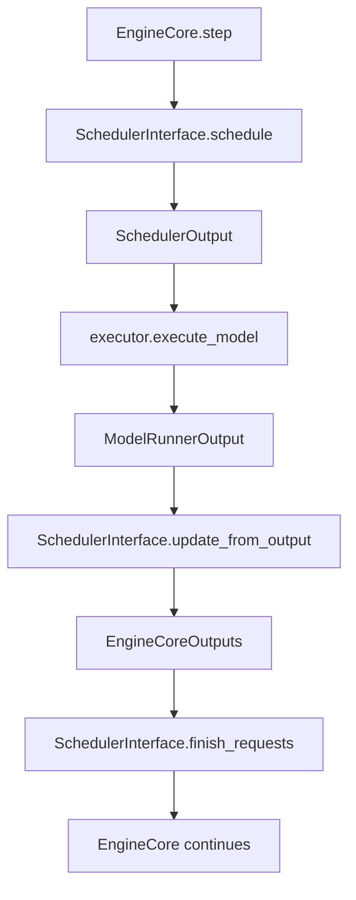

# C037: SchedulerInterface ABC

## Goal

C032 的 scheduler 是单体 FCFS 实现，直接耦合 EngineCore。未来要加入 priority (C051)、preemption (C052)、async scheduler 等变体，需要先建立标准调度器抽象接口。

C037 定义 SchedulerInterface ABC，让 EngineCore 通过接口调用调度器，不与具体实现耦合。

## New Features

- `v1/core/sched/interface.py` — SchedulerInterface ABC
  - `schedule()` → SchedulerOutput
  - `update_from_output(scheduler_output, model_runner_output)` → EngineCoreOutputs
  - `add_request(request)`
  - `finish_requests(request_ids, finished_status)` → list[Request]
  - `get_num_unfinished_requests()` → int
  - `has_unfinished_requests()` → bool
- `Scheduler` 实现 SchedulerInterface（FCFS 变体）

## File Tree

```
my_vllm/v1/core/sched/
├── interface.py       # (新增) SchedulerInterface ABC
├── scheduler.py       # Scheduler 实现 SchedulerInterface
├── output.py          # SchedulerOutput, NewRequestData, CachedRequestData
└── request_queue.py   # FCFSRequestQueue
```

## Runtime Flow



## Current Capability

- ✅ SchedulerInterface ABC 定义标准化调度契约
- ✅ Scheduler (FCFS) 实现完整接口
- ✅ EngineCore 通过 Scheduler API 调用不变
- ✅ 28/28 阻塞相关测试通过

## Current Limitation

- 仅 FCFS 一个调度策略实现
- 无 priority/preemption 调度器变体

## Next Stage

C038: Scheduler Resource Model — 调度决策显式建模 GPU/KV/token 三类资源预算。
