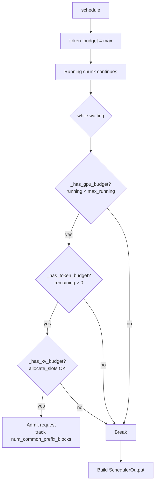

# C038: Scheduler Resource Model

## Goal

C032 的调度器已隐式使用 `max_running`、`token_budget`、`allocate_slots` 返回值做资源限制，但调度决策未显式建模 GPU/KV/token 三类资源预算。

C038 将资源检查显式化为 `_has_gpu_budget()` / `_has_token_budget()` / `_has_kv_budget()` 三个方法，并在 SchedulerOutput 中导出 `num_common_prefix_blocks` 追踪每个请求的 prefix cache 命中块数。

## New Features

- `SchedulerOutput.num_common_prefix_blocks: list[int]` — 每个新请求的 prefix cache 命中块数
- `Scheduler._has_gpu_budget()` — GPU 预算：max_num_seqs 不超上限
- `Scheduler._has_token_budget(remaining)` — Token 预算：至少还有 token 槽位
- `Scheduler._has_kv_budget(blocks)` — KV 预算：allocate_slots 非空
- `schedule()` while 循环用显式预算方法替换原隐式条件

## File Tree

```
my_vllm/v1/core/sched/
├── interface.py       # SchedulerInterface ABC
├── scheduler.py       # Scheduler + 资源预算方法
├── output.py          # + num_common_prefix_blocks
└── request_queue.py   # FCFSRequestQueue
```

## Runtime Flow



## Current Capability

- ✅ 显式资源预算检查（GPU/KV/token）
- ✅ `num_common_prefix_blocks` 导出 prefix cache 命中统计
- ✅ 28/28 阻塞相关测试通过

## Current Limitation

- 无优先级调度（C051）
- 无资源不足时的抢占（C052）

## Next Stage

C051: Priority Scheduler — 基于优先级的调度策略，FCFS/Priority 可切换。
