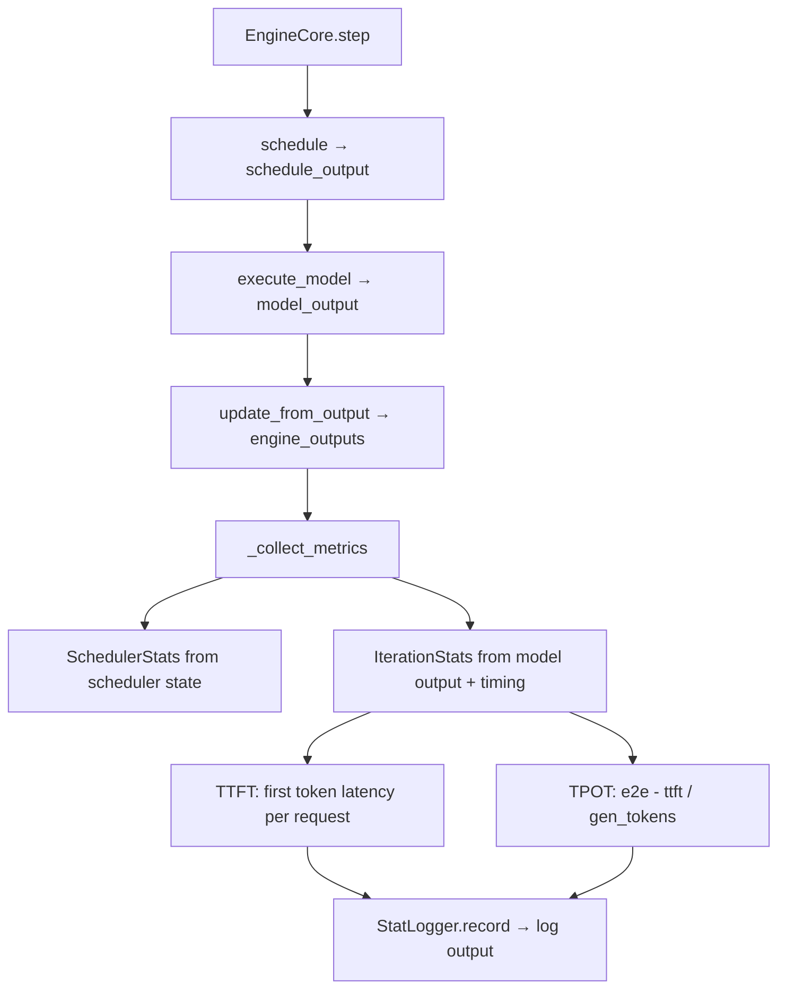

# C048: Metrics — TTFT, TPOT, ITL, Throughput, KV Utilization

## Goal

补齐 LLM Serving 关键可观测性指标。C032 仅有基础 `collector.py`（计数 + 吞吐量），缺少时间维度的延迟细粒度指标。

C048 引入 vLLM 对齐的 `SchedulerStats` + `IterationStats` 体系，在 `EngineCore.step()` 边界采集：
- TTFT (Time To First Token)
- TPOT (Time Per Output Token)  
- ITL (Inter-Token Latency)
- Prompt/Generation Throughput (tokens/s)
- KV Cache Utilization

## New Features

- `v1/metrics/stats.py` — `SchedulerStats`, `IterationStats`, `PrefixCacheStats`, `FinishedRequestStats`
- `v1/metrics/loggers.py` — `StatLoggerBase` ABC + `LoggingStatLogger`（每 N step 输出统计）
- `v1/metrics/prometheus.py` — stub（`setup_multiprocess_prometheus` 占位）
- `EngineCore` 集成：`_collect_metrics()` 在 step() 末尾采集 SchedulerStats + IterationStats
- TTFT: request arrival → first sampled token
- ITL: 连续两次 token 之间的间隔
- TPOT: (e2e - ttft) / num_generation_tokens

## File Tree

```
my_vllm/v1/metrics/
├── collector.py       # (existing) basic counter
├── stats.py           # (新增) SchedulerStats, IterationStats
├── loggers.py         # (新增) StatLoggerBase, LoggingStatLogger
└── prometheus.py      # (新增) stub
```

## Runtime Flow



## Current Capability

- ✅ SchedulerStats: num_running, num_waiting, kv_cache_usage
- ✅ IterationStats: TTFT, TPOT, ITL, prompt/decode throughput
- ✅ FinishedRequestStats: e2e latency, per-request breakdown
- ✅ LoggingStatLogger: periodic stat logging
- ✅ 27/27 阻塞测试通过

## Current Limitation

- ITL 追踪为平均值，非逐 token 间隔
- Prometheus 仅 stub
- 无 prefix cache hit rate 实时统计（PrefixCacheStats 字段存在但未填充）

## Next Stage

C054: KV Cache Metrics — block 生命周期可观测（reuse interval, residency, eviction count, hit rate）。
