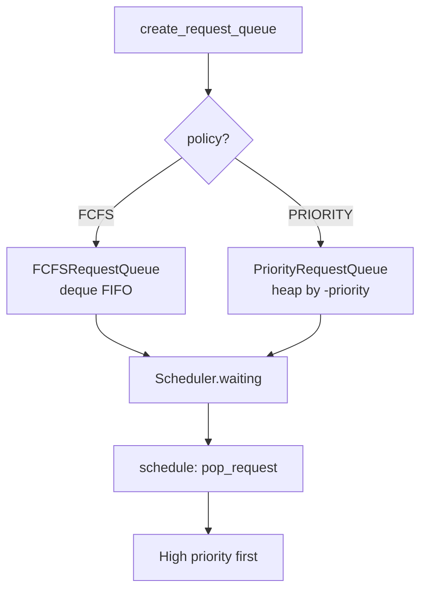

# C051: Priority Scheduler

## Goal

C032 的调度器仅支持 FCFS。生产环境需要优先级调度：高优先级请求应优先获取 GPU/KV 资源。这是 C052 (Preemption) 的前置依赖——抢占需要知道谁可被抢占（低优先级请求）。

C051 引入 `SchedulingPolicy` 枚举和 `PriorityRequestQueue`（heap-based），Scheduler 通过 `create_request_queue()` 工厂注入策略，实现 FCFS/Priority 可切换。

## New Features

- `Request.priority: int` — 请求优先级（高值 = 高优先级）
- `SchedulingPolicy(Enum)` — FCFS / PRIORITY
- `PriorityRequestQueue` — heap-based，按 (-priority, arrival_time, seq) 排序
- `create_request_queue(policy)` — 工厂函数
- `Scheduler.__init__(policy=SchedulingPolicy.FCFS)` — 可替换调度策略

## File Tree

```
my_vllm/v1/
├── request.py                      # + priority 字段
├── core/sched/
│   ├── interface.py                # SchedulerInterface ABC
│   ├── scheduler.py                # Scheduler + policy 参数
│   ├── output.py                   # SchedulerOutput
│   └── request_queue.py            # + SchedulingPolicy, PriorityRequestQueue, create_request_queue
```

## Runtime Flow



## Current Capability

- ✅ FCFS + Priority 两种调度策略
- ✅ `create_request_queue` 工厂，运行时切换
- ✅ Priority queue 按 priority+arrival_time 稳定排序
- ✅ 28/28 阻塞测试 + 手动优先级验证通过

## Current Limitation

- 无抢占机制 (C052)
- 无异步调度 (C053)

## Next Stage

C052: Preemption + KV Reclaim — GPU/KV 资源不足时抢占低优先级请求。
