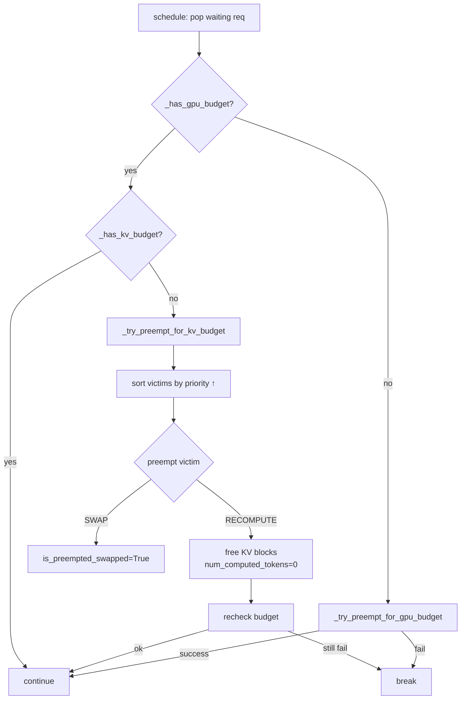

# C052: Preemption + KV Reclaim

## Goal

当 GPU/KV 资源不足时，高优先级新请求无法被调度。C052 引入抢占机制：Scheduler 选择运行中的低优先级请求，通过 RECOMPUTE（释放 KV blocks，恢复时重新 prefill）或 SWAP（保留 blocks，标记为 exchanged）模式将其驱逐，释放资源给高优先级请求。

## New Features

- `PreemptionMode(Enum)` — RECOMPUTE / SWAP
- `Scheduler._select_preemption_victims()` — 按优先级从低到高选择 victim
- `Scheduler._preempt(victim)` — set PREEMPTED, free blocks (RECOMPUTE) or mark swapped
- `Scheduler._try_preempt_for_gpu_budget()` — GPU slot 不足时抢占
- `Scheduler._try_preempt_for_kv_budget()` — KV block 不足时抢占
- `Request.is_preempted_swapped: bool` — SWAP 模式标记
- `SchedulerOutput.preempted_req_ids` — 本次 step 被抢占的 request IDs
- PREEMPTED 请求放回 waiting queue，下次 schedule 时重新执行

## File Tree

```
my_vllm/v1/
├── request.py                  # + is_preempted_swapped
├── core/sched/
│   ├── scheduler.py            # + PreemptionMode, preempt logic
│   ├── output.py               # preempted_req_ids already defined
│   └── ...
```

## Runtime Flow



## Current Capability

- ✅ RECOMPUTE 模式抢占：释放 KV blocks，重置 computed tokens
- ✅ SWAP 模式 stub：标记 is_preempted_swapped
- ✅ 按优先级选择 victim，不抢占同优先级或更高优先级请求
- ✅ `preempted_req_ids` 导出被抢占的 request IDs
- ✅ PREEMPTED 请求放回 waiting queue，支持 resume/retry
- ✅ 28/28 阻塞测试 + 手动抢占测试通过

## Current Limitation

- SWAP 模式仅 stub（无 CPU swap_in/swap_out 实现）
- 无 GPU 侧 KV block copy 支持（SWAP 需要）
- PREEMPTED 请求恢复时无 KV 数据恢复（RECOMPUTE 是全新 prefill）

## Next Stage

C054c: KVCacheBlock ref_cnt 级联释放 — 完善 block 池引用计数体系，支持共享 block 的级联递减。
