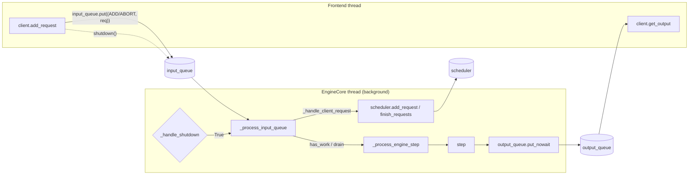

# C124: EngineCore busy loop primitives

## Goal

Add the vLLM V1 busy-loop infrastructure to `EngineCore` so the loop can
be spun by `BusyLoopClient` (C125) without changing the existing
caller-driven `step()` path. After C124:

- `EngineCore` owns `input_queue` + `output_queue` + `shutdown_state`.
- `EngineCore.run_busy_loop()` drains input → steps → forwards outputs
  in a `while _handle_shutdown(): ...` loop.
- `EngineCore.shutdown()` flips the state machine and pushes a `WAKEUP`
  sentinel so an idle loop unblocks.
- Caller-driven `step()` is untouched: `LLMEngine.generate()`'s
  `while has_work(): step()` keeps working.

Reference: `vllm/v1/engine/core.py` `EngineCore.run_busy_loop`
(L1358), `_process_input_queue` (L1368), `_process_engine_step`
(L1399), `_handle_shutdown` (L1423), `_handle_client_request` (L1471),
`shutdown` (L743). Reference enum: `vllm/v1/engine/__init__.py`
`EngineCoreRequestType` (L252).

## New Features

### `EngineCoreRequestType` (in `v1/engine/__init__.py`)

Mirrors vLLM `v1/engine/__init__.py:EngineCoreRequestType`. We keep
**only** `ADD` / `ABORT` / `WAKEUP`; `START_DP_WAVE`, `UTILITY`,
`EXECUTOR_FAILED` are out of scope for my-vllm's uniproc / no-ZMQ path
(LOOP-PLAN §3). vLLM uses `b"\x00"`-style byte literals so the tag can
ride on a ZMQ socket without separate encoding — my-vllm's queue is
in-process, so we use plain ints.

```python
class EngineCoreRequestType(enum.Enum):
    ADD = 0
    ABORT = 1
    WAKEUP = 2
```

### `EngineShutdownState` (in `v1/engine/core.py`)

Mirrors vLLM `v1/engine/core.py:EngineShutdownState` (L989). Three-state
machine: `RUNNING` (0) → `REQUESTED` (1) → `SHUTTING_DOWN` (2).

### `EngineCore` — busy-loop surface

`__init__` now initializes the queues and state:

```python
self.input_queue: queue.Queue[tuple[EngineCoreRequestType, Any]] = queue.Queue()
self.output_queue: queue.Queue[EngineCoreOutputs] = queue.Queue()
self.shutdown_state = EngineShutdownState.RUNNING
```

New methods (each mirrors vLLM with DP / batch_queue / EEP / UTILITY
stripped out, see LOOP-PLAN §2 C124):

| Method | vLLM line | What it does |
|---|---|---|
| `is_running()` | L1354 | `shutdown_state == RUNNING` |
| `run_busy_loop()` | L1358 | `while _handle_shutdown(): _process_input_queue(); _process_engine_step()` |
| `_process_input_queue()` | L1368 | Block on input queue until work; drain remaining |
| `_process_engine_step()` | L1399 | One `step()`; forward non-empty outputs |
| `_handle_shutdown()` | L1423 | Drive `REQUESTED → SHUTTING_DOWN`; return False when no work |
| `_handle_client_request()` | L1471 | Dispatch ADD / ABORT / WAKEUP (unknown → log) |
| `shutdown()` | (new) | Set `REQUESTED`; push `WAKEUP` sentinel to wake the loop |

`_handle_client_request` calls `add_request(req)` for ADD and
`self.scheduler.finish_requests(request, RequestStatus.FINISHED_ABORTED)`
for ABORT (per LOOP-PLAN C124 spec). The existing `step()` method is
unchanged.

### Caller-driven path: untouched

```python
def add_request(self, request):  # unchanged
    self.scheduler.add_request(request)
    ...

def step(self) -> EngineCoreOutputs:  # unchanged
    ...
```

`LLMEngine.generate()`'s `while self.has_work(): self.step()` still
works identically. C125 wires `BusyLoopClient` on top of these
primitives.

## File Tree (diff)

```
M  my_vllm/v1/engine/__init__.py          # +10 lines (EngineCoreRequestType enum)
M  my_vllm/v1/engine/core.py              # +128 lines (EngineShutdownState + 7 new methods)
A  tests/test_C124_busy_loop.py           # 264 lines, 14 tests
A  docs/snapshots/C124.md
```

## Runtime Flow

### Caller-driven (current `run.py`, unchanged)

```
LLMEngine.generate()
  └─ while has_work(): step()
        └─ EngineCore.step()                          # unchanged
              └─ schedule → execute → update_from_output
```

### Busy-loop (new — used by C125's BusyLoopClient)



### Shutdown

```
[Frontend thread]
shutdown()
  ├─ shutdown_state = REQUESTED
  └─ input_queue.put((WAKEUP, None))            # wake if idle

                              [EngineCore thread]
                              run_busy_loop() next iteration:
                                _handle_shutdown()
                                  state == REQUESTED → SHUTTING_DOWN
                                  has_work() ? loop : exit
```

## Current Capability

- `python run.py`: identical 50-token output to C123.
- `pytest tests/`: 208 passed / 55 failed — same baseline 55 failures
  as C123, +14 new tests in `tests/test_C124_busy_loop.py` (all green).
- `EngineCore.run_busy_loop()` runs in a thread and exits cleanly on
  `shutdown()` whether or not there is in-flight work.
- Input queue dispatches ADD / ABORT / WAKEUP; unknown request types
  log an error (no crash).
- `LLMEngine.generate()` caller-driven path is byte-for-byte the same
  as C123.

## Current Limitation

- **Scope reductions vs vLLM** (per LOOP-PLAN §3):
  - No DP `engines_running` / `batch_queue` / DP wave handling.
  - No `EEPNotification` / elastic EP scale-up notifications.
  - No `UTILITY` RPC, no `EXECUTOR_FAILED` sentinel.
  - No `aborts_queue` (separate queue) — aborts ride the main
    `input_queue`.
  - No `vllm_config.shutdown_timeout` driven abort vs. drain — the
    loop simply stops accepting new work and drains whatever is in
    flight until the scheduler reports no unfinished requests.
  - `EngineCoreRequestType` uses ints, not byte strings (in-process
    queue, no ZMQ socket).
- **Pre-existing scheduler limitation exposed by ABORT test**:
  `Scheduler.finish_requests` + `Scheduler._find_request` currently
  only look at `running`, not `waiting` — aborting a request that has
  not yet been scheduled is a no-op. Tracked separately; not part of
  C124.
- The busy loop runs `step()` on a single thread (no overlap with
  Python-level socket IO); ZMQ/IO overlap will arrive when
  multiproc/DP lands in a later phase (LOOP-PLAN §3.1).

## Summary

| Stage | What | Hot path |
|---|---|---|
| C121 | `EngineCore.step` → 12-line pipeline | `engine/core.py:253` |
| C122 | `Scheduler.schedule` → 43-line pipeline | `core/sched/scheduler.py` |
| C123 | BlockPool / KVCacheManager helpers | `core/block_pool.py`, `core/kv_cache_manager.py` |
| **C124** | **Busy loop primitives on `EngineCore`** | **`engine/core.py:158-256`** |

The loop is now *formable*: `EngineCore.run_busy_loop()` exists,
queues are wired, shutdown state is tracked. C125 wraps this in
`EngineCoreClient` (InprocClient / BusyLoopClient) and C126 makes
`LLMEngine` go through the client. C127 rewires `AsyncLLM` and
`api_server` to use `BusyLoopClient`. C128 closes the loop with
documentation and verification.
