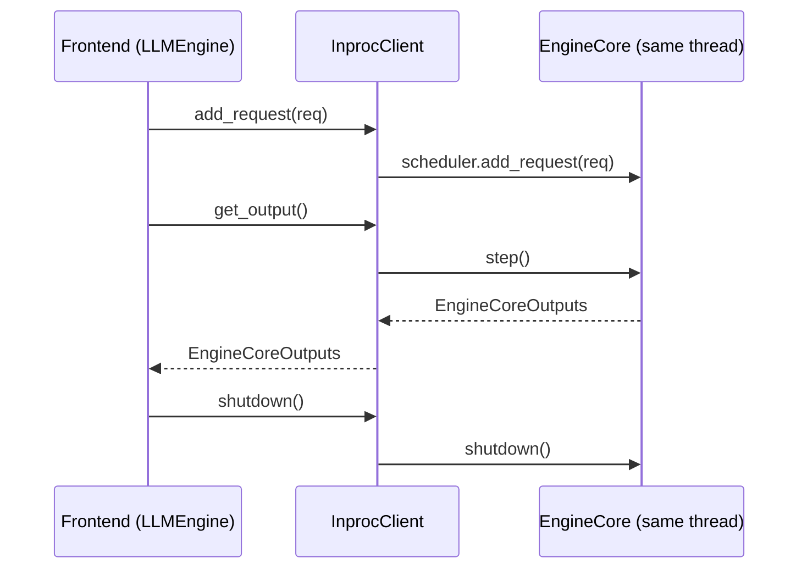
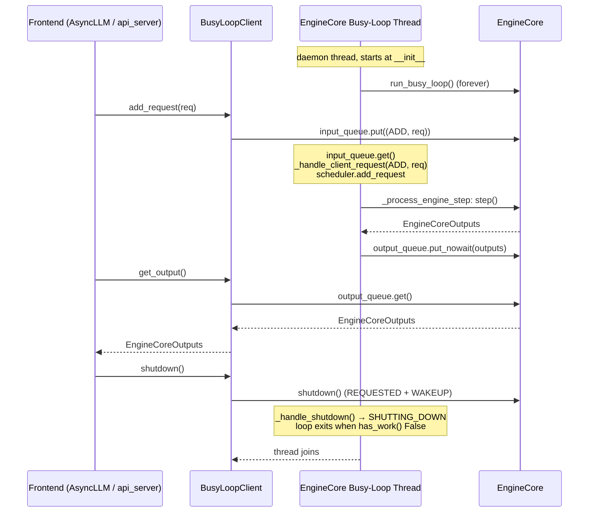

# C125: EngineCoreClient abstraction

## Goal

Introduce the LLMEngine ↔ EngineCore client layer. Two implementations
ride the C124 busy-loop primitives:

* **`InprocClient`** — synchronous, holds `EngineCore` directly. The
  frontend drives `step()` itself (`get_output() == engine_core.step()`).
  This is the default — `run.py` and the existing
  `LLMEngine.generate()` caller-driven path.
* **`BusyLoopClient`** — spawns a daemon thread running
  `EngineCore.run_busy_loop`. Requests enqueue to `input_queue`;
  outputs come back through `output_queue`. This is what `AsyncLLM`
  and the `api_server` will use (C127).

`EngineCoreClient.make_client(busy_loop, ...)` selects between them.

Reference: `vllm/v1/engine/core_client.py` `EngineCoreClient` (L71),
`make_client` (L83), `InprocClient` (L276) — `get_output` (L289),
`add_request` (L297), `abort_requests` (L301), `shutdown` (L305).

## New Features

### `EngineCoreClient` ABC

```python
class EngineCoreClient(ABC):
    @staticmethod
    def make_client(busy_loop, vllm_config, executor_class, log_stats):
        if busy_loop: return BusyLoopClient(...)
        return InprocClient(...)

    @abstractmethod
    def shutdown(self, timeout=None): ...
    @abstractmethod
    def get_output(self) -> EngineCoreOutputs: ...
    @abstractmethod
    def add_request(self, request: Request): ...
    @abstractmethod
    def abort_requests(self, request_ids: list[str]): ...

    def has_work(self) -> bool: return False   # default
```

The interface is the smallest one that still separates Inproc and
BusyLoop lifecycles. C126 rewires `LLMEngine` to go through this
client.

### `InprocClient`

| Method | Calls |
|---|---|
| `__init__` | `EngineCore(vllm_config, executor_class, log_stats)` |
| `get_output` | `engine_core.step()` |
| `add_request` | `engine_core.add_request(request)` |
| `abort_requests` | `scheduler.finish_requests(ids, RequestStatus.FINISHED_ABORTED)` |
| `shutdown` | `engine_core.shutdown()` |
| `has_work` | `engine_core.has_work()` |

This is essentially a thin shim — `LLMEngine.generate()`'s
`while has_work(): step()` works unchanged because `has_work()` and
`get_output()` map to the same underlying EngineCore methods.

### `BusyLoopClient`

| Method | Calls |
|---|---|
| `__init__` | Construct EngineCore + `Thread(target=engine_core.run_busy_loop, daemon=True).start()` |
| `get_output` | `engine_core.output_queue.get()` (blocking) |
| `add_request` | `engine_core.input_queue.put((EngineCoreRequestType.ADD, request))` |
| `abort_requests` | `engine_core.input_queue.put((EngineCoreRequestType.ABORT, request_ids))` |
| `shutdown` | `engine_core.shutdown()` + `_loop_thread.join(timeout=timeout)` |
| `has_work` | `engine_core.has_work()` |

The daemon thread is named `"EngineCoreBusyLoop"` for debuggability.
`shutdown(timeout=None)` flips `EngineShutdownState` via
`EngineCore.shutdown()` (which pushes a `WAKEUP` sentinel onto
`input_queue`) and then joins the thread.

### `make_client` factory

```python
EngineCoreClient.make_client(
    busy_loop=False, vllm_config=..., executor_class=..., log_stats=...,
)  # → InprocClient
EngineCoreClient.make_client(busy_loop=True, ...)               # → BusyLoopClient
```

`asyncio_mode` and `multiprocess_mode` are out of scope (LOOP-PLAN §3).

## File Tree (diff)

```
A  my_vllm/v1/engine/core_client.py          # 142 lines: ABC + 2 impls + factory
A  tests/test_C125_core_client.py            # 12 tests covering both clients
A  docs/snapshots/C125.md
```

## Runtime Flow

### `InprocClient` (default — `run.py`)



### `BusyLoopClient` (used by C127 `AsyncLLM` / `api_server`)



## Current Capability

- `python run.py`: identical 50-token output to C123/C124 (default Inproc path).
- `pytest tests/`: 220 passed / 55 failed — same baseline 55 failures
  as C124, +12 new tests in `tests/test_C125_core_client.py` (all green).
- Both clients drive `add_request → get_output` end-to-end against the
  same stub EngineCore.
- `BusyLoopClient.__init__` starts a daemon thread; `shutdown()` joins
  it within `timeout` seconds and transitions
  `EngineShutdownState → SHUTTING_DOWN`.
- `make_client(busy_loop=True/False)` selects the right client.

## Current Limitation

- **Scope reductions vs vLLM** (LOOP-PLAN §3):
  - No ZMQ / multiprocess / async I/O. `AsyncLLM` rewires at C127 via
    `asyncio.to_thread(client.get_output)` on the sync client surface.
  - No `step_fn` / `post_step` separation (vLLM's batch_queue +
    streaming); `InprocClient.get_output() == engine_core.step()`.
  - No `LoRARequest` / `sleep` / `wake_up` / `profile` /
    `reset_*_cache` / `collective_rpc` / `dp_engines_running` /
    `add_lora` / `remove_lora` / `pin_lora` / `list_loras` /
    `execute_dummy_batch` / `save_sharded_state` methods. my-vllm
    doesn't implement those features yet.
  - `make_client` ignores `asyncio_mode` and `multiprocess_mode`
    kwargs — only `busy_loop` is honored.
- **Single-process only**: `BusyLoopClient` is thread-based, not
  process-based (matches my-vllm's uniproc default). The LOOP-PLAN
  reserves real ZMQ separation for the distributed phase.
- **No tests for Inproc under load**: `InprocClient.add_request →
  get_output` is exercised only against the stub executor; with a
  real model this becomes `LLMEngine` testing territory (C126).
- **Pre-existing scheduler bug** (also exposed at C124):
  `Scheduler._find_request` only scans `running`, so aborting a
  waiting request is a no-op on `InprocClient.abort_requests` too.
  Tracked separately.

## Summary

| Stage | What | Where |
|---|---|---|
| C121 | `EngineCore.step` → 12-line pipeline | `engine/core.py:253` |
| C122 | `Scheduler.schedule` → 43-line pipeline | `core/sched/scheduler.py` |
| C123 | BlockPool / KVCacheManager helpers | `core/block_pool.py`, `core/kv_cache_manager.py` |
| C124 | Busy-loop primitives on `EngineCore` | `engine/core.py:158-256` |
| **C125** | **`EngineCoreClient` ABC + `InprocClient` + `BusyLoopClient`** | **`engine/core_client.py`** |

The LLMEngine ↔ EngineCore boundary is now materialized. The next
move is C126 — refactor `LLMEngine` to hold an `EngineCoreClient`
instead of an `EngineCore` directly (zero behavior change; pure
refactor).
