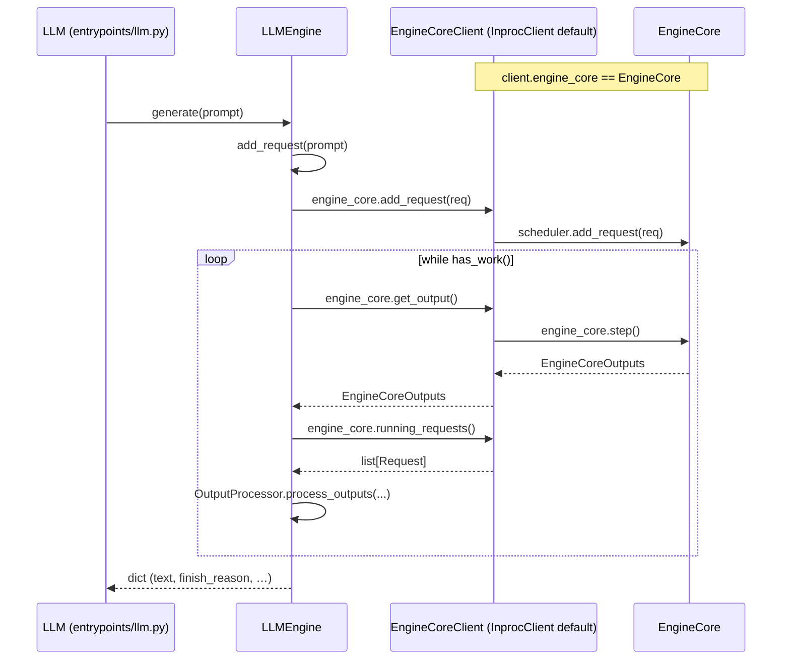

# C126: LLMEngine ↔ EngineCoreClient wiring

## Goal

Pure refactor: `LLMEngine` no longer constructs `EngineCore` directly.
It holds an `EngineCoreClient` (InprocClient for offline / default,
BusyLoopClient when `busy_loop=True`). Behavior is unchanged — `run.py`
output is byte-identical to C123/C124/C125.

Reference: `vllm/v1/engine/llm_engine.py` `LLMEngine.__init__` (L105,
`EngineCoreClient.make_client`), `add_request` (L276),
`abort_request` (L212), `model_executor` (L125).

## New Features

### `EngineCoreClient.running_requests()`

Default on the ABC returns `[]`; both `InprocClient` and
`BusyLoopClient` override to expose
`self.engine_core.scheduler.running`. `LLMEngine.step()` now builds
`req_map` from this accessor instead of poking at
`self._engine_core.scheduler.running` directly.

### `LLMEngine.engine_core`

The instance attribute that used to be `self._engine_core` (an
`EngineCore`) is now `self.engine_core` (an `EngineCoreClient`),
matching vLLM's naming convention. `LLMEngine.__init__` accepts a new
`busy_loop: bool = False` parameter; default `False` preserves the
caller-driven semantics `LLMEngine.generate()` has relied on.

```python
def __init__(
    self,
    vllm_config: VllmConfig,
    executor_class: type[Executor],
    tokenizer,
    busy_loop: bool = False,
):
    ...
    self.engine_core: EngineCoreClient = EngineCoreClient.make_client(
        busy_loop=busy_loop,
        vllm_config=vllm_config,
        executor_class=executor_class,
        log_stats=False,
    )
```

The call sites follow the same pattern:

| Site | Before | After |
|---|---|---|
| `add_request` | `self._engine_core.add_request(req)` | `self.engine_core.add_request(req)` |
| `step` (call) | `self._engine_core.step()` | `self.engine_core.get_output()` |
| `step` (req_map) | `self._engine_core.scheduler.running` | `self.engine_core.running_requests()` |
| `has_work` | `self._engine_core.has_work()` | `self.engine_core.has_work()` |

`entrypoints/llm.py` and `examples/server.py` keep working unchanged
because they only touch `LLMEngine.add_request` / `.step` /
`.generate` / `.has_work`. `LLMEngine` is otherwise a thin coordinator.

## File Tree (diff)

```
M  my_vllm/v1/engine/core_client.py          # +14 lines: running_requests() on ABC + impls
M  my_vllm/v1/engine/llm_engine.py            # pure refactor (EngineCore → EngineCoreClient)
A  tests/test_C126_llm_engine_client.py       # 6 tests (5 unit + 1 e2e output equivalence)
A  docs/snapshots/C126.md
```

## Runtime Flow (unchanged for InprocClient)



For `busy_loop=True` (used by C127 `AsyncLLM` / `api_server`), the
client instead spawns the busy-loop thread; `get_output()` blocks on
`output_queue.get()`.

## Current Capability

- `python run.py`: byte-identical 50-token output to C123/C124/C125.
- `pytest tests/`: 226 passed / 55 failed — same baseline 55 failures
  as C125, +6 new tests in `tests/test_C126_llm_engine_client.py`
  (all green).
- `LLMEngine.__init__(busy_loop=True)` wires up a `BusyLoopClient`;
  `LLMEngine.engine_core.shutdown(timeout=…)` joins the loop thread
  cleanly.
- `LLMEngine.engine_core.running_requests()` is the canonical accessor
  for the live running-request list. Both clients honor it.

## Current Limitation

- **Pure refactor scope**: no new behavior, no new bug fixes. The
  pre-existing limitations from C124 / C125 still apply:
  - `Scheduler._find_request` only scans `running` (abort-while-waiting
    no-op).
  - `EngineCoreRequestType` is int-typed (in-process queue, no ZMQ).
  - `BusyLoopClient`'s `running_requests()` reads scheduler state from
    the frontend thread while the busy-loop thread mutates it — racey
    in principle. In practice C127 will switch the only caller
    (`AsyncLLM`) to `asyncio.to_thread(client.get_output)` so the
    frontend thread no longer touches `scheduler.running` directly.
- **C126 doesn't change `AsyncLLM` / `api_server`**: those still use
  naive loops and call `LLMEngine` with the default
  `busy_loop=False`. C127 makes them use `busy_loop=True` and removes
  the naive loops.
- **`make_client` only honors `busy_loop`**: `asyncio_mode` /
  `multiprocess_mode` kwargs are ignored (intentional, LOOP-PLAN §3).

## Summary

| Stage | What | Where |
|---|---|---|
| C121 | `EngineCore.step` → 12-line pipeline | `engine/core.py:253` |
| C122 | `Scheduler.schedule` → 43-line pipeline | `core/sched/scheduler.py` |
| C123 | BlockPool / KVCacheManager helpers | `core/block_pool.py`, `core/kv_cache_manager.py` |
| C124 | Busy-loop primitives on `EngineCore` | `engine/core.py:158-256` |
| C125 | `EngineCoreClient` ABC + Inproc/BusyLoop impls | `engine/core_client.py` |
| **C126** | **`LLMEngine` holds `EngineCoreClient`** (pure refactor) | **`engine/llm_engine.py`** |

The C124→C126 trio delivers the loop infrastructure + client
abstraction + LLMEngine integration. The remaining work is C127
(`AsyncLLM` / `api_server` → `BusyLoopClient`) and C128 (verification
+ docs).