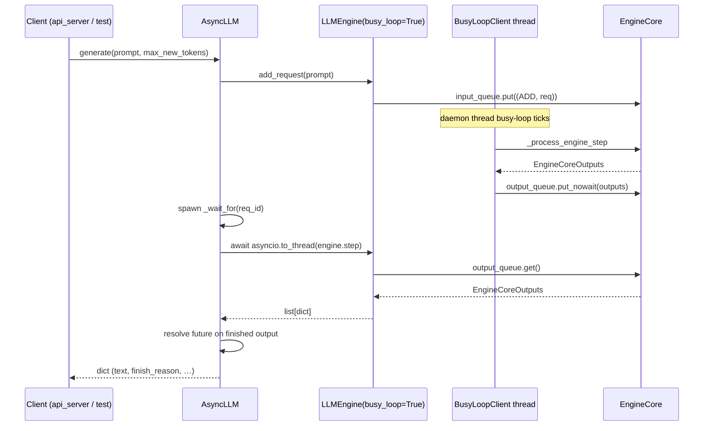

# C127: AsyncLLM + api_server → BusyLoopClient

## Goal

Replace AsyncLLM's C027-era naive `run_loop` with a per-request
waiter that drives `engine.step()` through `asyncio.to_thread`. The
engine is held with `busy_loop=True`, so the busy loop thread
(`BusyLoopClient`) is the single producer-side scheduler. The api_server
caller constructs `LLMEngine(busy_loop=True)`.

Reference: `vllm/v1/engine/async_llm.py` `AsyncLLM` (L70),
`add_request` (L280), `generate` (L524), `output_handler` (L656),
`check_health` (L900). The my-vllm path stays in-process / single
engine per LOOP-PLAN §3.1.

## New Features

### `AsyncLLM` rewrite

```python
class AsyncLLM:
    def __init__(self, engine: LLMEngine):
        self._engine = engine
        self._pending: dict[str, asyncio.Future] = {}
        self._errored = False

    async def generate(self, prompt, max_new_tokens=50) -> dict:
        loop = asyncio.get_running_loop()
        future = loop.create_future()
        req_id = self._engine.add_request(prompt, max_new_tokens=max_new_tokens)
        self._pending[req_id] = future
        waiter = loop.create_task(self._wait_for(req_id))
        try:
            return await future
        finally:
            if not waiter.done():
                waiter.cancel()
                try: await waiter
                except (asyncio.CancelledError, Exception): pass

    async def _wait_for(self, req_id):
        try:
            while req_id in self._pending:
                outputs = await asyncio.to_thread(self._engine.step)
                for r in outputs:
                    if r["request_id"] != req_id: continue
                    if r.get("finish_reason") or r.get("finished"):
                        pending = self._pending.pop(req_id, None)
                        if pending and not pending.done():
                            pending.set_result(r)
                        return
        except asyncio.CancelledError:
            self._pending.pop(req_id, None)
            raise
```

Retired (per LOOP-PLAN §2 C127):
- `asyncio.Queue[AsyncRequest]` and `AsyncRequest` dataclass
- `run_loop` / `_drain_queue` / `_add_to_engine`
- `_running` flag

Kept:
- `check_health` / `errored` / `dead_error` (mirrors vLLM async_llm.py L107/114/118).

The waiter uses `asyncio.to_thread(self._engine.step)` so the busy
loop's blocking `output_queue.get()` (C124) does not stall the event
loop. Cancellation cleans up the future so we don't leak it.

### `examples/server.py` switches to busy loop

```diff
   engine = LLMEngine(
       vllm_config=cfg,
       executor_class=UniProcExecutor,
       tokenizer=tokenizer,
+      busy_loop=True,
   )
```

`api_server.py` itself takes an engine as a parameter; it does not
care whether the client is `InprocClient` or `BusyLoopClient`.

## File Tree (diff)

```
M  my_vllm/v1/engine/async_llm.py                # rewrite: drop naive loop, per-request waiter
M  examples/server.py                              # busy_loop=True
M  tests/test_C027_async_scheduler.py             # rewritten to match new AsyncLLM API
A  tests/test_C127_async_llm_busy_loop.py         # 8 tests
A  docs/snapshots/C127.md
```

## Runtime Flow



The `BusyLoopClient` thread runs continuously (independent of the
event loop). `AsyncLLM.generate()` simply drains one batch at a time
from the engine's `output_queue`.

## Current Capability

- `python run.py`: byte-identical 50-token output to C123/C124/C125/C126
  (offline path uses `busy_loop=False`).
- `pytest tests/`: 234 passed / 55 failed — same baseline 55 failures
  as C126, +8 new tests in `tests/test_C127_async_llm_busy_loop.py`
  (all green). `test_C027_async_scheduler.py` rewritten; 6 tests pass.
- `AsyncLLM(engine).generate(...)` resolves the future when the
  request's `finish_reason` shows up in `engine.step()` output.
- `examples/server.py` constructs `LLMEngine(busy_loop=True)` —
  ready for `python examples/server.py` to launch the daemon thread.

## Current Limitation

- **No streaming output**: `AsyncLLM.generate()` returns a single
  `dict` only when the request is finished. The intermediate per-step
  outputs are dropped. vLLM exposes streaming via `output_handler`;
  we add it when needed (post-C128).
- **No output_queue backpressure**: `BusyLoopClient` runs continuously;
  if the frontend (AsyncLLM / api_server) doesn't drain
  `output_queue.get()` fast enough, the queue grows unbounded. C128
  does not fix this; flagged in the LOOP-PLAN §3 scope-reduction list.
- **Concurrency caveat**: two concurrent `generate()` calls each spawn
  their own `_wait_for` task; each calls `engine.step()` via
  `asyncio.to_thread`. Step is single-threaded under the GIL, so
  concurrent calls interleave rather than parallelize, but they do
  correctly resolve their own futures (per-request `request_id`
  filter).
- **`AsyncLLM` is no longer framework-agnostic**: it must hold an
  `LLMEngine` (or any object exposing `add_request` + `step`). The
  naive C027 design worked with a stub; the new design still does,
  but the stub must return the request's `request_id` in step output
  for `generate()` to resolve.

## Summary

| Stage | What | Where |
|---|---|---|
| C121 | `EngineCore.step` → 12-line pipeline | `engine/core.py:253` |
| C122 | `Scheduler.schedule` → 43-line pipeline | `core/sched/scheduler.py` |
| C123 | BlockPool / KVCacheManager helpers | `core/block_pool.py`, `core/kv_cache_manager.py` |
| C124 | Busy-loop primitives on `EngineCore` | `engine/core.py:158-256` |
| C125 | `EngineCoreClient` ABC + Inproc/BusyLoop impls | `engine/core_client.py` |
| C126 | `LLMEngine` holds `EngineCoreClient` (pure refactor) | `engine/llm_engine.py` |
| **C127** | **`AsyncLLM` drops naive loop; `api_server` uses `busy_loop=True`** | **`engine/async_llm.py`, `examples/server.py`** |

C128 is the final commit — verification, doc updates, and confirmation
that the LOOP-PLAN §5 done criteria are met.