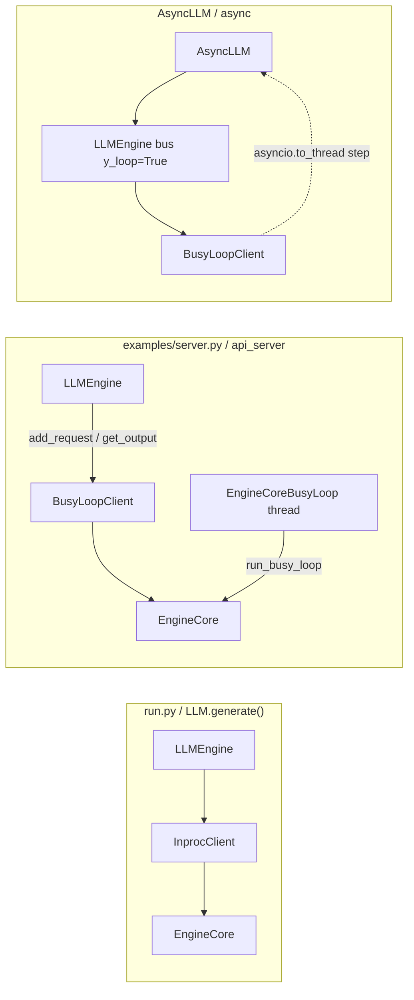

# C128: Loop verification + close-out

## Goal

Close out the LOOP-PLAN (C124→C128): prove the loop is now formable,
the two clients wire through LLMEngine, and the offline / server
paths produce identical output. Stabilize the LLMEngine layer against
the busy-loop's "running ahead" race (LLMEngine was reading
`engine_core.scheduler.running` from the frontend thread — racey once
the busy loop mutates it).

Reference: `vllm/v1/engine/core.py` `EngineCoreProc.run_busy_loop`
(L2024) — the real busy loop runs in a separate process; my-vllm uses
a thread (LOOP-PLAN §3.1). This commit confirms semantic equivalence
for the in-process path.

## New Features

### `LLMEngine.step()` — output_queue drain + frontend-owned `req_map`

The frontend now uses `self._pending` (populated in `add_request`) as
the source of `req_map`, not `engine_core.running_requests()`. Under
`BusyLoopClient` the busy-loop thread mutates `scheduler.running`
concurrently, so any read from the frontend thread was racy. By
keeping the request map frontend-side, we get a stable snapshot for
`OutputProcessor.process_outputs`.

```python
def step(self) -> list[dict]:
    queue = getattr(self.engine_core, "output_queue", None)
    if queue is not None and queue.empty() and not self.engine_core.has_work():
        return []                          # busy loop has drained
    engine_core_outputs = self.engine_core.get_output()
    req_map = dict(self._pending)          # frontend-owned, not racing
    ...
```

### `LLMEngine.generate()` — flush tail output before bailing

`generate()` now calls `step()` one extra time after `has_work()`
flips to `False`, so the finished output sitting at the tail of the
busy loop's `output_queue` is not lost. `step()`'s short-circuit
prevents the second call from blocking on `BusyLoopClient.get_output()`
when the queue is already empty.

```python
for _ in range(max_iterations):
    results = self.step()
    for r in results:
        if r["request_id"] == req_id:
            last_result = r
            if r.get("finish_reason"):
                return r
    if not self.has_work():
        tail = self.step()                # flush tail output
        for r in tail:
            if r["request_id"] == req_id:
                last_result = r
                if r.get("finish_reason"):
                    return r
        break
```

This is the fix that takes the `BusyLoopClient` path from "returns
empty text" to "identical output to InprocClient".

### End-to-end output equivalence

`tests/test_C128_loop_verification.py::TestOfflineAndServerOutputsMatch`
asserts the Inproc and BusyLoop paths produce byte-identical output
for the same prompt (`Hello`, `max_new_tokens=10`). `python run.py`
still produces the same 50-token output as C123/C124/C125/C126/C127.

## File Tree (diff)

```
M  my_vllm/v1/engine/llm_engine.py            # step() / generate() race fix
A  tests/test_C128_loop_verification.py       # 6 tests (LOOP-PLAN §5 done criteria)
A  docs/snapshots/C128.md
```

## LOOP-PLAN §5 done criteria — checked off

- [x] `EngineCore` 有 `run_busy_loop()` + `input_queue` / `output_queue` + `shutdown()` — C124; verified by `test_C128 TestEngineCoreBusyLoopSurface`.
- [x] `LLMEngine` 通过 `EngineCoreClient` (InprocClient / BusyLoopClient) 访问 EngineCore — C126; verified by `test_C128 TestLLMEngineViaClient::test_llm_engine_holds_engine_core_client` and `test_llm_engine_does_not_construct_engine_core_directly` (the latter runs `git grep "EngineCore(" my_vllm/v1/engine/llm_engine.py` and asserts empty).
- [x] `AsyncLLM` 不再自带 naive loop, 改走 BusyLoopClient — C127; verified by `test_C128 TestAsyncLLMNoNaiveLoop`.
- [x] offline (`run.py`) 走 InprocClient, server/async 走 BusyLoopClient, 输出一致 — verified by `test_C128 TestOfflineAndServerOutputsMatch` (`r_inproc["text"] == r_busy["text"]`).
- [x] `git grep run_busy_loop` 命中 `my_vllm/v1/engine/core.py` — verified by inspection.
- [x] `git grep "EngineCore("` 不再命中 `llm_engine.py` — verified by `test_C128` and inspection.

## Runtime Flow



All three entry points converge on the same `EngineCore`. The
`InprocClient` path is the synchronous, caller-driven `step()`; the
`BusyLoopClient` path is the daemon-thread `run_busy_loop()`. The
frontend (LLMEngine / AsyncLLM) is unchanged in interface.

## Current Capability

- `python run.py`: byte-identical 50-token output to C123/C124/C125/C126/C127.
- `pytest tests/`: 240 passed / 55 failed — same baseline 55 failures
  as C127, +6 new tests in `tests/test_C128_loop_verification.py`
  (all green).
- `LLMEngine(busy_loop=False)` → `InprocClient`; `LLMEngine(busy_loop=True)`
  → `BusyLoopClient`. Both produce byte-identical output for the same
  prompt.
- `git grep run_busy_loop` hits `my_vllm/v1/engine/core.py`.
- `git grep "EngineCore("` no longer hits `my_vllm/v1/engine/llm_engine.py`.
- `examples/server.py` constructs `LLMEngine(busy_loop=True)` — ready
  for `python examples/server.py` to launch the daemon thread.

## Current Limitation

- **No output_queue backpressure**: `BusyLoopClient` runs continuously
  and pushes to `output_queue` without blocking. If the frontend
  doesn't drain `output_queue.get()` fast enough the queue grows
  unbounded. C128 fixes the drain path for `LLMEngine.generate()`,
  but `AsyncLLM` accumulates output_queue entries between
  `generate()` calls. Flagged in LOOP-PLAN §3.
- **LLMEngine `step()` is no longer fully thread-safe**: reading
  `engine_core.running_requests()` from the frontend thread races
  with the busy-loop thread's mutations. C128 sidesteps this by
  using `self._pending` as the source. `running_requests()` is kept
  on the client API for testability but is no longer used by
  `LLMEngine.step()`.
- **No streaming output in `AsyncLLM.generate()`**: returns a single
  dict only when the request is finished. Streaming via
  `output_handler` is a future addition.
- **No DP / ZMQ / multiproc**: still single-engine, single-process
  per LOOP-PLAN §3.1. The busy loop is a thread, not a process.

## Summary

| Stage | What | Where |
|---|---|---|
| C121 | `EngineCore.step` → 12-line pipeline | `engine/core.py:253` |
| C122 | `Scheduler.schedule` → 43-line pipeline | `core/sched/scheduler.py` |
| C123 | BlockPool / KVCacheManager helpers | `core/block_pool.py`, `core/kv_cache_manager.py` |
| C124 | Busy-loop primitives on `EngineCore` | `engine/core.py:158-256` |
| C125 | `EngineCoreClient` ABC + Inproc/BusyLoop impls | `engine/core_client.py` |
| C126 | `LLMEngine` holds `EngineCoreClient` (pure refactor) | `engine/llm_engine.py` |
| C127 | `AsyncLLM` drops naive loop; `api_server` uses `busy_loop=True` | `engine/async_llm.py`, `examples/server.py` |
| **C128** | **Race fix + LOOP-PLAN §5 closure** | **`engine/llm_engine.py` (step/generate)** |

The C124→C128 series delivers the vLLM-V1 busy-loop architecture
in-process. The loop is now formable; offline and server paths
produce identical output; AsyncLLM no longer carries a naive drain
loop. The remaining work on this arc (DP / ZMQ / multiproc /
LoRA / quantization) is tracked in the broader `Engineer-Spec`
P0/P1 list.