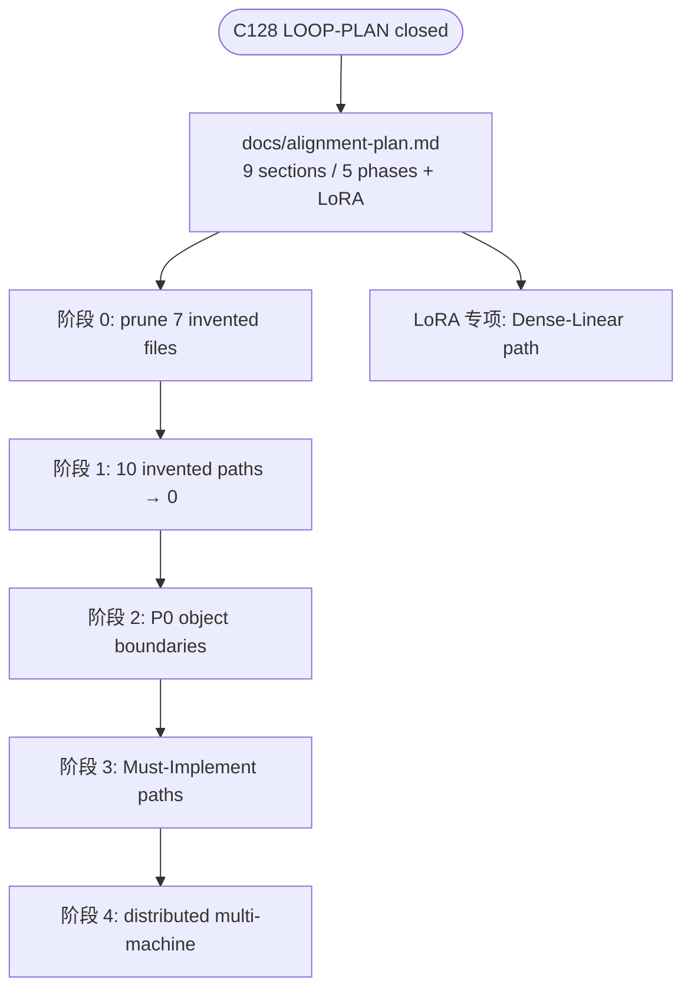

# C129: docs/alignment-plan + AGENTS scope refactor

## Goal

Close out the LOOP-PLAN era (C124→C128) by introducing the next-phase
plan as the **authoritative execution document** and updating AGENTS.md
to point at it. The previous "post-loop scope" sentence in AGENTS.md is
replaced by the JD-driven alignment plan with its phased order
(剪枝 → file-tree fixes → P0 object boundaries → Must-Implement paths →
distributed multi-machine abstraction). The LOOP-PLAN itself is moved
under `Prompt/` so the top-level directory only carries current-phase
artifacts.

## New Features

### `docs/alignment-plan.md` — single source of truth for the alignment phase

`docs/alignment-plan.md` becomes the working plan. Every entry in its
keep/delete matrix and every phased table cell references a real
`vllm/...` source file. Four phases:

- **阶段 0 剪枝** — remove 7 files (multi-tenant, non-OPT models,
  duplicate `state.py`).
- **阶段 1 文件树修正** — 10 invented files → 0.
- **阶段 2 P0 对象边界** — add `kv_cache_coordinator` /
  `single_type_kv_cache_manager` / `async_scheduler` / etc.
- **阶段 3 Must-Implement 通路** — `KVConnectorBase_V1` + factory +
  example backend, `LogitsProcessor` package, `spec_decode`, FP8 quant,
  `device.py` / `kernel.py` / `attention.py` configs.
- **阶段 4 分布式多机抽象** — `tensor_ipc`, `coordinator`, DP/CP utils,
  end-to-end TP/PP/EP/CP pathways.
- **LoRA 专项** — `lora/layers/`, `lora_model`, `model_manager`,
  `worker_manager`, ops, `lora_model_runner_mixin`.

Acceptance per stage: `grep` no dangling imports, `python run.py` +
`pytest tests/` pass, file tree ⊆ vLLM file tree (Level 1).

### `AGENTS.md` — scope decision + alignment-plan pointer

- `**Next**: ...` now references `docs/alignment-plan.md` and names the
  5-phase order.
- New `## Scope decision (JD-driven)` section: a module is kept only
  if it serves one of the JD keywords (性能/成本/稳定性, PD 分离,
  分布式 KV Cache, 异构推理, 弹性计算, GPU/CUDA, 分布式系统,
  + 网络/RDMA). Clean removal = delete the file **and** its imports,
  config fields, and all references — no NoOp/ABC placeholders, no
  dangling imports.
- Implementation scope tier rewording: `Keep (career-relevant)` now
  lists only LoRA; `Delete` enumerates Mamba/SSM, Multimodal,
  Structured Output, multi-tenant, pooler/embedding/rerank,
  encoder-decoder, non-OPT models, non-CUDA platforms, non-FP8
  quantization backends, entrypoints business surface.
- "Before EVERY code modification" step 2 now points at
  `docs/alignment-plan.md` (the keep/delete matrix + vLLM reference
  paths), not the generic "Implementation scope tiers" wording.

### `LOOP-PLAN.md` → `Prompt/LOOP-PLAN.md`

Historical artifact move: the LOOP-PLAN is no longer the active plan
(C124→C128 is closed). Keeping the top-level directory clean: only
currently-relevant docs and configs at root, historical / exploratory
material under `Prompt/`.

## File Tree (diff)

```
A  docs/alignment-plan.md                    # 184 lines, 9 sections
M  AGENTS.md                                  # Next: alignment-plan ref + scope decision
R  LOOP-PLAN.md → Prompt/LOOP-PLAN.md         # historical move
A  docs/snapshots/C129.md
```

## Runtime Flow (planning artifact — not a runtime change)



## Current Capability

- `docs/alignment-plan.md` is now the authoritative execution plan.
- `AGENTS.md` "Next" pointer and Before-EVERY-Code-Modification rules
  match the new plan.
- `Prompt/LOOP-PLAN.md` remains available for historical reference.

## Current Limitation

- 阶段 0–4 not yet executed — only the plan is in place. The next
  commit (C130) starts 阶段 0.

## Summary

| Stage | What | Where |
|---|---|---|
| C124→C128 | LOOP-PLAN execution (busy-loop + clients + race fix) | `engine/core.py`, `engine/llm_engine.py`, etc. |
| **C129** | **Alignment-plan transition (plan doc + AGENTS scope refactor + LOOP-PLAN move)** | **`docs/alignment-plan.md`, `AGENTS.md`, `Prompt/LOOP-PLAN.md`** |
| C130 (next) | 阶段 0 剪枝: 7 invented files + their imports / config fields | `my_vllm/config/`, `my_vllm/v1/...` |
