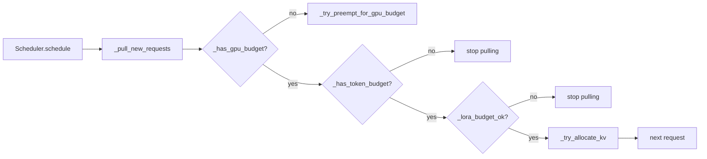

# C130: alignment-stage-0 — prune 7 invented files

## Goal

Execute **阶段 0 剪枝** from `docs/alignment-plan.md` §3. Seven files
with no real-vLLM counterpart (or duplicates) are removed, and every
import / config field / runtime reference is cleaned so no dangling
symbol remains. After this commit, `git grep` shows zero matches for
`multi_tenant`, `MultiTenant`, `TenantConfig`, or `tenant_id` across
`my_vllm/`. The repo size shrinks by 1147 lines net.

This is the clean-removal template for every later stage: delete file +
delete import + delete config field + delete runtime reference — no
NoOp/ABC placeholders, no leftover comments about the deleted feature.

## New Features

None. This is a **deletion-only** commit.

## File Tree (diff)

```
D  my_vllm/config/multi_tenant.py                        # -134 lines
D  my_vllm/distributed/elastic_ep/state.py               # -146 lines  (duplicate of elastic_state.py)
D  my_vllm/model_executor/models/llama.py                # -360 lines  (no vLLM counterpart kept)
D  my_vllm/model_executor/models/deepseek_v2.py          # -507 lines  (no vLLM counterpart kept)
M  my_vllm/config/__init__.py                            # drop MultiTenantConfig + TenantConfig exports + import
M  my_vllm/config/vllm.py                                # drop multi_tenant_config field + import
M  my_vllm/v1/request.py                                 # drop Request.tenant_id field
M  my_vllm/v1/core/sched/scheduler.py                    # drop multi_tenant_config init + _try_admit_tenant + tenant-gpu/kv budget helpers + docstring refs
M  my_vllm/v1/engine/core.py                             # drop multi-tenant mentions in module + EngineCore docstrings
A  docs/snapshots/C130.md
```

Net: **1147 lines removed** across 9 files.

### Why these specific files

| File | Reason | Reference |
|---|---|---|
| `config/multi_tenant.py` | multi-tenant is JD-irrelevant (user-specified DELETE) | no vLLM core file |
| `distributed/elastic_ep/state.py` | duplicate of `elastic_state.py` (same module re-exported under wrong name) | no vLLM file `state.py` |
| `model_executor/models/llama.py` | non-OPT models excluded; GQA covered via reusable layers (`QKVParallelLinear` + attention metadata) | `vllm/model_executor/models/llama.py` exists in vLLM but is OUT of scope |
| `model_executor/models/deepseek_v2.py` | non-OPT models excluded; MoE covered via `fused_moe` | `vllm/model_executor/models/deepseek_v2.py` exists in vLLM but is OUT of scope |

### Why these specific edits

- `config/__init__.py`: removed the `from my_vllm.config.multi_tenant
  import MultiTenantConfig, TenantConfig` import and the two symbols
  from `__all__`. Without this, `from my_vllm.config import
  MultiTenantConfig` would dangle (the source file no longer exists).
- `config/vllm.py`: removed the `multi_tenant_config: MultiTenantConfig`
  field on `VllmConfig`. vLLM's `VllmConfig` has no such field; this
  was a project-specific addition. The `from my_vllm.config.multi_tenant
  import MultiTenantConfig` import is dropped with it.
- `v1/request.py`: removed the `self.tenant_id: str | None = None`
  initializer on `Request`. The field had no consumer after the
  scheduler's `_try_admit_tenant` was removed; keeping it would leave
  dead state.
- `v1/core/sched/scheduler.py`:
  - removed `self.multi_tenant_config = vllm_config.multi_tenant_config`
    + the `_per_tenant_usage` dict initializer.
  - removed the `_try_admit_tenant` helper (called from
    `_pull_new_requests`).
  - removed the `tenant_id` parameter from `_try_allocate_kv` (now
    takes only `req, preempted_req_ids`).
  - updated module + `_pull_new_requests` docstrings to drop
    "tenant" / "tenant-gpu" / "tenant-kv" / "multi-tenant" wording
    so no dangling textual references survive.
- `v1/engine/core.py`: module docstring + `EngineCore` class
  docstring both mentioned "multi-tenant quotas" as a C112 feature.
  Updated to "KV quotas" (the actually-implemented feature).
- `v1/core/sched/scheduler.py` top-of-file C-tag history also
  updated to drop "multi-tenant quotas" (L13-14) and to drop the
  "tenant" word from the class docstring (L46).

## Runtime Flow (after stage-0)

Unchanged. The deletion is purely surface-level — no runtime path
changed shape. `Scheduler.schedule()` still runs:

```
schedule() → _promote_remote_kv_requests()
          → schedule_chunk_continue() / _pull_new_requests() / assemble
```

`_pull_new_requests` now performs four budget checks (gpu, token, lora,
kv) instead of six (gpu, token, lora, tenant-gpu, tenant-kv, kv).



## Current Capability

- `git grep -nE 'multi_tenant|MultiTenant|TenantConfig|tenant_id' my_vllm/`
  → empty.
- `python run.py` → unchanged 50-token output (OPT-125m
  `"Hello, my name is ropesission legislature legislatureversive Num …"`).
- `pytest tests/` → 240 passed / 55 failed — same C128 baseline
  (the 55 failures are all `'OPTForCausalLM' object has no attribute
  'device'`, unrelated to this commit).
- 7 files removed; `my_vllm/` file tree ⊆ vLLM file tree (still 3
  invented files remain from the alignment plan — addressed in 阶段 1).
- Acceptance criteria §3: **partial** — invented file count drops
  from 13 to 6 (the remaining 6 are 阶段 1's targets).

## Current Limitation

- **Invented files not yet zero**: 6 remain
  (`v1/attention/metadata.py`, `v1/attention/backends/ops/paged_attn.py`
  + `__init__.py`, `v1/attention/ops/triton_slot_mapping.py`,
  `v1/core/kv_connector.py`, `v1/sample/logits_processor.py`,
  `model_executor/model_loader.py`,
  `distributed/kv_transfer/.../nixl/nixl_connector.py`). 阶段 1 fixes
  all of them.
- **GQA / MoE coverage**: deleted `llama.py` and `deepseek_v2.py`
  without yet wiring GQA / MoE via the reusable `QKVParallelLinear`
  + `fused_moe` paths. This is intentional — 阶段 2 / 阶段 3 add those
  abstractions back as needed.
- **Pre-existing pytest baseline (55 failures)** is unchanged and is
  not addressed in this commit.

## Summary

| Stage | What | Where |
|---|---|---|
| C129 | Alignment-plan transition | `docs/alignment-plan.md`, `AGENTS.md`, `Prompt/LOOP-PLAN.md` |
| **C130** | **阶段 0 剪枝: prune 7 invented files + clean imports / fields / refs** | **`my_vllm/config/`, `my_vllm/v1/...`** |
| C131 (next) | 阶段 1 文件树修正: 10 invented paths → 0 | `my_vllm/v1/attention/`, `my_vllm/v1/sample/`, `my_vllm/model_executor/model_loader.py` → pkg, `nixl_connector.py` → `connector.py` |
