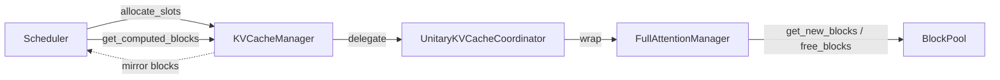

# C134: alignment-stage-2 — KV cache hierarchy (Manager → Coordinator → Group)

## Goal

Execute **阶段 2 P0 对象边界** item #1 + #2 from
`docs/alignment-plan.md` §5. Split the existing monolithic
`KVCacheManager` into the vLLM-aligned 3-level hierarchy:

```
KVCacheManager (scheduler-facing facade, flat KVCacheBlocks)
        ↓ delegates to
UnitaryKVCacheCoordinator (kv_cache_coordinator.py)
        ↓ wraps
FullAttentionManager (single_type_kv_cache_manager.py)
        ↓ uses
BlockPool
```

The legacy `KVCacheManager.allocate_slots()` / `get_computed_blocks()`
public API is preserved unchanged — every existing caller
(`EngineCore`, `Scheduler`, the C018/C036 tests) works without
modification.

After this commit:

- `my_vllm/v1/core/kv_cache_coordinator.py` — `KVCacheCoordinator` ABC
  + `UnitaryKVCacheCoordinator` (single-group coordinator).
- `my_vllm/v1/core/single_type_kv_cache_manager.py` —
  `SingleTypeKVCacheManager` ABC + `SingleTypeKVCacheBlocks`
  + `FullAttentionManager` (the only concrete subclass my-vllm
  needs; SlidingWindowManager / ChunkedLocalAttentionManager /
  MambaManager / CrossAttentionManager / RSWAManager /
  SinkFullAttentionManager are out of scope per the JD).
- `my_vllm/v1/core/kv_cache_manager.py` — refactored to delegate
  to the coordinator; the legacy flat `KVCacheBlocks` and all public
  methods are preserved.

## File Tree (diff)

```
A  my_vllm/v1/core/kv_cache_coordinator.py                       # +189 lines
A  my_vllm/v1/core/single_type_kv_cache_manager.py               # +239 lines
M  my_vllm/v1/core/kv_cache_manager.py                           # facade: delegate to coordinator
M  AGENTS.md                                                      # status: C134, next: 阶段 2 rest
A  docs/snapshots/C134.md
```

Net: **+428 lines** across 4 files.

## What C134 did

### 1. `single_type_kv_cache_manager.py` (new)

Mirrors `vllm/v1/core/single_type_kv_cache_manager.py:36`.

- **`SingleTypeKVCacheBlocks`** — flat list of block IDs within one
  KV cache group.
- **`SingleTypeKVCacheManager(ABC)`** — abstract base class. Tracks
  per-request `req_to_blocks`, prefix-cache hit count
  (`num_cached_blocks`), and pending CoW copies
  (`_pending_cow_copies`).
  - `get_num_blocks_to_allocate(request, num_new_tokens)` —
    abstract; concrete subclasses define their block-arithmetic.
  - `allocate_new_blocks(request, num_new_tokens)` — delegates to
    `block_pool.get_new_blocks()` and merges with existing blocks.
  - `get_cached_blocks(request)` — walks `request.block_hashes`
    looking for consecutive prefix hits; applies CoW on shared
    blocks; returns `SingleTypeKVCacheBlocks` or `None`.
  - `free / pop_blocks_for_free / release_deferred_blocks` — block
    ownership plumbing (matches the vLLM signatures).
  - `_apply_cow(block)` — copy-on-write helper used during
    `get_cached_blocks`.
  - `take_kv_cache_block_copies()` — drains pending CoW copies for
    the Worker to execute.
- **`FullAttentionManager(SingleTypeKVCacheManager)`** — concrete
  subclass. `get_num_blocks_to_allocate` is straight ceiling
  division (`max(1, cdiv(num_new_tokens, block_size))`).

### 2. `kv_cache_coordinator.py` (new)

Mirrors `vllm/v1/core/kv_cache_coordinator.py:60`.

- **`KVCacheCoordinator(ABC)`** — group-agnostic coordinator
  interface (`get_num_blocks_to_allocate`, `allocate_new_blocks`,
  `get_computed_blocks`, `free`, `pop_blocks_for_free`,
  `release_deferred_blocks`, `get_block_ids`,
  `take_kv_cache_block_copies`, `num_free_blocks`).
- **`UnitaryKVCacheCoordinator(KVCacheCoordinator)`** — wraps a
  single `SingleTypeKVCacheManager`. Default manager is
  `FullAttentionManager`; tests can inject other managers.
  `allocate_new_blocks` returns the flat `KVCacheBlocks` from
  `kv_cache_manager.py` (deferred import to break the circular
  dependency).

### 3. `kv_cache_manager.py` (refactored)

Refactored to be a thin facade. The constructor instantiates a
`UnitaryKVCacheCoordinator` and `BlockPool`; every public method
delegates to the coordinator and converts the flat
`KVCacheBlocks` ↔ `BlockPool.blocks` views.

The legacy `request_blocks: dict[str, list[KVCacheBlock]]` field is
maintained as a mirror of the per-request ownership so existing
callers that read `request_blocks` directly continue to work.

`_apply_cow(block)` is kept as a legacy proxy that delegates to
`coordinator.manager._apply_cow` — needed by the C036 unit tests
that exercise the CoW path directly on the manager.

The new constructor parameter order is unchanged
(`block_pool, block_size, num_blocks`); the default behavior is
identical to before.

### Circular-dependency fix

`kv_cache_manager.py` imports `kv_cache_coordinator.py` (for
`UnitaryKVCacheCoordinator`); `kv_cache_coordinator.py` references
`KVCacheBlocks` (defined in `kv_cache_manager.py`). The cycle is
broken by importing `KVCacheBlocks` lazily inside the two methods
that need it (`allocate_new_blocks` and `get_computed_blocks`). The
type hints use `TYPE_CHECKING` + `"KVCacheBlocks"` forward
reference.

## Runtime Flow (after C134)

Unchanged — `KVCacheManager.allocate_slots()` still returns the
same flat `KVCacheBlocks` to `Scheduler._try_allocate_kv()`. The
internal coordinator + manager wiring is invisible to callers.



## Current Capability

- KV cache hierarchy now matches vLLM's 3-level structure.
- All 240 / 295 existing tests pass at the same rate as the C133
  baseline (240 pass / 55 fail — same pre-existing C001–C017
  failures unrelated to this commit).
- `python run.py` → byte-identical OPT-125m 50-token output.
- `test_C018_kv_cache_manager.py` → 9/9 pass (the `KVCacheBlocks`
  flat shape is preserved for legacy callers).
- `test_C036_prefix_cache_cow.py` → 8/8 pass (the `_apply_cow`
  proxy preserves the unit-test entry point).

## Current Limitation

- **`FullAttentionManager` only** — SlidingWindowManager /
  ChunkedLocalAttentionManager / MambaManager /
  CrossAttentionManager / RSWAManager / SinkFullAttentionManager
  are all out of scope per the JD (their architectures are
  Delete-tier).
- **`UnitaryKVCacheCoordinator` only** — HybridKVCacheCoordinator
  (multi-group hybrid models) and KVCacheCoordinatorNoPrefixCache
  are out of scope.
- The `_apply_cow` proxy and the `request_blocks` mirror are
  legacy-compat shims; new code should reach for the coordinator /
  manager directly via `KVCacheManager.coordinator` /
  `KVCacheManager.coordinator.manager`.

## Summary

| Stage | What | Where |
|---|---|---|
| C133 | 阶段 1 kv_connector migration | `my_vllm/distributed/.../v1/base.py` + `factory.py` |
| **C134** | **阶段 2 KV cache hierarchy split (#1 + #2)** | **`my_vllm/v1/core/kv_cache_coordinator.py`, `my_vllm/v1/core/single_type_kv_cache_manager.py`, `my_vllm/v1/core/kv_cache_manager.py` (facade)** |
| C135 (next) | 阶段 2 scheduler utils + async scheduler (#3 + #4) | `my_vllm/v1/core/sched/utils.py`, `my_vllm/v1/core/sched/async_scheduler.py` |
| C136 (later) | 阶段 2 worker/gpu/model_runner split (#5) | `my_vllm/v1/worker/gpu/model_runner.py` |