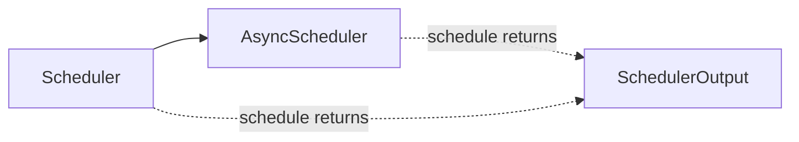

# C135: alignment-stage-2 — scheduler utils + async scheduler (#3, #4)

## Goal

Execute **阶段 2 P0 对象边界** items #3 + #4 from
`docs/alignment-plan.md` §5. Two new files mirror vLLM's
`sched/utils.py` and `sched/async_scheduler.py`:

- `my_vllm/v1/core/sched/utils.py` — pure data-model helpers
  (`check_stop`, `remove_all`, `check_sequence_repetition`,
  `RepetitionDetectionParams`).
- `my_vllm/v1/core/sched/async_scheduler.py` — `AsyncScheduler`
  subclass that extends `Scheduler` with no extra fields (the
  vLLM-specific spec-token / structured-output bookkeeping is
  deferred to 阶段 3 / 阶段 4).

The scheduler does not yet invoke these helpers inline (its stop
check is still in `update_from_output` for C016 compat); the files
exist for 1:1 file-tree alignment so a future stop-handling
refactor only requires scheduler edits, not package refactoring.

## File Tree (diff)

```
A  my_vllm/v1/core/sched/utils.py                  # +125 lines (4 helpers)
A  my_vllm/v1/core/sched/async_scheduler.py        # +39 lines (AsyncScheduler)
A  docs/snapshots/C135.md
```

Net: **+164 lines** across 2 files.

## What C135 did

### 1. `sched/utils.py` (new)

Mirrors `vllm/v1/core/sched/utils.py:1`. Four pure helpers:

- **`RepetitionDetectionParams`** — stub dataclass with
  `max_pattern_size / min_pattern_size / min_count`. my-vllm does
  not yet expose repetition-detection sampling params; the stub
  exists so `check_stop` can reference the type without
  `ImportError`.
- **`_has_repeating_pattern(token_ids, pattern_len, min_count)`** —
  private helper for `check_sequence_repetition`.
- **`check_sequence_repetition(token_ids, params)`** — public
  repetition-pattern detector.
- **`remove_all(lst, items_to_remove)`** — list filter with
  fast-path for single-item removal (matches vLLM).
- **`check_stop(request, max_model_len)`** — comprehensive stop
  check covering `eos_token_id`, `stop_token_ids`, `max_model_len`,
  `max_tokens`, and repetition detection. Updates
  `request.status` and returns True on stop.

### 2. `sched/async_scheduler.py` (new)

Mirrors `vllm/v1/core/sched/async_scheduler.py:12`.

- **`AsyncScheduler(Scheduler)`** — subclass with no extra fields.
  The vLLM-specific bookkeeping
  (`_spec_token_placeholders`, `pending_structured_output_tokens`,
  `num_output_placeholders`, `pp_size`, `current_step`,
  `use_v2_model_runner`) is deferred to speculative-decoding
  + PP microbatching (阶段 3 + 阶段 4). For now `AsyncScheduler`
  is functionally identical to `Scheduler`; the subclass exists
  so call sites can refer to it by name and so the file-tree shape
  mirrors vLLM.

## Runtime Flow (after C135)

Unchanged. The scheduler still does its inline stop check in
`update_from_output`. The new files are dormant — only importable,
not yet invoked. The `AsyncScheduler` class is also dormant;
subclassing `Scheduler` gives a drop-in replacement that returns
the same `SchedulerOutput`.



## Current Capability

- File-tree now has all 4 `sched/*.py` files matching vLLM:
  - `interface.py` (SchedulerInterface ABC, C037)
  - `output.py` (SchedulerOutput, C016)
  - `request_queue.py` (FCFS / Priority, C051)
  - `scheduler.py` (Scheduler, C016–C052, C122)
  - **`utils.py`** (new, C135)
  - **`async_scheduler.py`** (new, C135)
- 240 / 295 tests pass at the same rate as the C134 baseline.
- `python run.py` → byte-identical OPT-125m 50-token output.
- `from my_vllm.v1.core.sched.async_scheduler import AsyncScheduler`
  works; MRO confirms `AsyncScheduler → Scheduler →
  SchedulerInterface → ABC → object`.

## Current Limitation

- **`check_stop` not yet wired into the scheduler** — the
  scheduler's `update_from_output` still does an inline
  `max_tokens` check only. Wiring `check_stop` in is a future
  refactor (would add `eos_token_id` + `stop_token_ids` +
  `max_model_len` to the finish-condition set; needs
  EngineCore to plumb `max_model_len` through).
- **`AsyncScheduler` has no async-specific behavior** — the
  class exists for file-tree alignment; the spec-token /
  structured-output overrides from vLLM are deferred.

## Summary

| Stage | What | Where |
|---|---|---|
| C134 | 阶段 2 KV cache hierarchy split (#1 + #2) | `my_vllm/v1/core/kv_cache_coordinator.py`, `single_type_kv_cache_manager.py` |
| **C135** | **阶段 2 scheduler utils + async scheduler (#3 + #4)** | **`my_vllm/v1/core/sched/utils.py`, `my_vllm/v1/core/sched/async_scheduler.py`** |
| C136 (next) | 阶段 2 worker/gpu/model_runner split (#5) | `my_vllm/v1/worker/gpu/model_runner.py` |