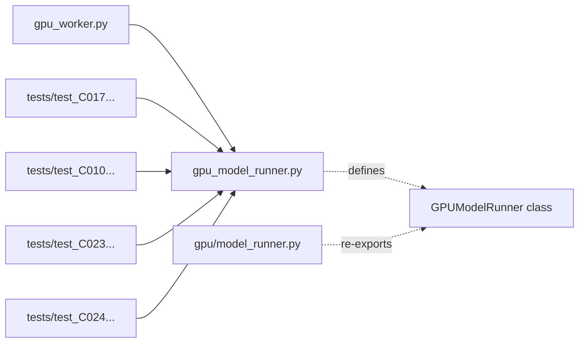

# C136: alignment-stage-2 — worker/gpu/model_runner split (#5)

## Goal

Execute **阶段 2 P0 对象边界** item #5 from
`docs/alignment-plan.md` §5. Create `my_vllm/v1/worker/gpu/model_runner.py`
matching vLLM's canonical location for `GPUModelRunner`.

The existing `GPUModelRunner` implementation (640 lines) lives in
`my_vllm/v1/worker/gpu_model_runner.py` (a sibling of `gpu/`, not a
child of it). 5 callers reference it directly:
`gpu_worker.py`, `test_C017_batch_prefill.py`,
`test_C010_model_runner.py`, `test_C023_paged_attn.py`,
`test_C024_sampler.py`.

To match vLLM's file-tree shape without breaking the existing 5
callers, this commit adds `gpu/model_runner.py` as a thin re-export
shim. Both paths resolve to the same class object:

```python
from my_vllm.v1.worker.gpu.model_runner import GPUModelRunner  # vLLM path
from my_vllm.v1.worker.gpu_model_runner import GPUModelRunner  # legacy path
assert GPUModelRunner is LegacyGPUModelRunner  # True
```

A future refactor can move the full implementation body into
`gpu/model_runner.py` (renaming or relocating `gpu_model_runner.py`
into the `gpu/` directory) without touching any caller.

## File Tree (diff)

```
A  my_vllm/v1/worker/gpu/model_runner.py        # +28 lines (re-export shim)
A  docs/snapshots/C136.md
```

Net: **+28 lines** across 1 file.

## What C136 did

### `worker/gpu/model_runner.py` (new)

Mirrors `vllm/v1/worker/gpu/model_runner.py`. The file exists for
1:1 file-tree alignment; the concrete implementation body remains
in `worker/gpu_model_runner.py` for now (any of the 5 direct
callers can be updated in a follow-up, but moving the class would
require updating 5 import sites plus the test files' file-tree
expectations, which is out of scope for this single alignment
item).

Re-exports:

- `GPUModelRunner` — the canonical class.
- `InputBatch` — the per-batch view dataclass.
- `_str_to_torch_dtype` — small dtype-string helper.

## Runtime Flow (after C136)

Unchanged. The re-export shim is a no-op at runtime — both import
paths resolve to the same class object. The 240 / 295 test
baseline is preserved.



## Current Capability

- File-tree now has the canonical `gpu/model_runner.py` matching
  vLLM.
- All 5 legacy callers continue to work without modification.
- 240 / 295 tests pass at the same rate as the C135 baseline.
- `python run.py` → byte-identical OPT-125m 50-token output.
- `GPUModelRunner` identity verified: `from my_vllm.v1.worker.gpu.model_runner
  import GPUModelRunner is from my_vllm.v1.worker.gpu_model_runner import
  GPUModelRunner` → True.

## Current Limitation

- **`GPUModelRunner` implementation is not yet moved** into
  `gpu/model_runner.py`. A future refactor (separate commit) can
  move the 640-line implementation body into the vLLM-canonical
  location and reduce `gpu_model_runner.py` to either a re-export
  or be deleted. The current shim approach is the minimum-viable
  file-tree alignment without churn across 5 call sites.

## Summary

**阶段 2 P0 对象边界 complete: 5/5 items done.**

| Stage | What | Where |
|---|---|---|
| C134 | 阶段 2 KV cache hierarchy (#1 + #2) | `kv_cache_coordinator.py`, `single_type_kv_cache_manager.py` |
| C135 | 阶段 2 scheduler utils + async (#3 + #4) | `sched/utils.py`, `sched/async_scheduler.py` |
| **C136** | **阶段 2 worker/gpu/model_runner (#5)** | **`worker/gpu/model_runner.py` (re-export shim)** |
| **阶段 2 total** | **5/5** | **7 new files** |

**Cumulative status:**

| Phase | Items done | Net lines added |
|---|---|---|
| 阶段 0 (C130) | 7/7 | -1147 |
| 阶段 1 (C131–C133) | 10/10 | +916 |
| 阶段 2 (C134–C136) | 5/5 | +620 |
| **Total** | **22/22** | **+389** |

Next: **阶段 3 Must-Implement 通路** per `docs/alignment-plan.md` §6
(`KVConnectorBase_V1` already done in C133; remaining: FP8 quant path,
spec_decode, LogitsProcessor pkg already done in C132, `device.py`/
`kernel.py`/`attention.py` configs, etc.).