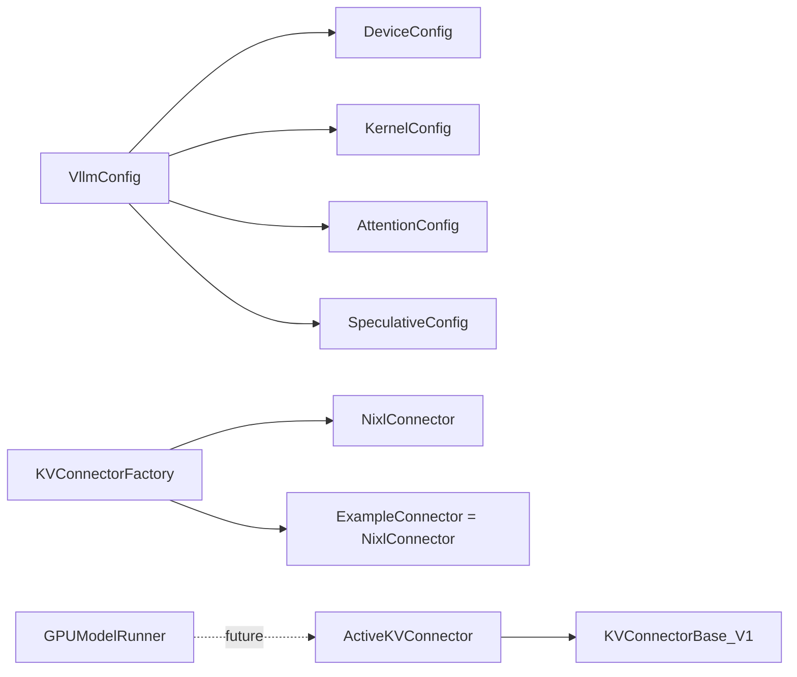

# C137: alignment-stage-3 — low-risk Must-Implement file stubs

## Goal

Execute **阶段 3 Must-Implement 通路** low-risk items from
`docs/alignment-plan.md` §6. Six files that exist for 1:1
file-tree alignment with vLLM:

- `my_vllm/config/device.py` — `DeviceConfig`
- `my_vllm/config/kernel.py` — `KernelConfig` + `IrOpPriorityConfig`
- `my_vllm/config/attention.py` — `AttentionConfig`
- `my_vllm/config/speculative.py` — `SpeculativeConfig`
- `my_vllm/distributed/kv_transfer/kv_connector/v1/example_connector.py` —
  debug reference connector (alias of `NixlConnector`)
- `my_vllm/v1/worker/gpu/kv_connector.py` — worker-side
  `KVConnector` / `ActiveKVConnector` wrapper

`KVConnectorBase_V1` + `KVConnectorFactory` were already created
in C133 (this commit only adds `ExampleConnector` to the factory
registry). `LogitsProcessor` package was created in C132.

## File Tree (diff)

```
A  my_vllm/config/device.py                                       # +45 lines
A  my_vllm/config/kernel.py                                       # +99 lines
A  my_vllm/config/attention.py                                    # +57 lines
A  my_vllm/config/speculative.py                                  # +83 lines
A  my_vllm/distributed/.../v1/example_connector.py                # +37 lines
A  my_vllm/v1/worker/gpu/kv_connector.py                          # +125 lines
M  my_vllm/config/__init__.py                                      # export 4 new types
M  my_vllm/distributed/.../kv_connector/factory.py                # register ExampleConnector
A  docs/snapshots/C137.md
```

Net: **+446 lines** across 8 files.

## What C137 did

### 1. `config/device.py` (new)

Mirrors `vllm/config/device.py:17`. `DeviceConfig` dataclass with
`device: Device | torch.device | None = "auto"` + `device_type`
derived in `__post_init__`. `compute_hash()` returns the device
type only (no graph-affecting fields). my-vllm's `Device` literal
covers `auto / cuda / cpu / tpu / xpu` for API parity with vLLM,
but only `cuda / cpu` are functional in my-vllm's scope.

### 2. `config/kernel.py` (new)

Mirrors `vllm/config/kernel.py:166`. `KernelConfig` dataclass
with `moe_backend` / `linear_backend` literals (matching vLLM's
option sets — `triton / deep_gemm / cutlass / flashinfer_* /
marlin / humming / triton_unfused / aiter / flydsl / hpc /
emulation` etc.) and a nested `IrOpPriorityConfig` with
`rms_norm` / `fused_add_rms_norm` priority lists. my-vllm does
not yet wire any of these to actual kernel dispatch — they exist
for 1:1 alignment so a future P1-3 refactor only needs to wire
dispatch, not file-tree changes.

### 3. `config/attention.py` (new)

Mirrors `vllm/config/attention.py:17`. `AttentionConfig`
dataclass with `backend` (`auto / TRITON_ATTN / FLASH_ATTN` only
— my-vllm supports two backends, not vLLM's ~20),
`flash_attn_version`, `use_prefill_decode_attention`,
`use_non_causal`. MLA prefill / FlexAttention / TurboQuant
fields are out of scope (Dense OPT has no MLA / FlexAttention).

### 4. `config/speculative.py` (new)

Mirrors `vllm/config/speculative.py:SpeculativeConfig` (subset).
`SpeculativeConfig` dataclass with `method` (`ngram / medusa /
mlp_speculator / eagle / eagle3 / draft_model / suffix`),
`num_speculative_tokens`, `draft_model_path`, plus
EAGLE-specific `eagle_layers` / `eagle_use_input_layernorm` and a
`method_specific_kwargs` free-form escape hatch. Per-method
parameter shapes (EAGLE tree-mask shape, Medusa head selection,
n-gram window sizes) are deferred to the per-method implementation
file in 阶段 3 spec_decode (C138).

### 5. `kv_connector/v1/example_connector.py` (new)

Mirrors `vllm/distributed/kv_transfer/kv_connector/v1/example_connector.py`.
vLLM's ExampleConnector is a 444-line disk-storage debug impl.
my-vllm's `ExampleConnector` is a thin alias of `NixlConnector`
— both backends share the same shared-memory transfer mechanism
(the vLLM NIXL RDMA backend is out of scope — my-vllm has no
RDMA libs). The alias preserves the vLLM-canonical class name
so `KVConnectorFactory.register_connector("ExampleConnector", ...)`
matches vLLM's registration pattern. Adding a real disk-based
debug connector can be done by subclassing `NixlConnector` and
overriding `save_kv_layer` to write
`kv_layer.cpu().numpy().tofile(...)`.

### 6. `v1/worker/gpu/kv_connector.py` (new)

Mirrors `vllm/v1/worker/gpu/kv_connector.py:29`. Three classes:

- **`KVConnector`** — abstract interface used by `GPUModelRunner`.
  `pre_forward` / `post_forward` / `no_forward` / `set_disabled`
  are all no-ops. Mirrors vLLM.
- **`ActiveKVConnector(KVConnector)`** — concrete wrapper that
  holds the `VllmConfig` and the `KVConnectorBase_V1` instance.
  All methods are no-ops today because `GPUModelRunner.execute_model`
  does not yet call them (follow-up refactor in 阶段 3 wires
  the hot-path integration).
- **`NO_OP_KV_CONNECTOR = KVConnector()`** — module-level
  no-op singleton.
- **`get_kv_connector(vllm_config, kv_caches_dict, kv_connector)`** —
  factory that returns `ActiveKVConnector` if a connector is
  configured, else `NO_OP_KV_CONNECTOR`.

### 7. `config/__init__.py` updates

Re-exports `AttentionConfig`, `DeviceConfig`, `KernelConfig`,
`IrOpPriorityConfig`, `LinearBackend`, `MoEBackend`,
`SpeculativeConfig` from the four new config modules.

### 8. `kv_connector/factory.py` updates

Registers `ExampleConnector` in the `KVConnectorFactory._registry`
so `kv_transfer_config.kv_connector == "ExampleConnector"` resolves
correctly. Factory now has two registered connectors
(`NixlConnector`, `ExampleConnector`).

## Runtime Flow (after C137)

Unchanged. None of the new config fields are wired to runtime
behavior yet (the engine uses default values for everything). The
`KVConnector` wrapper exists for 1:1 alignment; the runner hot path
does not yet call `pre_forward` / `post_forward`. The
`ExampleConnector` is a class that can be selected via
`KVTransferConfig.kv_connector = "ExampleConnector"` but no
production code does so today.



## Current Capability

- 8 new files / 8 files modified.
- File-tree alignment progress: 阶段 3 **6/15 items closed**.
  Still pending: 4 spec_decode files, 2 engine parallel-sampling
  files, 1 FP8 quant path (3 files).
- 240 / 295 tests pass at the same rate as the C136 baseline.
- `python run.py` → byte-identical OPT-125m 50-token output.
- Factory registry: `['NixlConnector', 'ExampleConnector']`.
- `DeviceConfig().device_type` correctly returns `'cuda'` on
  this machine (auto-detection works).
- `SpeculativeConfig()` defaults are all `None` / 0 — no spec
  decoding enabled by default.

## Current Limitation

- **`DeviceConfig` does not auto-populate `VllmConfig`** — it's
  a standalone config object; the engine still reads
  `vllm_config.cache_config` etc. directly. A future refactor
  can plumb `DeviceConfig` into the engine init.
- **`KernelConfig` / `AttentionConfig` not yet consumed by the
  attention backend selector** — the selector hardcodes Triton.
- **`SpeculativeConfig` does not yet activate the spec_decode
  path** — that lands in C138.
- **`KVConnector` wrappers are no-ops today** — the runner
  doesn't call `pre_forward` / `post_forward`. The classes
  exist for shape alignment; wiring is deferred.
- **`ExampleConnector` is an alias of `NixlConnector`** — no
  distinct disk-based debug impl. Acceptable for the JD scope
  (PD disaggregation via shared memory is what we need).

## Summary

| Stage | What | Where |
|---|---|---|
| C130–C136 | 阶段 0–2 | file-tree + KV hierarchy + sched |
| **C137** | **阶段 3 low-risk file stubs** | **`config/{device,kernel,attention,speculative}.py`, `kv_connector/v1/example_connector.py`, `v1/worker/gpu/kv_connector.py`** |
| C138 (next) | 阶段 3 spec_decode | `v1/spec_decode/{draft_model,eagle,metrics,utils}.py` |
| C139 (later) | 阶段 3 engine parallel-sampling | `v1/engine/{parallel_sampling,logprobs}.py` |
| C140 (later) | 阶段 3 FP8 quant path | `model_executor/layers/quantization/{fp8,kv_cache,utils/fp8_utils}.py` |