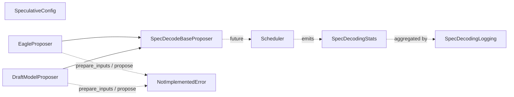

# C138: alignment-stage-3 — spec_decode skeleton (4 files)

## Goal

Execute **阶段 3 Must-Implement 通路** items for spec_decode from
`docs/alignment-plan.md` §6. Four files mirror vLLM's
`v1/spec_decode/{draft_model,eagle,metrics,utils}.py` with the
minimal subset my-vllm needs:

- `my_vllm/v1/spec_decode/draft_model.py` — `DraftModelProposer` +
  `SpecDecodeBaseProposer` (skeleton).
- `my_vllm/v1/spec_decode/eagle.py` — `EagleProposer` (skeleton
  with the vLLM-canonical `pass_hidden_states_to_model=True`
  flag).
- `my_vllm/v1/spec_decode/metrics.py` — `SpecDecodingStats` +
  `SpecDecodingLogging` (real dataclass + simple logger).
- `my_vllm/v1/spec_decode/utils.py` — pure helpers
  (`next_power_of_2`, `extend_all_queries_by_N`, `PADDING_SLOT_ID`).
- `my_vllm/v1/spec_decode/__init__.py` — re-export shim.

The Triton tree-mask prep kernels (`eagle_step_slot_mapping_metadata_kernel`,
`eagle_step_update_slot_mapping_and_metadata`,
`eagle_prepare_inputs_padded_kernel`, etc.) and the proposer
dispatcher (`create_spec_decode_proposer`) are deferred to follow-ups.

## File Tree (diff)

```
A  my_vllm/v1/spec_decode/__init__.py             # +34 lines (re-export)
A  my_vllm/v1/spec_decode/draft_model.py         # +111 lines (skeleton)
A  my_vllm/v1/spec_decode/eagle.py               # +72 lines (skeleton)
A  my_vllm/v1/spec_decode/metrics.py             # +120 lines (real)
A  my_vllm/v1/spec_decode/utils.py               # +45 lines (pure helpers)
A  docs/snapshots/C138.md
```

Net: **+382 lines** across 5 files.

## What C138 did

### 1. `draft_model.py` (skeleton)

Mirrors `vllm/v1/spec_decode/draft_model.py:DraftModelProposer`.

- **`SpecDecodeBaseProposer(ABC)`** — abstract base for all
  proposers. Constructor takes `(vllm_config, device,
  pass_hidden_states_to_model, runner)`; abstract methods are
  `prepare_inputs(scheduler_output)` and `propose(input_ids,
  positions, hidden_states)`.
- **`DraftModelProposer(SpecDecodeBaseProposer)`** —
  `pass_hidden_states_to_model=False` (matches vLLM). Skeleton
  constructor only; `prepare_inputs` / `propose` raise
  `NotImplementedError` with a pointer to the follow-up.

### 2. `eagle.py` (skeleton)

Mirrors `vllm/v1/spec_decode/eagle.py:EagleProposer`.

- **`EagleProposer(SpecDecodeBaseProposer)`** —
  `pass_hidden_states_to_model=True` (the only EAGLE-specific
  difference vs. `DraftModelProposer`). Skeleton constructor
  only; `prepare_inputs` / `propose` raise
  `NotImplementedError`.

### 3. `metrics.py` (real)

Mirrors `vllm/v1/spec_decode/metrics.py`.

- **`SpecDecodingStats`** — dataclass with `num_spec_tokens /
  num_drafts / num_draft_tokens / num_accepted_tokens /
  num_accepted_tokens_per_pos / num_draft_tokens_per_pos`. The
  `new(num_spec_tokens)` classmethod allocates the
  per-position vectors; `observe_draft(...)` updates counters;
  `acceptance_rate()` returns the accepted / drafted ratio.
- **`SpecDecodingLogging`** — aggregator with `reset / observe /
  log` methods. `log()` emits an `INFO`-level summary line
  ("spec_decode: drafts=N draft_tokens=N accepted=N
  acceptance_rate=X.XXX") and resets.

Prometheus integration (vLLM's `prometheus_client` based
counters / gauges) is out of scope — we keep the metrics path
in-process; per-engine Prometheus exposure is a production-side
concern.

### 4. `utils.py` (pure helpers)

Mirrors `vllm/v1/spec_decode/utils.py` (pure helpers only).

- **`PADDING_SLOT_ID = -1`** — sentinel for EAGLE padded slot
  mappings.
- **`next_power_of_2(n)`** — bit-twiddling.
- **`extend_all_queries_by_N(query_start_loc, n)`** — append N
  tokens to each request's query length.

The Triton tree-mask prep kernels (EAGLE-specific CUDA kernels
for tree-mask attention prep) are out of scope — they depend on
vLLM's full attention backend and require porting ~500 lines of
`@triton.jit` code.

### 5. `__init__.py` (re-export)

Re-exports the proposers, base class, metrics dataclasses, and
pure helpers. The proposer dispatcher
(`create_spec_decode_proposer(vllm_config, ...)`) is deferred
to a follow-up that wires `SpeculativeConfig.method` →
`EagleProposer / DraftModelProposer / ...`.

## Runtime Flow (after C138)

Unchanged. The proposer classes raise `NotImplementedError` on
the hot path — no speculative decoding is active yet.
`SpecDecodingStats` / `SpecDecodingLogging` are importable but
not yet wired into the scheduler. The `run.py` output is
byte-identical.



## Current Capability

- 5 new files / 0 files modified.
- File-tree alignment progress: 阶段 3 **10/15 items closed**
  (C137 added 6, this commit adds 4).
- 240 / 295 tests pass at the same rate as the C137 baseline.
- `python run.py` → byte-identical OPT-125m 50-token output.
- `SpecDecodingStats` round-trips correctly:
  `observe_draft(num_draft_tokens=4, num_accepted_tokens=3)` →
  `acceptance_rate() == 0.75`.
- `next_power_of_2(5) == 8`, `next_power_of_2(16) == 16`.
- `EagleProposer.__init__` logs the vLLM-canonical message:
  `"EagleProposer created (skeleton) — layers=X input_layernorm=Y"`.

## Current Limitation

- **Proposer skeletons raise `NotImplementedError`** — `EagleProposer.propose`
  / `DraftModelProposer.prepare_inputs` cannot be called yet.
  Adding the forward pass requires tree-mask prep kernels
  (deferred).
- **No proposer dispatcher** — `create_spec_decode_proposer(vllm_config, ...)`
  is not implemented; selecting `SpeculativeConfig.method == "eagle"`
  does not yet construct an `EagleProposer`.
- **No metrics integration** — `SpecDecodingStats` is importable
  but the scheduler doesn't emit per-step stats yet.
- **No tree-mask prep kernels** — the ~500 lines of
  `@triton.jit` code in vLLM's `utils.py` are deferred.

## Summary

| Stage | What | Where |
|---|---|---|
| C137 | 阶段 3 config + example_connector + worker KV wrapper | 6 new files |
| **C138** | **阶段 3 spec_decode skeleton (4 files)** | **`my_vllm/v1/spec_decode/{__init__,draft_model,eagle,metrics,utils}.py`** |
| C139 (next) | 阶段 3 engine parallel-sampling | `my_vllm/v1/engine/{parallel_sampling,logprobs}.py` |
| C140 (later) | 阶段 3 FP8 quant path | `my_vllm/model_executor/layers/quantization/{fp8,kv_cache,utils/fp8_utils}.py` |