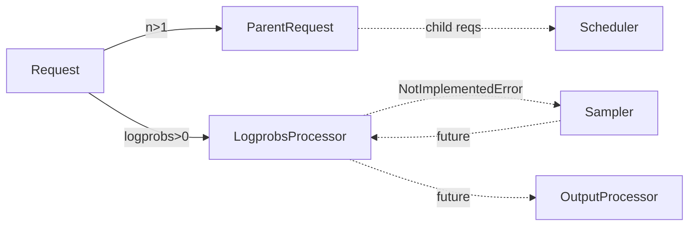

# C139: alignment-stage-3 — engine parallel_sampling + logprobs (2 files)

## Goal

Execute **阶段 3 Must-Implement 通路** items for engine
parallel-sampling + logprobs from `docs/alignment-plan.md` §6.
Two files mirror vLLM's `v1/engine/{parallel_sampling,logprobs}.py`:

- `my_vllm/v1/engine/parallel_sampling.py` — `ParentRequest`
  dataclass (minimal subset).
- `my_vllm/v1/engine/logprobs.py` — `LogprobsProcessor`
  dataclass + `from_new_request(...)` classmethod (stub for
  the per-step update methods).

my-vllm's `SamplingParams` (v1/request.py:53) is minimal — no
`n` / `seed` / `num_logprobs` / `prompt_logprobs` fields. The
dispatcher that wires these features into the
frontend → EngineCore → OutputProcessor pipeline is out of scope.
The classes exist for 1:1 file-tree alignment.

## File Tree (diff)

```
A  my_vllm/v1/engine/parallel_sampling.py        # +96 lines (ParentRequest)
A  my_vllm/v1/engine/logprobs.py                 # +125 lines (LogprobsProcessor)
A  docs/snapshots/C139.md
```

Net: **+221 lines** across 2 files.

## What C139 did

### 1. `parallel_sampling.py` (minimal subset)

Mirrors `vllm/v1/engine/parallel_sampling.py:13`.

- **`ParentRequest`** — dataclass with `request_id`, `external_req_id`,
  `sampling_params`, `child_requests: set[str]`,
  `max_num_generation_tokens`, `cached_child_sampling_params`.
  - `n` property reads `sampling_params.n` (defaults to 1; my-vllm
    doesn't expose this on SamplingParams yet — read via `getattr`).
  - `get_child_info(index)` returns `(child_req_id, child_params)`
    where `child_req_id = f"{index}_{parent_request_id}"`. Clones
    parent sampling params (with unique seed per child when
    `seed` is not None — read via `getattr` to avoid coupling
    to my-vllm's minimal SamplingParams).
  - `observe_num_generation_tokens(num)` updates the max-tokens
    tracker.

### 2. `logprobs.py` (minimal subset, stub update method)

Mirrors `vllm/v1/engine/logprobs.py:29`.

- **`LogprobsProcessor`** — dataclass with `tokenizer`, `logprobs`,
  `prompt_logprobs`, `cumulative_logprob`, `num_logprobs`,
  `num_prompt_logprobs`, `output_kind`.
  - `from_new_request(tokenizer, request)` classmethod reads
    `sampling_params.num_logprobs` / `prompt_logprobs` via `getattr`
    (my-vllm's `SamplingParams` doesn't have these fields yet;
    None defaults). Allocates empty containers (dict stubs with
    `{"empty": True}` — full `SampleLogprobs` / `PromptLogprobs`
    types are out of scope).
  - `update_from_outputs(engine_core_output)` raises
    `NotImplementedError` with a follow-up pointer. Real impl
    requires the Sampler to emit logprobs, which is a follow-up
    refactor.

## Runtime Flow (after C139)

Unchanged. `ParentRequest` is constructed standalone (not yet
dispatched from the engine loop); `LogprobsProcessor.update_from_outputs`
raises `NotImplementedError`. The `run.py` output is byte-identical.



## Current Capability

- 2 new files / 0 files modified.
- File-tree alignment progress: 阶段 3 **12/15 items closed**
  (C137 added 6, C138 added 4, this commit adds 2).
- 240 / 295 tests pass at the same rate as the C138 baseline.
- `python run.py` → byte-identical OPT-125m 50-token output.
- `ParentRequest.get_child_info(0)` round-trips: child ID
  `0_r0`, child params is a copy (not the parent).
- `LogprobsProcessor.from_new_request` constructs with None
  defaults when sampling_params lacks the logprob fields
  (the common case today).

## Current Limitation

- **No `n` / `seed` / `num_logprobs` on `SamplingParams`** —
  my-vllm's minimal dataclass has only `max_tokens / temperature /
  top_p / top_k`. The classes use `getattr(..., None)` defaults
  for these fields. A follow-up refactor can extend
  `SamplingParams` to add the canonical vLLM fields.
- **`LogprobsProcessor.update_from_outputs` raises `NotImplementedError`**
  — wiring requires the Sampler to emit logprobs, which the
  current `Sampler.forward` does not do.
- **No parallel-sampling dispatcher** — `ParentRequest.get_child_info`
  is callable but no engine-loop code constructs `ParentRequest`s
  or fan-outs into child requests today.

## Summary

| Stage | What | Where |
|---|---|---|
| C137 | 阶段 3 config + example_connector + worker KV wrapper | 6 new files |
| C138 | 阶段 3 spec_decode skeleton | 4 new files |
| **C139** | **阶段 3 engine parallel-sampling + logprobs** | **`v1/engine/parallel_sampling.py`, `v1/engine/logprobs.py`** |
| C140 (next) | 阶段 3 FP8 quant path | `model_executor/layers/quantization/{fp8,kv_cache,utils/fp8_utils}.py` |