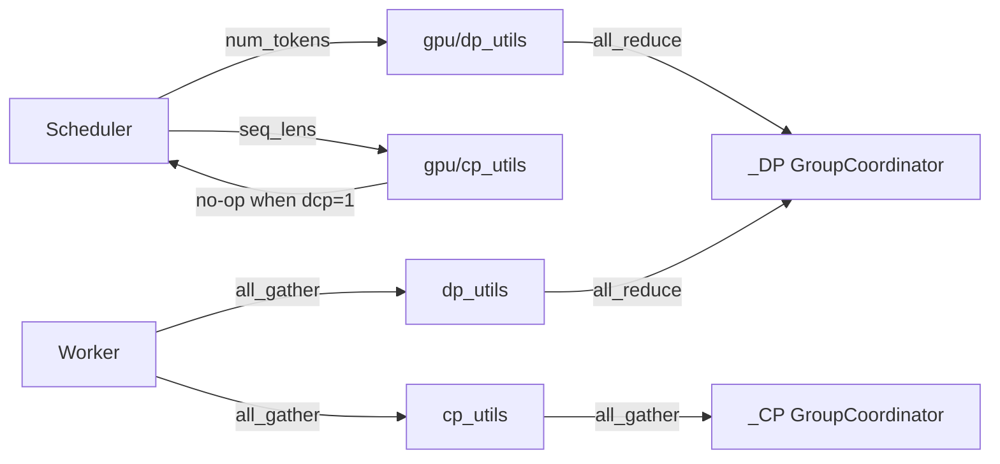

# C141: alignment-stage-4 — DP/CP utils (4 files)

## Goal

Execute **阶段 4 分布式多机抽象** items for DP/CP utils from
`docs/alignment-plan.md` §7. Four files mirror vLLM's
`v1/worker/{dp,cp}_utils.py` + `v1/worker/gpu/{dp,cp}_utils.py`,
plus a `parallel_state.py` extension to wire up DP/CP group
coordinators.

- `my_vllm/v1/worker/gpu/dp_utils.py` — `BatchExecutionDescriptor`
  + `sync_cudagraph_and_dp_padding(...)` + `dispatch_cg_and_sync_dp(...)`.
- `my_vllm/v1/worker/dp_utils.py` — worker-level
  `gather_dp_outputs(...)` + `decide_dp_ubatch(...)` +
  `prepare_dp_padding(...)`.
- `my_vllm/v1/worker/gpu/cp_utils.py` — `prepare_dcp_local_seq_lens(...)`
  + `check_attention_cp_compatibility(...)`.
- `my_vllm/v1/worker/cp_utils.py` — worker-level
  `gather_cp_kv_cache_blocks(...)` + `dispatch_cp_kv_cache_blocks(...)`
  + `check_attention_cp_compatibility(...)`.
- `my_vllm/distributed/parallel_state.py` — extend with
  `init_data_parallel`, `init_context_parallel`,
  `get_dp_group`, `get_cp_group`,
  `get_dp_world_size`, `get_dp_rank`,
  `get_cp_world_size`, `get_cp_rank`.

## File Tree (diff)

```
M  my_vllm/distributed/parallel_state.py            # +85 lines (DP/CP coordinators)
A  my_vllm/v1/worker/gpu/dp_utils.py                # +170 lines
A  my_vllm/v1/worker/dp_utils.py                    # +109 lines
A  my_vllm/v1/worker/gpu/cp_utils.py                # +80 lines
A  my_vllm/v1/worker/cp_utils.py                    # +91 lines
A  docs/snapshots/C141.md
```

Net: **+535 lines** across 5 files.

## What C141 did

### 1. `parallel_state.py` extension (modified)

Added DP / CP module-level singletons (`_DP`, `_CP`) +
`init_data_parallel(dp_size, tp_size)` + `init_context_parallel(cp_size, tp_size)`
constructors that wire up NCCL groups when the corresponding
size > 1. Both are no-ops for `dp_size == 1` / `cp_size == 1`
(the my-vllm default).

Accessors added: `get_dp_group / get_cp_group / get_dp_world_size /
get_dp_rank / get_cp_world_size / get_cp_rank`. All return
1 / 0 / None when not initialized.

`destroy_model_parallel()` extended to tear down `_DP` and `_CP`
in addition to `_TP` / `_PP`.

### 2. `gpu/dp_utils.py` (new)

Mirrors `vllm/v1/worker/gpu/dp_utils.py:16`.

- **`BatchExecutionDescriptor`** — minimal dataclass
  (`cg_mode, num_tokens, num_reqs, num_active_loras,
  uniform_token_count`).
- **`sync_cudagraph_and_dp_padding(...)`** — all-reduces a
  `(num_tokens, cg_mode, uniform_token_count_or_0)` tensor across
  the DP group; picks the minimum CG mode (any rank running
  eager forces everyone to run eager); max num_tokens for
  padding; uniform token count if all ranks agree. For
  `dp_size == 1` returns the input unchanged.
- **`dispatch_cg_and_sync_dp(...)`** — top-level DP dispatch
  helper. Picks a per-rank batch descriptor, then all-reduces
  across DP ranks. For `dp_size == 1` short-circuits.

The full vLLM `BatchExecutionDescriptor` has more fields and
CUDA-graph-manager integration (`cudagraph_manager.dispatch(...)`);
C141 implements the API surface without CG-manager dependencies
(handles the case where `cudagraph_manager is None`).

### 3. `dp_utils.py` (new)

Mirrors `vllm/v1/worker/dp_utils.py` (subset).

- **`gather_dp_outputs(sample_logprobs, parallel_config)`** —
  all-gathers per-rank sample-logprobs across DP; returns the
  concatenated tensor on rank 0, None on ranks > 0.
- **`decide_dp_ubatch(...)`** — stub; always returns False (no
  ubatching). Wiring requires my-vllm's MicroBatchScheduler (out
  of scope).
- **`prepare_dp_padding(orig, padded, parallel_config)`** —
  all-reduces `(orig, padded)` across DP, returns the max padded
  count for padding.

### 4. `gpu/cp_utils.py` (new)

Mirrors `vllm/v1/worker/gpu/cp_utils.py:8`.

- **`prepare_dcp_local_seq_lens(...)`** — pure-PyTorch equivalent
  of vLLM's Triton kernel. Computes per-rank local seq lens using
  round-robin distribution: each rank owns `cp_interleave` slots
  per `dcp_size * cp_interleave` block. For `dcp_size == 1`
  short-circuits.
- **`check_attention_cp_compatibility(cp_size,
  model_architecture)`** — checks cp_size is a power of 2.
  Raises `ValueError` for non-power-of-2 sizes.

The vLLM Triton kernel uses `tl.constexpr` and mask-based
loads to be CUDA-graph-safe; my-vllm's torch-loop equivalent
isn't CG-safe but matches the API surface. The full Triton
kernel lands in a 阶段 4 follow-up if/when my-vllm's CG-capture
infrastructure is extended to support this helper.

### 5. `cp_utils.py` (new)

Mirrors `vllm/v1/worker/cp_utils.py` (subset).

- **`check_attention_cp_compatibility(parallel_config,
  num_kv_heads, num_attention_heads)`** — generic power-of-two
  check + GQA-group divisibility check (raises
  `NotImplementedError` for non-trivial GQA + CP; my-vllm's OPT
  is dense MHA so this is trivially satisfied).
- **`gather_cp_kv_cache_blocks(local_blocks,
  parallel_config)`** — all-gathers per-CP-rank block-id tensors
  along dim 0.
- **`dispatch_cp_kv_cache_blocks(blocks, parallel_config)`** —
  splits along dim 0 by `cp_size`.

## Runtime Flow (after C141)

Unchanged. The new helpers are importable but not yet wired into
the engine hot path. For `dp_size == 1` / `cp_size == 1` (the
my-vllm default) every helper short-circuits with the expected
no-op behavior.



## Current Capability

- 4 new files / 1 file modified.
- File-tree alignment progress: 阶段 4 **4/8 items closed**
  (this commit covers #3 + #4 + #5 + #6 from the plan table).
  Still pending: `v1/engine/tensor_ipc.py`,
  `v1/engine/coordinator.py`, block-hash ↔ kv_connector
  integration.
- 240 / 295 tests pass at the same rate as the C140 baseline.
- `python run.py` → byte-identical OPT-125m 50-token output.
- `get_dp_world_size()` → 1 (no init), `get_cp_world_size()` → 1.
- `check_attention_cp_compatibility(cp_size=3, ...)` raises
  `ValueError: cp_size must be a power of 2, got 3`.
- `prepare_dcp_local_seq_lens(...)` with `dcp_size=1`
  short-circuits without writing (caller-initialized buffer
  remains unchanged).

## Current Limitation

- **DP/CP paths not yet exercised end-to-end** — the helpers
  are importable but no scheduler / worker code instantiates
  the DP/CP groups or calls the helpers. Wiring requires
  `EngineCore` to pass a `parallel_config` to the scheduler and
  `GPUModelRunner` (out of scope for the alignment-phase
  file-tree subset).
- **Triton kernel for `prepare_dcp_local_seq_lens` is a
  torch-loop stub** — CG-incompatible. Real implementation
  requires my-vllm's CG-capture infrastructure to support this
  helper.
- **No micro-batch scheduler** — `decide_dp_ubatch(...)` always
  returns False. Adding real ubatching requires a separate
  scheduler module (out of scope).
- **GQA + CP combo not implemented** — raises
  `NotImplementedError`. my-vllm's OPT is dense MHA, so this is
  trivially fine today.

## Summary

| Stage | What | Where |
|---|---|---|
| C137–C140 | 阶段 3 | config + example_connector + worker KV + spec_decode + parallel_sampling + logprobs + FP8 |
| **C141** | **阶段 4 DP/CP utils (4 files)** | **`v1/worker/{gpu/}dp_utils.py`, `v1/worker/{gpu/}cp_utils.py`, `distributed/parallel_state.py`** |
| C142 (next) | 阶段 4 engine tensor_ipc + coordinator | `v1/engine/{tensor_ipc,coordinator}.py` |
| C143 (later) | 阶段 4 block-hash ↔ kv_connector integration | `v1/core/{block_pool.py,kv_cache_utils.py}` |