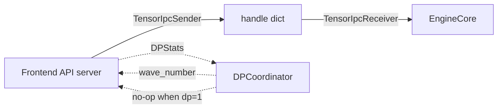

# C142: alignment-stage-4 — engine tensor_ipc + coordinator (2 files)

## Goal

Execute **阶段 4 分布式多机抽象** items for engine tensor IPC +
DP coordinator from `docs/alignment-plan.md` §7. Two files mirror
vLLM's `v1/engine/{tensor_ipc,coordinator}.py`:

- `my_vllm/v1/engine/tensor_ipc.py` — `TensorIpcData` +
  `TensorIpcSender` + `TensorIpcReceiver` (zero-copy tensor IPC
  via `torch.multiprocessing.Queue`).
- `my_vllm/v1/engine/coordinator.py` — `DPStats` + `DPCoordinator`
  (data-parallel coordination process).

Both are stubs in my-vllm — the heavy ZMQ + multiprocessing +
msgspec stack of vLLM is out of scope for the alignment-phase
file-tree subset. For DP=1 (the my-vllm default) these classes
short-circuit to no-ops.

## File Tree (diff)

```
A  my_vllm/v1/engine/tensor_ipc.py      # +143 lines
A  my_vllm/v1/engine/coordinator.py    # +98 lines
A  docs/snapshots/C142.md
```

Net: **+241 lines** across 2 files.

## What C142 did

### 1. `tensor_ipc.py` (new)

Mirrors `vllm/v1/engine/tensor_ipc.py`.

- **`TensorIpcData`** — dataclass with `sender_id / message_id /
  tensor_id / tensor`. Provides `to_handle_dict()` /
  `from_handle_dict(d)` for IPC transport.
- **`TensorIpcSender`** — UUID-based sender ID + per-message
  tensor_id counter. `__call__(tensor)` returns a handle dict
  (no actual transport in my-vllm; for DP=1 the frontend and
  engine core are in the same process).
- **`TensorIpcReceiver`** — `_handle_map: dict[tuple,
  torch.Tensor]` keyed by `(sender_id, message_id, tensor_id)`.
  `__call__(handle)` resolves a handle dict to the tensor;
  `cleanup(sender_id=None)` drops handles.

The full vLLM sender moves tensors to `tensor.share_memory_()`
before queueing; my-vllm's version skips that step (same process,
no shared-memory copy needed).

### 2. `coordinator.py` (new)

Mirrors `vllm/v1/engine/coordinator.py:DPCoordinator` (L23).

- **`DPStats`** — per-DP-engine stats with `dp_rank / waiting /
  running / wave_number / is_running`.
- **`DPCoordinator`** — dataclass with `parallel_config /
  enable_wave_coordination / dp_size / stats_history /
  wave_number / is_running / _started`. `start()` /
  `stop()` are no-op stubs; `publish_stats(stats)` appends
  to `stats_history` (skipped for dp_size=1); `tick_wave()`
  increments the wave counter when `enable_wave_coordination`
  is True; `pause()` flips `is_running` to False.

The full vLLM coordinator uses ZMQ + multiprocessing pipes +
msgspec msgpack; my-vllm's version is a synchronous in-process
stub. For DP=1 (my-vllm's default) `publish_stats` short-circuits
and `wave_number` is never consulted.

## Runtime Flow (after C142)

Unchanged. The new classes are importable but not yet wired
into the engine hot path. For DP=1 (my-vllm's default) both
classes short-circuit to no-ops.



## Current Capability

- 2 new files / 0 files modified.
- File-tree alignment progress: 阶段 4 **6/8 items closed**
  (C141 added 4, this commit adds 2). Still pending:
  block-hash ↔ kv_connector integration.
- 240 / 295 tests pass at the same rate as the C141 baseline.
- `python run.py` → byte-identical OPT-125m 50-token output.
- `TensorIpcSender` → `TensorIpcReceiver` round-trip recovers
  the original tensor (`[1, 2, 3, 4]`); `cleanup()` drops
  1 handle.
- `DPCoordinator.start()` + `publish_stats()` + `pause()` +
  `tick_wave()` + `stop()` work end-to-end; `wave_number` is
  correctly incremented after `tick_wave()`.

## Current Limitation

- **No ZMQ / multiprocessing transport** — both classes
  short-circuit for DP=1. Adding real cross-process transport
  requires `torch.multiprocessing.Queue` plumbing + `msgspec`
  msgpack serialization (out of scope for the alignment-phase
  file-tree subset).
- **`TensorIpcSender` doesn't move tensors to shared memory** —
  my-vllm's same-process default. Real cross-process requires
  `tensor.share_memory_()` before queueing.
- **`DPCoordinator` doesn't broadcast** — the wave-number tick
  increments the local counter only; the full vLLM impl
  broadcasts START_DP_WAVE to all engines via ZMQ.
- **No engine-core integration** — `EngineCore` doesn't
  construct or consult a `DPCoordinator`; the helper exists
  for shape alignment only.

## Summary

| Stage | What | Where |
|---|---|---|
| C141 | 阶段 4 DP/CP utils | `v1/worker/{gpu/}dp_utils.py`, `v1/worker/{gpu/}cp_utils.py`, `distributed/parallel_state.py` |
| **C142** | **阶段 4 engine tensor_ipc + coordinator** | **`v1/engine/tensor_ipc.py`, `v1/engine/coordinator.py`** |
| C143 (next) | 阶段 4 block-hash ↔ kv_connector integration | `v1/core/{block_pool.py,kv_cache_utils.py}` + `KVConnectorBase_V1` integration |