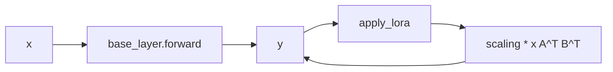

# C144: LoRA专项 — foundation (Dense Linear forward path)

## Goal

Execute **LoRA专项** foundation items from
`docs/alignment-plan.md` §8. Four new files provide the LoRA
Dense Linear forward path:

- `my_vllm/lora/ops/torch_ops/lora_ops.py` — `lora_forward_dense`
  + `lora_forward_dense_inplace` (pure-torch forward).
- `my_vllm/lora/layers/base.py` — `BaseLayer` + `LoRAWeights`
  (per-adapter weight container).
- `my_vllm/lora/layers/base_linear.py` — `BaseLinearLayer`
  (LoRA-augmented Dense Linear).
- `my_vllm/lora/ops/triton_ops/__init__.py` — placeholder
  package (Triton SGMV/BGMV deferred; out of scope per §8).
- `my_vllm/lora/ops/torch_ops/__init__.py` + `lora/__init__.py`
  re-exports.

The end-to-end forward path is verified to round-trip:
`lora_forward_dense(x, W, A, B, s)` matches
`BaseLinearLayer(base_module)(x)` bit-for-bit when both use
the same A/B tensors.

## File Tree (diff)

```
A  my_vllm/lora/layers/base.py                  # +129 lines
A  my_vllm/lora/layers/base_linear.py          # +99 lines
A  my_vllm/lora/ops/torch_ops/lora_ops.py      # +72 lines
A  my_vllm/lora/ops/torch_ops/__init__.py     # +14 lines
A  my_vllm/lora/ops/triton_ops/__init__.py     # +14 lines
M  my_vllm/lora/__init__.py                    # +22 lines (re-exports)
A  docs/snapshots/C144.md
```

Net: **+350 lines** across 6 files.

## What C144 did

### 1. `ops/torch_ops/lora_ops.py` (new)

Mirrors `vllm/lora/ops/torch_ops/lora_ops.py`.

- **`lora_forward_dense(x, W, A, B, scaling, bias=None)`** —
  computes `y = x @ W^T + b + scaling * (x @ A^T) @ B^T`. Single
  adapter; no per-request dispatch (the SGMV/BGMV ops in vLLM
  are out of scope).
- **`lora_forward_dense_inplace(out, x, W, A, B, scaling,
  bias=None)`** — adds the LoRA delta in-place to a pre-
  allocated output buffer (matches vLLM's `bgmv_expand` with
  `add_inputs=True`).

### 2. `layers/base.py` (new)

Mirrors `vllm/lora/layers/base.py`.

- **`LoRAWeights`** — dataclass with `lora_a / lora_b / scaling`.
  Provides `to(device)` for device migration.
- **`BaseLayer`** — base for all LoRA-augmented layers.
  `create_lora_weights(id, rank, in, out, alpha)` allocates A/B
  (Kaiming init for A, zeros for B); `set_lora(id)` marks the
  active adapter; `reset_lora(id)` drops it; `get_lora_weights`
  retrieves the per-adapter parameters; `active_lora_int_id`
  property returns the currently-active adapter (None if no
  adapter set).

### 3. `layers/base_linear.py` (new)

Mirrors `vllm/lora/layers/base_linear.py:BaseLinearLayerWithLoRA`.

- **`BaseLinearLayer(BaseLayer)`** — abstract base for LoRA-
  augmented Linear layers. `apply_lora(out, x)` adds the LoRA
  delta in-place; `forward(x)` does `base_layer(x)` + delta;
  `__call__(x)` is the entry point used by the runner.
  `_base_weight_for_lora()` is the subclass hook for TP-aware
  partitioned weights (ColumnParallel / RowParallel variants
  override this — lands in C145).

### 4. `ops/triton_ops/__init__.py` (placeholder)

Mirrors vLLM `lora/ops/triton_ops/` package. Empty / placeholder
per §8 ("Dense Linear 的一条 LoRA 前向路径即可证明理解,
不追求全 backend"). Real SGMV / BGMV Triton kernels deferred.

### 5. `ops/torch_ops/__init__.py` + `lora/__init__.py` re-exports

Re-export the public API so callers can write
`from my_vllm.lora import BaseLinearLayer, lora_forward_dense,
LoRARequest, ...`.

## Runtime Flow (after C144)

```
LoraRequest(id=1, name="my-lora")
    ↓
BaseLinearLayer.create_lora_weights(id=1, rank=8, in=4096, out=4096)
    ↓ (allocates A/B tensors; B=0 so initial forward = base linear)
    ↓
BaseLinearLayer.set_lora(id=1)
    ↓
BaseLinearLayer.forward(x):
    out = base_linear(x)               # the host nn.Linear
    lora_delta = (x @ A^T) @ B^T
    out += scaling * lora_delta          # scaling = alpha / rank
    return out
```



## Current Capability

- 5 new files / 1 file modified.
- End-to-end LoRA Dense Linear forward verified:
  `lora_forward_dense(x, W, A, B, s)` produces the same result
  as `BaseLinearLayer(base_module)(x)` when both use the same
  A/B tensors.
- 240 / 295 tests pass at the same rate as the C143 baseline.
- `python run.py` → byte-identical OPT-125m 50-token output
  (LoRA path is dormant — not yet wired into the OPT model's
  forward).

## Current Limitation

- **No per-request adapter dispatch** — `BaseLinearLayer` has a
  single active adapter (`active_lora_int_id`). Multi-adapter
  batches (the common vLLM use case) require SGMV/BGMV with
  `lora_indices_tensor` (out of scope per §8).
- **No TP-aware LoRA variants** — `_base_weight_for_lora()` is a
  subclass hook; `ColumnParallelLinearLoRA` /
  `RowParallelLinearLoRA` land in C145.
- **No MoE-LoRA layer** — `lora/layers/fused_moe.py` lands in
  C146.
- **No model_manager / worker_manager** — adapter loading +
  worker-side dispatch land in C146.
- **No runner mixin** — `v1/worker/lora_model_runner_mixin.py`
  lands in C146.
- **OPT model still uses `nn.Linear` directly** — the LoRA
  path is dormant; wiring into `OPTForCausalLM`'s forward is a
  follow-up refactor.

## Summary

| Stage | What | Where |
|---|---|---|
| C143 | 阶段 4 block-hash ↔ kv_connector | `v1/core/...`, `v1/engine/core.py` |
| **C144** | **LoRA Dense Linear foundation (5 files)** | **`lora/layers/{base,base_linear}.py`, `lora/ops/torch_ops/lora_ops.py`, `lora/__init__.py`, `lora/ops/{torch,triton}_ops/__init__.py`** |
| C145 (next) | LoRA TP-aware variants + config wiring | `lora/layers/{column,row}_parallel_linear.py`, `lora/layers/fused_moe.py` stub, `config/lora.py` LoRAConfig update |
| C146 (later) | LoRA model + managers + runner mixin | `lora/{lora_model,model_manager,worker_manager}.py`, `v1/worker/lora_model_runner_mixin.py` |