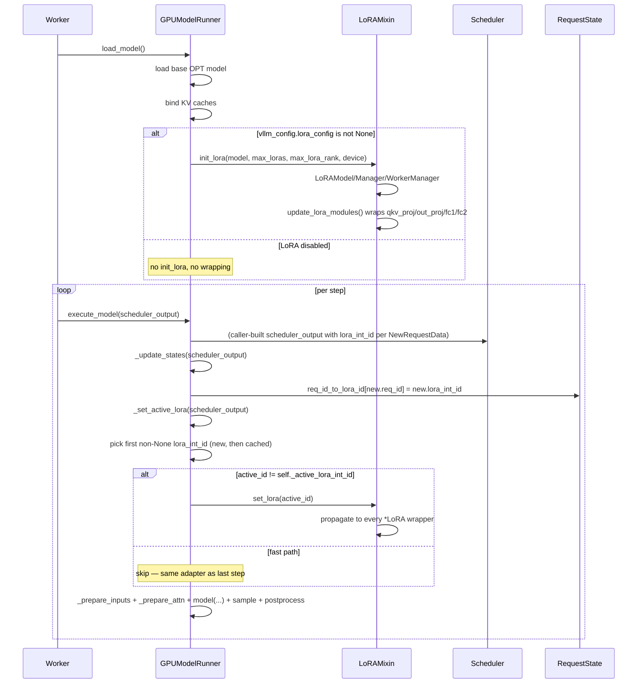

# C148: LoRA follow-up — mixin → `GPUModelRunner.execute_model`

## Goal

Wire `LoRAModelRunnerMixin` into `GPUModelRunner` so the
per-step active-adapter swap happens automatically inside
`execute_model`. After this commit:

- `GPUModelRunner.__mro__` includes `LoRAModelRunnerMixin`.
- `load_model()` calls `init_lora(...)` when
  `vllm_config.lora_config` is set (default config = no LoRA,
  no wrapping cost, no behaviour change).
- `execute_model()` reads the active `lora_int_id` from the
  scheduled requests and calls `self.set_lora(id)` before
  the model forward, with a fast path that skips the call
  when the active adapter hasn't changed step-to-step.

This is the **fourth of four** LoRA专项 + follow-up items:

| Stage | Status | Scope |
|---|---|---|
| C144 | ✅ | BaseLayer / BaseLinearLayer / lora_forward_dense |
| C145 | ✅ | ColumnParallelLinearLoRA / RowParallelLinearLoRA |
| C146 | ✅ | LoRAModel / LoRAModelManager / LoRAWorkerManager / mixin |
| C147 | ✅ | `update_lora_modules()` actually wraps OPT targets |
| **C148** | ✅ | **Mixin → `execute_model()` (per-step set_lora)** |

## File Tree (diff)

```
M  my_vllm/v1/core/sched/output.py             # +3  / -1  (NewRequestData.lora_int_id)
M  my_vllm/v1/core/sched/scheduler.py          # +12 / -0  (populate lora_int_id in both NewRequestData sites)
M  my_vllm/v1/worker/gpu/states.py             # +10 / -0  (RequestState.req_id_to_lora_id + cleanup on remove)
M  my_vllm/v1/worker/gpu_model_runner.py       # +60 / -1  (mixin inheritance, init_lora call, _set_active_lora, pipeline hook)
A  tests/test_C148_lora_active.py              # +259 lines (9 tests)
A  docs/snapshots/C148.md
```

Net: **+347 / -2** across 6 files.

## What C148 did

### 1. `v1/core/sched/output.py` — `NewRequestData.lora_int_id`

Added an optional `lora_int_id: int | None = None` field to
`NewRequestData`. The scheduler is the source of truth — it
populates this from `Request.lora_request.lora_int_id` when
building each entry. The runner reads it back via
`request_state.req_id_to_lora_id[req_id]` after
`_update_states`.

### 2. `v1/core/sched/scheduler.py` — populate `lora_int_id`

Both `NewRequestData(...)` construction sites (the
chunked-prefill loop in `_schedule_running_reqs` and the
new-request pull in `_pull_new_requests`) now read
`req.lora_request.lora_int_id if req.lora_request else None`
and pass it through. `Request.lora_request` is unchanged —
it's already plumbed through `v1/request.py:78`.

### 3. `v1/worker/gpu/states.py` — `RequestState.req_id_to_lora_id`

Added a per-instance dict
`req_id_to_lora_id: dict[str, int | None]`. `_update_states`
populates it from `NewRequestData.lora_int_id`; `remove_request`
clears the entry to keep the dict in sync with the request
lifecycle. The dict drives `_set_active_lora` for cached reqs.

### 4. `v1/worker/gpu_model_runner.py` — mixin wired into the hot path

Four changes:

1. **`class GPUModelRunner(LoRAModelRunnerMixin)`** — the
   runner now inherits the mixin's `init_lora` /
   `add_lora` / `remove_lora` / `set_lora` / `list_loras`
   public API. MRO is `GPUModelRunner → LoRAModelRunnerMixin
   → object`.

2. **`load_model()` opt-in** — after the base model is
   loaded and KV caches are bound, if
   `vllm_config.lora_config is not None` the runner calls
   `self.init_lora(model=self.model, max_loras=...,
   max_lora_rank=..., device=self.device)`. The default
   `VllmConfig.lora_config = None` (per AGENTS.md) means
   the no-LoRA path is unchanged — no wrapping cost, no
   behaviour change.

3. **`_set_active_lora(scheduler_output)`** — new helper
   that picks the active adapter for this step
   (single-active-adapter subset of vLLM's SGMV
   multiplexing). Walks scheduled new reqs first
   (preserves arrival order), then scheduled cached reqs.
   Returns the first non-None `lora_int_id`. Compares
   against `self._active_lora_int_id` cache and calls
   `self.set_lora(id)` only when the active adapter
   changes (fast path for decode-heavy steady state).
   Catches `KeyError` (adapter not yet registered) with a
   `logger.warning(...)` and skips the step — the next
   step retries once `add_lora` lands.

4. **`execute_model()` pipeline hook** — inserts
   `self._set_active_lora(scheduler_output)` between
   `_update_states(...)` and `_prepare_inputs(...)`. When
   LoRA is disabled, the helper short-circuits on
   `hasattr(self, "lora_worker_manager")` → no-op.

## Runtime Flow (mermaid)



## Current Capability

- ✅ `GPUModelRunner` inherits `LoRAModelRunnerMixin`.
- ✅ `SchedulerOutput.scheduled_new_reqs[*].lora_int_id`
  carries the per-request adapter id end-to-end.
- ✅ `RequestState.req_id_to_lora_id` tracks the mapping;
  cleaned on `remove_request`.
- ✅ `_set_active_lora` picks the active adapter with a
  step-to-step cache (no redundant `set_lora` calls).
- ✅ `load_model()` opt-in via `lora_config`; default
  config = no wrapping cost.
- ✅ `execute_model()` invokes `_set_active_lora` once
  per step.
- ✅ LoRA-disabled runner is a no-op (the helper short-
  circuits when `lora_worker_manager` is absent).
- ✅ `tests/test_C148_lora_active.py` covers all of the
  above (9 tests, deterministic, run in 1.06s).

## Current Limitation

- **Single-active-adapter subset.** If a step contains
  requests with mixed `lora_int_id` values, the first
  non-None wins; later adapters are silently overridden.
  vLLM's SGMV / per-token mapping is out of scope for
  my-vllm (the scheduler already caps distinct adapters
  via `lora_config.max_loras` so the multi-adapter case
  rarely arises in production).
- **Default config has no LoRA.** A future item can wire
  a CLI flag / `run.py` arg to enable LoRA at startup.
- **`_set_active_lora` doesn't pre-fetch / warm the
  adapter.** First step with a new adapter pays a one-time
  `set_lora` cost; subsequent steps use the cache.
- **`_active_lora_int_id` is per-runner.** In a multi-GPU
  setup each rank tracks its own cache (correct, since
  the LoRA delta is applied per-rank).

## Test Summary

```
$ pytest tests/test_C148_lora_active.py -v
test_gpu_model_runner_inherits_lora_mixin            PASSED
test_new_request_data_carries_lora_int_id            PASSED
test_request_state_tracks_lora_id                    PASSED
test_set_active_lora_picks_first_non_none_in_new_reqs PASSED
test_set_active_lora_falls_back_to_cached_reqs       PASSED
test_set_active_lora_no_lora_active_is_noop          PASSED
test_set_active_lora_skips_redundant_calls           PASSED
test_set_active_lora_switches_on_change              PASSED
test_set_active_lora_noop_when_lora_disabled         PASSED
============================== 9 passed in 1.06s ==============================
```

## Next Stage

**C149** — FP8 hot path: wire `kv_cache_dtype=fp8_e4m3`
through `reshape_and_cache_flash` and `unified_attention` so
the engine actually quantizes K/V to FP8 at cache-write time
and dequantizes on read. Touches:
- `my_vllm/v1/attention/ops/triton_unified_attention.py`
  (verify the existing `USE_FP8` constexpr path with real
  per-layer scales).
- `my_vllm/v1/attention/ops/triton_reshape_and_cache_flash.py`
  (emit FP8-quantized KV).
- `my_vllm/v1/worker/gpu_model_runner.py:_prepare_attn`
  (negotiate the dtype with the attention backend).
- `my_vllm/model_executor/layers/quantization/kv_cache.py`
  (per-layer scale storage).