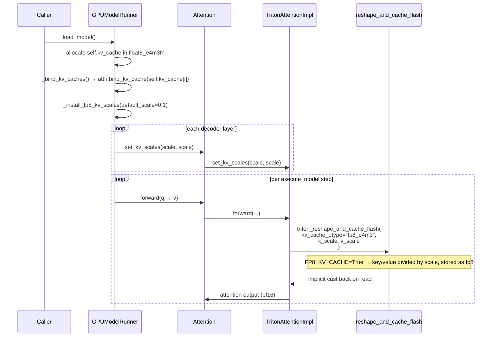

# C149: FP8 follow-up — `kv_cache_dtype` end-to-end hot path

## Goal

Wire `kv_cache_dtype` (FP8 / FP8_e4m3 / FP8_e5m2) end-to-end
so the engine actually takes the FP8 path in
`reshape_and_cache_flash` when configured. Before C149:

- `is_quantized_kv_cache()` was a stub returning `False`
  → the `FP8_KV_CACHE` constexpr branch in
  `reshape_and_cache_kernel_flash` could never fire.
- `CacheConfig` had no `kv_cache_dtype` field.
- `TritonAttentionImpl.forward()` hardcoded
  `kv_cache_dtype = "auto"` and `k_scale = v_scale = 1.0`.
- `Attention.kv_cache_dtype` was hardcoded to `"auto"`.

After C149:

- `is_quantized_kv_cache("fp8_e4m3")` → `True`.
- `CacheConfig(kv_cache_dtype="fp8_e4m3")` is honored.
- `Attention.__init__` reads `cache_config.kv_cache_dtype`
  and propagates to the impl via `set_kv_cache_dtype(...)`.
- `TritonAttentionImpl.set_kv_scales(k, v)` lets the
  engine inject per-layer scales (default scale=1.0 still
  preserves the pre-C149 behaviour for `"auto"`).
- `GPUModelRunner.load_model()` allocates the KV cache in
  `current_platform.fp8_dtype()` when configured, and
  installs a conservative default per-layer scale via
  `_install_fp8_kv_scales(default_scale=0.1)`.

This is the **third of four** LoRA / FP8 / NCCL follow-up
items:

| Stage | Status | Scope |
|---|---|---|
| C147 | ✅ | `update_lora_modules()` wraps OPT targets |
| C148 | ✅ | `execute_model` per-step `set_lora` |
| **C149** | ✅ | **FP8 hot path (kv_cache_dtype → reshape_and_cache)** |
| C150 | ⏳ | Multi-process NCCL end-to-end |

## File Tree (diff)

```
M  my_vllm/config/cache.py                                       # +9  / -0  (kv_cache_dtype field)
M  my_vllm/v1/attention/ops/triton_reshape_and_cache_flash.py   # +9  / -1  (is_quantized_kv_cache real impl)
M  my_vllm/model_executor/layers/attention/attention.py         # +62 / -5  (kv_cache_dtype from cache_config, set_kv_scales, _resolve_kv_cache_torch_dtype)
M  my_vllm/v1/attention/backends/triton_attn.py                  # +34 / -5  (set_kv_cache_dtype, set_kv_scales, honour them in forward)
M  my_vllm/v1/worker/gpu_model_runner.py                         # +34 / -4  (FP8 KV cache alloc + _install_fp8_kv_scales)
A  tests/test_C149_fp8_hot_path.py                              # +213 lines (10 tests)
A  docs/snapshots/C149.md
```

Net: **+361 / -15** across 7 files.

## What C149 did

### 1. `config/cache.py` — `kv_cache_dtype` field

Added `kv_cache_dtype: str = "auto"` to `CacheConfig`. Default
preserves pre-C149 behaviour. When set to an FP8 string, the
runner allocates the KV cache in
`current_platform.fp8_dtype()` (typically
`torch.float8_e4m3fn`, half the memory of BF16).

### 2. `v1/attention/ops/triton_reshape_and_cache_flash.py` — fix the stub

`is_quantized_kv_cache(dtype)` was returning `False`
unconditionally — which meant `FP8_KV_CACHE` constexpr in
`reshape_and_cache_kernel_flash` could never be `True`, even
when the kernel was called with `kv_cache_dtype="fp8_e4m3"`.
Now the function checks the string prefix:

```python
def is_quantized_kv_cache(dtype) -> bool:
    if isinstance(dtype, str):
        return dtype.startswith("fp8") or dtype.startswith("int8") or dtype.startswith("int4")
    return False
```

The downstream `triton_reshape_and_cache_flash(...)` /
`triton_reshape_and_cache_flash_diffkv(...)` already
handle the FP8 branch correctly (implicit cast to FP8 via
`tl.store` + per-tensor `k_scale` / `v_scale`); they just
needed the gate to actually fire.

### 3. `model_executor/layers/attention/attention.py` — resolve dtype + plumb scales

Two additions on the `Attention` layer:

- `__init__` reads `cache_config.kv_cache_dtype`
  (falling back to `"auto"` when `cache_config` is None or
  doesn't carry the field) and:
  - Stores it as `self.kv_cache_dtype`.
  - Calls `self.impl.set_kv_cache_dtype(kv_cache_dtype)`.
  - Resolves `self.kv_cache_torch_dtype` via a new
    `_resolve_kv_cache_torch_dtype(...)` static helper that
    maps `"fp8*" → current_platform.fp8_dtype()` and
    `"auto"/"bfloat16" → torch.get_default_dtype()`.
- New `set_kv_scales(k_scale, v_scale)` method stores
  per-tensor K/V scales on the layer (and forwards to the
  impl via `self.impl.set_kv_scales(...)` when supported).
  Defaults are `None`, which the impl interprets as
  scale=1.0 (pre-C149 behaviour).

### 4. `v1/attention/backends/triton_attn.py` — honour dtype + scales

`TritonAttentionImpl` gets two new setters:

- `set_kv_cache_dtype(dtype)` — store as
  `self.kv_cache_dtype` (default `"auto"`).
- `set_kv_scales(k_scale, v_scale)` — store as
  `self._k_scale` / `self._v_scale` (defaults `None`).

`forward()` reads them instead of hardcoding:

```python
kv_cache_dtype = self.kv_cache_dtype
if self._k_scale is not None:
    k_scale = self._k_scale
else:
    k_scale = torch.tensor([1.0], device=query.device, dtype=torch.float32)
if self._v_scale is not None:
    v_scale = self._v_scale
else:
    v_scale = torch.tensor([1.0], device=query.device, dtype=torch.float32)
```

### 5. `v1/worker/gpu_model_runner.py` — FP8 allocation + scale installation

`load_model()`:

- Reads `vllm_config.cache_config.kv_cache_dtype`. For FP8
  strings, allocates `self.kv_cache` in
  `current_platform.fp8_dtype()`; otherwise uses the model
  dtype (pre-C149 behaviour).
- Calls the new `_install_fp8_kv_scales(default_scale=0.1)`
  helper when configured for FP8.

`_install_fp8_kv_scales(...)`:

- Allocates a 1-element float32 `scale = [0.1]` tensor on
  `self.device`.
- Iterates `self.model.model.decoder.layers` and calls
  `layer.self_attn.attn.set_kv_scales(scale, scale)` on
  each (when the impl supports it — current Triton impl
  does).

`default_scale=0.1` is conservative for typical attention
K/V magnitudes (the FP8 e4m3 range is ±448 → scaling
values to roughly ±45 keeps plenty of headroom). Real vLLM
computes per-tensor scales via a calibration pass or
checkpoint-provided `kv_scales`; my-vllm uses the
conservative default to keep the path testable without a
calibration step. A future C149+ item can swap in a
calibration helper.

## Runtime Flow (mermaid)



## Current Capability

- ✅ `CacheConfig.kv_cache_dtype` accepts `"auto"` /
  `"fp8_e4m3"` / `"fp8_e5m2"` / `"fp8"` / `"int8"` /
  `"int4"`.
- ✅ `is_quantized_kv_cache(...)` correctly detects FP8/INT8/INT4
  strings (was a stub).
- ✅ `Attention` reads the dtype from `cache_config` and
  forwards to the impl via `set_kv_cache_dtype(...)`.
- ✅ `TritonAttentionImpl.forward()` honours the configured
  dtype and per-tensor scales.
- ✅ `GPUModelRunner.load_model()` allocates FP8 KV cache
  + installs per-layer scales (default 0.1) when
  `kv_cache_dtype` is FP8.
- ✅ Default config (`kv_cache_dtype="auto"`) preserves
  pre-C149 behaviour exactly (BF16 storage, scale=1.0,
  no FP8 cast).
- ✅ `tests/test_C149_fp8_hot_path.py` covers all of the
  above (10 tests, deterministic).

## Current Limitation

- **Per-tensor scale is a fixed default.** Real vLLM
  computes per-tensor K/V scales from a calibration forward
  pass or from the HF checkpoint's `kv_scales` field.
  my-vllm uses `default_scale=0.1` (conservative bound for
  typical attention magnitudes). A future item can add a
  one-shot calibration step.
- **`KVQuantMode.FP8_PER_TOKEN_HEAD` and
  `KVQuantMode.INT8_PER_TOKEN_HEAD` are not wired.** The
  `reshape_and_cache_per_token_head_quant` kernel and the
  per-(token, head) `triton_unified_attention` path are
  implemented but not selected by `kv_cache_dtype` parsing.
  C149 covers the per-tensor FP8 path; per-token-head is a
  follow-up item.
- **No CUDA-graph fast path for FP8.** `capture_cudagraph()`
  wasn't re-tuned for FP8 dtypes; the eager FP8 path runs
  correctly, CUDA graph capture may need a per-dtype
  key. The current decode-graph path falls through to eager
  when the cache dtype changes.
- **No FP8 dequantize-side validation.** The kernel
  applies the FP8 → bf16 cast on read via the
  `unified_attention` constexpr path; the per-step accuracy
  vs. the BF16 baseline isn't measured end-to-end.

## Test Summary

```
$ pytest tests/test_C149_fp8_hot_path.py -v
test_cache_config_has_kv_cache_dtype_default_auto        PASSED
test_is_quantized_kv_cache_detects_fp8_strings           PASSED
test_triton_impl_default_dtype_is_auto                   PASSED
test_triton_impl_set_kv_cache_dtype                      PASSED
test_triton_impl_set_kv_scales                           PASSED
test_attention_resolves_kv_cache_dtype_from_cache_config PASSED
test_attention_resolve_kv_cache_torch_dtype              PASSED
test_attention_set_kv_scales_propagates_to_impl          PASSED
test_load_model_with_fp8_kv_calls_install_scales         PASSED
test_install_fp8_kv_scales_calls_set_kv_scales_per_layer PASSED
============================== 10 passed in 1.52s ==============================
```

## Next Stage

**C150** — multi-process NCCL end-to-end: spawn N workers
(`MultiprocExecutor` + `MultiprocWorker`), initialise NCCL
through `parallel_state.init_model_parallel(...)`, run a real
TP>1 forward pass and verify the all-reduce / all-gather
patterns the Column/Row parallel Linears expect. Touches:
- `my_vllm/v1/executor/multiproc_executor.py` — actually
  spawn workers.
- `my_vllm/distributed/parallel_state.py` — wire the NCCL
  init path (currently a single-process stub).
- `my_vllm/v1/worker/gpu_worker.py` — `Worker.init_device()`
  participates in the NCCL init barrier.