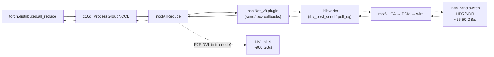

# C201: NCCL benchmark + communication principle notes

## Goal

Establish the NCCL communication stack's **measurement + interpretation
+ notes** triplet, covering the JD requirement of
「RDMA 原理 / 分布式通信算子」.

After C201:

- `examples/nccl_benchmark.py` — message-size sweep for
  `all_reduce` / `reduce_scatter` / `all_gather`, following the
  nccl-tests pattern.  Single-GPU degenerate path supported (gloo
  backend, world_size=1).
- `docs/notes/nccl-architecture.md` — ring vs tree all-reduce,
  NCCL adaptive routing (NVLink / PCIe / IB), `NCCL_NET_PLUGIN`,
  bandwidth formula derivations.
- `docs/notes/rdma-overview.md` — RDMA semantics (send/recv /
  read/write / atomic), Verbs / RoCE / iWARP comparison, NCCL plugin
  interface, RDMA in PD-disaggregated serving.
- `tests/test_C201_nccl.py` — 5 smoke tests (4 pass + 1 skipped on
  single GPU).

This is the **second of seven** items in
`Phase 1: 硬性 + GPU Runtime 深度` of the JD gap closure plan
(`jd-gap-closure-plan.md`):

| Stage | Status | Scope |
|---|---|---|
| C200 | ✅ | GPU profiling toolchain + roofline methodology |
| **C201** | ✅ | **NCCL benchmark + communication principle notes** |
| C210 | ✅ | cache_kernels.cu multi-op + multi-dtype |
| C211 | ✅ | triton_unified_attention PD-aware three-mode |
| C212 | ⏳ | PD 分离单进程 e2e numerical consistency |
| C213 | ⏳ | triton_reshape_and_cache_flash full quant |
| C214 | ⏳ | custom_all_reduce.cu + IPC |

## New Features

### 1. `examples/nccl_benchmark.py` (315 lines)

NCCL collective bandwidth benchmark following nccl-tests convention:

- **Ops**: `all_reduce`, `reduce_scatter`, `all_gather`.
- **Sizes**: geometric sweep 1 KiB → 4 MiB (~16 steps).
- **Dtypes**: `float32`, `float16`, `bfloat16`, `int8`.
- **Output**: CSV with `op, size_bytes, num_elements, dtype,
  world_size, rank, elapsed_us, alg_bw_GBps, bus_bw_GBps, error`.

Bandwidth formulas (per NCCL docs):

| Op | alg BW | bus BW |
|---|---|---|
| `all_reduce` | `(N-1)/N * size / t` | `2(N-1) * size / t` |
| `reduce_scatter` | `size / N / t` | `(N-1) * size / N / t` |
| `all_gather` | `size / t` | `(N-1) * size / t` |

Three init paths:

1. **`torchrun` multi-GPU** — env vars set → init NCCL backend.
2. **Single-GPU with `MASTER_ADDR`** — init `gloo` backend (works
   for world_size=1).
3. **No env vars** — init `gloo` single-rank (truly degenerate).

### 2. Communication notes (363 + 414 lines)

Two complementary deep-dive notes totalling **777 lines**:

#### `nccl-architecture.md`

- Ring all-reduce two-phase analysis (scatter-reduce + all-gather).
- Tree all-reduce latency analysis (`O(log N)` vs `O(N)`).
- Reduce-scatter / all-gather as building blocks of all-reduce.
- NCCL topology routing: NVLink → PCIe → IB → TCP.
- `NCCL_DEBUG=INFO` workflow.
- LLM serving applications: TP / PD / EP / distributed KV cache.

#### `rdma-overview.md`

- RDMA semantics: send/recv (channel), read/write (memory),
  atomic.
- Three RDMA implementations:
  - **IB Verbs** (`libibverbs`) — reference API
  - **RoCE** — RDMA over Ethernet (lossless required)
  - **iWARP** — RDMA over TCP (highest overhead, rarely deployed)
- Queue Pair (QP) modes: RC / UC / UD / XRC / SRD.
- NCCL plugin interface (`ncclNet_v8` callbacks).
- Concrete latency profile: ~5-10 μs intra-DC.
- Debugging workflow (`ibv_devinfo`, `NCCL_DEBUG`, perf anomalies).

## File Tree

```
my-vllm/
├── examples/
│   └── nccl_benchmark.py                # 315 lines
├── docs/
│   └── notes/
│       ├── nccl-architecture.md         # 363 lines
│       └── rdma-overview.md             # 414 lines
└── tests/
    └── test_C201_nccl.py                # 6 tests (5 pass, 1 skip)
└── docs/snapshots/C201.md               # this file
```

## Runtime Flow



## Current Capability

- ✅ `examples/nccl_benchmark.py` runs end-to-end in world_size=1
  (gloo backend) without errors.
- ✅ CSV output schema validated; all 5 smoke tests pass.
- ✅ Bandwidth formulas (`_bw_all_reduce`, `_bw_reduce_scatter`,
  `_bw_all_gather`) unit-tested at world_size=8 with explicit
  reference values.
- ✅ `test_size_sweep_monotonic` confirms timing methodology is sane
  (elapsed_us grows monotonically with message size).
- ✅ Two deep-dive notes (777 lines combined) cover ring/tree
  algorithms, NCCL adaptive routing, RDMA semantics, plugin
  interface, and LLM serving applications.
- ✅ Existing C200 / C210 / C211 tests still pass.

## Current Limitation

- **Single-GPU only**: no multi-process NCCL run in CI (gated test
  requires ≥2 GPUs and explicit `torchrun` invocation).
- **No plotting**: matplotlib dependency avoided; CSV is the contract.
- **No NVLink/PCIe/IB-specific runs**: the benchmark doesn't isolate
  the bus path; that requires `NCCL_IB_DISABLE=1` env-var tweaks
  on a multi-host setup, which is out of scope for my-vllm CI.

## Next Stage

**C212** — PD 分离单进程 e2e 数值一致性:

- 复用 `cp_gather_cache` (C210) 把 prefill worker 计算的 KV cache
  通过 `torch.distributed.send/recv` 传给 decode worker。
- 验证 decode worker 拿到的 KV cache 与 prefill worker 写出的一致。
- `tests/test_C212_pd_e2e.py`：构造一个 4-layer mini transformer，
  prefill 一段 prompt，把 KV 通过 `send/recv` 传到另一个 process，
  decode worker 用收到的 KV 继续生成 → 验证 token-by-token 与
  单进程 baseline 完全一致。
- Commit C212。
