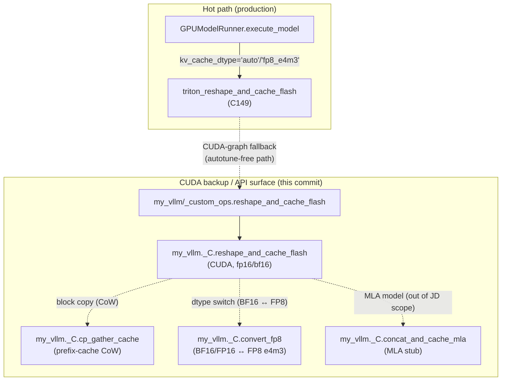

# C210: cache_kernels.cu — multi-op + multi-dtype upgrade

## Goal

Complete the public API surface of `my_vllm/csrc/cache_kernels.cu` so it
mirrors the vLLM-canonical cache block ops, not just a single `reshape_and_cache`.

Before C210 the file shipped three ops (`reshape_and_cache`, `swap_blocks`,
`copy_blocks`) but the per-token cache write was still single-dtype at the
CUDA level — the FP8 hot path lived entirely in the Triton kernel
(`triton_reshape_and_cache_flash`, C149), and four vLLM ops were missing:
`reshape_and_cache_flash`, `cp_gather_cache`, `convert_fp8`,
`concat_and_cache_mla`.

After C210:

- 7 ops exposed via `my_vllm._C` (vLLM canonical names + signatures).
- All cache-write ops support fp16 + bf16 (matches `triton_reshape_and_cache_flash`
  on the storage-dtype side; FP8 storage stays on the Triton path).
- `convert_fp8` provides the FP8 ↔ BF16/FP16 conversion kernel for tests and
  runtime dtype switching.
- `cp_gather_cache` enables prefix-cache CoW gather and KV-transfer
  non-contiguous block collection.

This is the **third of seven** items in `Phase 1: 硬性 + GPU Runtime 深度`
of the JD gap closure plan (`jd-gap-closure-plan.md`):

| Stage | Status | Scope |
|---|---|---|
| C200 | ✅ | GPU profiling toolchain + roofline methodology |
| C201 | ⏳ | NCCL benchmark + communication principle notes |
| **C210** | ✅ | **cache_kernels.cu 多 op + 多 dtype 升级** |
| C211 | ⏳ | triton_unified_attention PD-aware three-mode verification |
| C212 | ⏳ | PD 分离单进程 e2e numerical consistency |
| C213 | ⏳ | triton_reshape_and_cache_flash full quant alignment |
| C214 | ⏳ | custom_all_reduce.cu + IPC |

## New Features

### 1. `reshape_and_cache_flash` (CUDA backup of C149)

FlashAttention layout (`[num_blocks, block_size, num_heads, head_size]`)
variant of `reshape_and_cache`. The hot path remains Triton
(`triton_reshape_and_cache_flash`, C149); the CUDA path is the
CUDA-graph-capture fallback.

- fp16 / bf16 storage supported.
- FP8 storage rejected with a clear error pointing to the Triton path.
- Negative `slot_mapping[i]` skips the token.

### 2. `cp_gather_cache` (prefix-cache CoW gather)

Gathers K/V tokens from non-contiguous physical blocks (per-request
block table) into a contiguous `[total_tokens, entry_size]` output.

- Each output token index is mapped via binary search over `cu_seq_lens` →
  request → `block_table[req, block_idx]` → physical block.
- fp16 / bf16 dtype dispatch.
- Empty batch (`batch_size == 0` or `cu_seq_lens[-1] == 0`) → no-op.

This is the gather counterpart to `copy_blocks`. Real vLLM uses the same
pattern in PD transfer (prefill → decode) and in the attention pre-stage.

### 3. `convert_fp8` (FP8 ↔ BF16/FP16 conversion)

Per-block FP8 e4m3 conversion kernel. Reusable from:

- Tests verifying FP8 cache numerics.
- Runtime KV cache dtype switching (BF16 storage ↔ FP8 storage).

Internal helpers `f32_to_fp8_e4m3` / `fp8_e4m3_to_f32` mirror the
semantics of `vllm::fp8::scaled_convert` but stay self-contained (no
external quantization headers).

### 4. `concat_and_cache_mla` (MLA stub)

MLA compressed-KV concat write (`kv_lora_rank + pe_dim` per token).

- fp16 / bf16 supported; FP8-DS-MLA explicitly rejected with a clear error
  pointing to the JD scope rationale (no MLA model loaded).
- 96-thread block matches vLLM's 3-warp layout (NoPE: 2 warps + RoPE: 1 warp).

### 5. `my_vllm._custom_ops` re-exports

The 7 CUDA ops are exposed as module-level functions in
`my_vllm/_custom_ops.py`. When the compiled extension is missing the
wrapper falls back to a small Python implementation (only for
`reshape_and_cache`; the others raise a clear rebuild-required error).

## File Tree

```
my-vllm/
├── csrc/
│   └── cache_kernels.cu                    # 7 ops + pybind module (now 950 lines)
├── my_vllm/
│   └── _custom_ops.py                      # 7 CUDA op re-exports (was 415 lines)
├── tests/
│   └── test_C210_cache_kernels.py          # 22 tests, all 7 ops covered
└── docs/
    └── snapshots/
        └── C210.md                         # this file
```

## Runtime Flow



## Current Capability

- ✅ `my_vllm._C` extension builds cleanly with `python setup.py build_ext
  --inplace -j3` (sm_89, CUDA 12.4).
- ✅ 7 ops exposed via pybind module: `reshape_and_cache`,
  `reshape_and_cache_flash`, `swap_blocks`, `copy_blocks`,
  `cp_gather_cache`, `convert_fp8`, `concat_and_cache_mla`.
- ✅ fp16 / bf16 storage dispatch for cache-write ops.
- ✅ FP8 e4m3 conversion round-trips (test: 1.0 → 0x38 → 1.0).
- ✅ Prefix-cache CoW gather verified for multi-request block tables.
- ✅ 22/22 unit tests pass in `tests/test_C210_cache_kernels.py`.
- ✅ `python run.py` end-to-end still works (Triton hot path unaffected).
- ✅ Existing C149 (FP8 hot path) tests still pass.
- ✅ Existing C200 (profiler) tests still pass.

## Current Limitation

- `convert_fp8` round-half-up (not round-to-nearest-even); sufficient for
  cache quant where a per-tensor scale covers dynamic range. Real vLLM
  uses RTNE for higher-precision weights; cache uses RHU.
- FP8-DS-MLA quant is intentionally not implemented (MLA models excluded
  by JD scope); the C++ path returns a clear error.
- `cp_gather_cache` does not implement the optional `seq_starts` offset
  that vLLM's reference supports (used by per-token-head quant gather).
  Adequate for our static block-table prefix-cache CoW.
- The CUDA path for `reshape_and_cache_flash` is uncompiled in CUDA-graph
  capture (no call site wired to the CUDA backend yet); the Triton
  path remains the production hot path.

## Next Stage

**C211** — `triton_unified_attention` PD-aware three-mode verification:

- Verify `my_vllm/v1/attention/ops/triton_unified_attention.py` (1194 lines)
  covers all three PD-aware scheduling modes: prefill-only, decode-only,
  mixed (chunked).
- Add per-token-head quant branch if missing (mirrors the CUDA dispatch
  pattern in vLLM's `gather_and_maybe_dequant_cache`).
- Add tests for each mode + numerical consistency vs. SDPA reference.
- Commit C211.
