# C223: NgramProposer — prompt-lookup n-gram speculative decoder

## Goal

Replace the `NotImplementedError` stubs in `my_vllm/v1/spec_decode/`
with a **real end-to-end n-gram speculative-decoding proposer**,
extracted from vLLM's
`vllm/v1/spec_decode/ngram_proposer.py`.  This closes the
**B1-a "补实一条通路"** path from `docs/cleanup-plan.md` §3 for the
n-gram method specifically (EAGLE / draft_model remain class shells —
their full implementations require loading a draft model which is out
of scope for the JD-aligned subset).

The n-gram proposer is the simplest **training-free** speculative
decoder: no draft model is loaded.  At each target-model step, it
looks at the prompt + already-generated tokens and finds the
**longest n-gram** (length in `[prompt_lookup_min, prompt_lookup_max]`)
that matches the suffix of the context.  If found, it returns the
`k` tokens immediately after the matched n-gram as draft tokens for
parallel verification by the target model.

Covers JD **加分 #1 「Spec decode / 推理加速」** — establishes the
architecture-aligned ngram proposer and the spec-decode config
wiring (`SpeculativeConfig.prompt_lookup_*`, `VllmConfig.
speculative_config`).

Plan checklist:

- [x] `my_vllm/v1/spec_decode/ngram_proposer.py` — full NgramProposer
      extracted from vLLM (Numba-JIT'd batch kernel + KMP-style inner
      loop), 395 lines.
- [x] `my_vllm/config/speculative.py` — added `prompt_lookup_min` +
      `prompt_lookup_max` (vLLM-canonical field names) and
      `__post_init__` default-resolution (5/5) + min/max validation.
- [x] `my_vllm/config/vllm.py` — added `speculative_config:
      SpeculativeConfig | None = None` field (was referenced in
      skeleton code but never declared on the dataclass).
- [x] `my_vllm/v1/spec_decode/__init__.py` — exports
      `NgramProposer`; adds `create_spec_decode_proposer(vllm_config,
      ...)` dispatcher mirroring vLLM's
      `gpu_model_runner.py:596-611` drafter selection.
- [x] `tests/test_C223_ngram_proposer.py` — 33 tests (8 test classes):
      config defaults/validation, kernel correctness (golden
      cases), per-request filtering, batch output alignment,
      dispatcher routing, JIT warm-up timing, interface contracts.
- [x] `examples/ngram_proposer_benchmark.py` — synthetic vocab /
      batch / context sweep (CSV stdout), 233 lines.
- [x] `tests/test_C210_cache_kernels.py` /
      `tests/test_C211_unified_attention.py` /
      `tests/test_C213_reshape_cache_flash.py` /
      `tests/test_C214_allreduce.py` /
      `tests/test_C220_quant_gemm.py` /
      `tests/test_C221_fused_moe.py` — still pass (no regressions).

## What's in this commit

### 1. `my_vllm/v1/spec_decode/ngram_proposer.py`

Mirrors `vllm/v1/spec_decode/ngram_proposer.py` (293 lines) almost
verbatim:

  * **Algorithm** — find the longest n-gram (length `[min_n, max_n]`)
    matching the suffix of the context tokens, then return the `k`
    tokens immediately after the matched n-gram.
  * **Implementation** — KMP failure-function style LPS walk on the
    reversed sequence, capped at `max_ngram` to keep the prefix
    array small.  C224-equivalent `prange` parallel kernel over the
    batch dimension.  Outer Numba types `njit(parallel=True)` /
    inner `jit(nopython=True)` match vLLM.
  * **Pre-allocated buffers** — `valid_ngram_draft` (max_num_seqs ×
    k int32) and `valid_ngram_num_drafts` (max_num_seqs int32) are
    allocated in `__init__` and reused across calls (zero-copy batch
    output).
  * **JIT warm-up** — `__init__` triggers Numba compilation by
    calling `propose()` once with dummy inputs.  This avoids the
    ~1-second first-call latency hit in production.
  * **Per-request filtering** — `propose()` skips requests with
    empty `sampled_token_ids` (fresh prefill) and requests at
    `max_model_len` (no draft budget).
  * **k clipping** — `k = min(k, max_model_len - total)` and
    `k = min(k, total_token - start_position)` (the available tail).

Differences from vLLM (principled scope reductions):

  * **No `numa_count.max_num_seqs`** or other server-deployment
    tunings — vLLM has hooks for NUMA-aware CPU scheduling that
    are deployment-side concerns.
  * **Numba is now a soft import.**  Real vLLM hard-pins
    `numba==0.65.0` (see `requirements/cuda.txt`).  We lazy-import
    and raise a clear `ImportError` if numba isn't installed —
    allows the rest of `my_vllm.v1.spec_decode` to be importable on
    CPU-only environments (e.g. for type-checking / linting).
  * **No `NumbaPendingDeprecationWarning` suppression.**  Numba
    0.67 (which we have installed) deprecates reflected lists; vLLM
    doesn't suppress this either, so we follow suit.  Tests expose
    the warnings so they get noticed.

### 2. `my_vllm/config/speculative.py`

C223 delta on top of C137's skeleton:

  * Added `prompt_lookup_min: int | None` and
    `prompt_lookup_max: int | None` fields — exact vLLM-canonical
    names from `vllm/config/speculative.py:157-162`.
  * Added `__post_init__` that mirrors vLLM's
    `vllm/config/speculative.py:737-763`:
      * Resolves `[ngram]` method name → `ngram`.
      * Defaults both `prompt_lookup_min` and `prompt_lookup_max` to
        5 when both are `None` (vLLM's documented default).
      * One-sided defaulting — `min=None` falls back to `max` and
        vice versa.
      * Validates `min <= max`.
  * `compute_hash()` now includes the n-gram window in its digest.

Out of scope (kept out of this minimal subset):

  * Full vLLM `__post_init__` (model routing for MTP / DSpark /
    dspark, draft_tensor_parallel_size validation, draft
    quantization, etc.).
  * `draft_model_config` / `draft_parallel_config` plumbing
    (ngram doesn't need them — the proposer is device-agnostic).
  * `num_speculative_tokens_per_batch_size` (dynamic per-batch
    schedule — defer to a follow-up that wires the runner).

### 3. `my_vllm/config/vllm.py`

Added `speculative_config: SpeculativeConfig | None = None` field.
This field was referenced by every C137 skeleton
(`my_vllm/v1/spec_decode/draft_model.py:50` etc.) but never
declared on the `VllmConfig` dataclass.  Closing this gap removes a
silent `AttributeError` waiting to happen.

### 4. `my_vllm/v1/spec_decode/__init__.py`

Exports `NgramProposer` and adds
`create_spec_decode_proposer(vllm_config, device=None, runner=None)`
which mirrors vLLM's drafter selection logic at
`vllm/v1/worker/gpu_model_runner.py:596-611`:

  * `method == "ngram"` → `NgramProposer(vllm_config)`
  * `method == "draft_model"` → `DraftModelProposer(...)` (class
    shell, NotImplementedError on `prepare_inputs` / `propose`)
  * `method == "eagle"` → `EagleProposer(...)` (same)
  * Anything else → `NotImplementedError`

### 5. `examples/ngram_proposer_benchmark.py`

Sweep over (batch_size × context_length × vocab_size) and report
median / min / max per-call latency + tokens/sec throughput.  The
benchmark exercises JIT warm-up (paid once in `__init__`) and the
batch kernel end-to-end.

Sample output (RTX 4060, vocab=128):

```
batch,context_len,warmup_us,median_us,min_us,max_us,tokens_per_sec,drafts_returned
1,64,2,9.71,7.99,46.94,6592501,0
8,256,2,1.13,0.97,1.28,1813994686,0
32,256,2,2.79,2.73,2.96,2935148692,0
```

(`drafts_returned` is 0 because vocab=128 + length ≤ 256 means the
suffix is unique — that's correct behavior.  Use `--vocab-size 8`
to force more matches.)

### 6. `tests/test_C223_ngram_proposer.py` (33 tests, 8 classes)

  * **TestSpeculativeConfigNgram** (7) — defaults, min/max
    validation, bracket-form normalization, non-ngram methods leave
    ngram fields `None`.
  * **TestVllmConfigSpeculative** (2) — dataclass field wired
    through.
  * **TestInnerKernel** (9) — golden cases on
    `_find_longest_matched_ngram_and_propose_tokens`: empty /
    too-short / at-max-length contexts, repeated n-grams, unique
    suffix, min/max bounds, k-clipping.
  * **TestProposePerRequest** (6) — per-request filtering,
    AssertionError when `num_speculative_tokens > k`, happy path.
  * **TestBatchPropose** (2) — mixed valid / invalid batches,
    output-length invariant.
  * **TestDispatcher** (4) — `create_spec_decode_proposer` routes
    correctly.
  * **TestJitWarmup** (1) — second call is fast (no JIT hit).
  * **TestNgramProposerInterface** (2) — `NgramProposer` is NOT a
    `SpecDecodeBaseProposer` (vLLM quirk — ngram operates on raw
    numpy arrays, not the runner interface); `load_model` is a no-op.

## Architecture diagram

```mermaid
flowchart LR
    VllmConfig[VllmConfig] -- "speculative_config" --> SC[SpeculativeConfig]
    SC -- "method='ngram' + prompt_lookup_*" --> NP[NgramProposer]
    NP -- "Numba @njit(parallel=True) prange" --> BP[batch_propose_numba]
    BP -- "for each req" --> FM[_find_longest_matched_ngram_and_propose_tokens]
    FM -- "KMP LPS walk on reversed tokens" --> OUT["draft_token_ids: list[list[int]]"]
    OUT --> R[Runner: verify / accept / bonus]
    CD[create_spec_decode_proposer] -- "method dispatch" --> NP

    style NP fill:#cfc,stroke:#060
    style SC fill:#fef,stroke:#606
    style CD fill:#cff,stroke:#066
```



## File Tree

```
my_vllm/
  config/
    speculative.py            # +47 lines (prompt_lookup_*, __post_init__)
    vllm.py                   # +7 lines (speculative_config field)
  v1/spec_decode/
    ngram_proposer.py         # NEW 395 lines (extracted from vLLM)
    __init__.py               # UPDATED  (export NgramProposer + dispatcher)
    # (eagle.py / draft_model.py / metrics.py / utils.py / metadata.py unchanged)

tests/
  test_C223_ngram_proposer.py  # NEW 484 lines (33 tests, 8 classes)

examples/
  ngram_proposer_benchmark.py  # NEW 233 lines (sweep)
```

## Runtime Flow

```
Scheduler step
  ↓
GPUModelRunner.execute_model(scheduler_output)
  ↓
  draft_token_ids = self.drafter.propose(     # NgramProposer
      num_speculative_tokens=K,
      sampled_token_ids=[...],                # from previous step
      num_tokens_no_spec=np.array([...]),     # ctx len per req
      token_ids_cpu=np.array([[...]]),         # (B, max_model_len)
  )
  ↓
  # Concatenate drafts to input_ids → single target-model forward
  # Compare target predictions to drafts → accept prefix, reject rest
  # Emit bonus token for accepted-prefix
  # Update KV cache, increment num_computed_tokens
```

(End-to-end verify-accept-bonus path is **not** wired in this commit
— that's C223.5 / C225 follow-up work.  The proposer itself is fully
exercisable from any Python test that constructs numpy arrays, as
demonstrated by `tests/test_C223_ngram_proposer.py`.)

## Current Capability

* **End-to-end n-gram proposer** — `NgramProposer` is fully
  functional: Numba-JIT'd, correct against golden cases, sub-ms
  per-call at the v1 baseline scale.
* **Spec-decode config wired** — `SpeculativeConfig.
  prompt_lookup_min/max` defaults match vLLM (5/5), validation
  matches vLLM (`min <= max`).
* **Dispatcher** — `create_spec_decode_proposer` routes correctly
  for all methods defined in `SpecMethod`.
* **Benchmark + tests** — 33 unit tests + a synthetic sweep
  benchmark cover the algorithm, the dispatch path, and the JIT
  warm-up timing.

## Current Limitation

* **Runner-side verify / accept / bonus path is NOT wired in this
  commit.**  `NgramProposer.propose()` returns correct draft token
  lists, but the runner does not yet:
    1. Concatenate drafts to the input_ids tensor.
    2. Run the target model on `(ctx + drafts)` in a single
       forward pass.
    3. Apply rejection sampling to decide accept/reject.
    4. Emit the bonus token for the accepted-prefix boundary.
    5. Update KV cache / `num_computed_tokens` for the
       accepted+bonus tokens.

  These are the standard 5-step spec-decode verification path
  (canonical vLLM implementation lives in
  `vllm/v1/worker/gpu_model_runner.py:5021-5070` /
  `vllm/v1/sample/rejection_sampler.py`).  Wiring them is a
  substantial cross-cutting change to the runner — defer to
  C223.5 / C225 (next phase) to keep C223 scope focused on the
  proposer itself.

* **No NumPy → PyTorch tensor bridging.**  The proposer operates
  on CPU NumPy arrays (matching vLLM's CPU-side proposer).  The
  runner passes `token_ids_cpu` from the per-request slot — but
  my-vllm's GPUModelRunner doesn't currently maintain that
  representation.  When the verify path lands, we'll need to add
  the per-request `token_ids_cpu` mirror.

* **No `NumbaProposerGPU`** — vLLM's Triton-fused GPU variant
  (`vllm/v1/spec_decode/ngram_proposer_gpu.py`, 217 lines) is out
  of scope for this engineering subset.  The Triton kernel is an
  internal vLLM optimization, not part of the architecture boundary
  (the architecture boundary is `propose() -> list[list[int]]`).

* **Other proposers (EAGLE / DraftModel / Medusa) remain class
  shells.**  `NotImplementedError` on `prepare_inputs` / `propose`.
  They pass the dispatcher but cannot actually draft.  This is
  consistent with the B1-b "降级 no-op" path from
  `docs/cleanup-plan.md` §3 for those methods.

## Next Stage

**C224** — rotary_embedding fused 路径 (per
`Prompt/Engineer-Spec/README.md` § Model architecture priorities).
The `_custom_ops.py` already exposes `rotary_embedding` dispatch
(C149-era infrastructure), but the path through the model is not
yet wired — needed for GQA/MQA support (currently OPT only uses
MHA, which doesn't exercise RoPE).

Concretely:

* Add `RotaryEmbedding` layer in
  `my_vllm/model_executor/layers/rotary_embedding/` (mirroring
  vLLM's `vllm/model_executor/layers/rotary_embedding/`).
* Wire it into the attention layer so that Q/K are rotated before
  the QK dot product.
* Verify on OPT-125m (which has RoPE — the model uses
  `RotaryEmbedding` in its HF reference impl; vLLM OPT replaces
  this with its own rotary layer).
* Add `test_C224_rotary_embedding.py` — golden Q/K rotation vs.
  PyTorch reference.

C224 is the last commit in **Phase 2 (架构深度 + 加分, C220-C224)**.
Phase 3 (收尾, C230-C233) starts after: elastic_ep 接线 / cumem
allocator (VMM) / docs/notes 笔记集 / 全量回归.

## References

* vLLM `vllm/v1/spec_decode/ngram_proposer.py` — reference
  implementation (293 lines, Numba + KMP failure function).
* vLLM `vllm/config/speculative.py` — `SpeculativeConfig`
  reference (1362 lines; we extract the n-gram-relevant subset).
* vLLM `vllm/v1/worker/gpu_model_runner.py:596-611` — drafter
  dispatcher.
* Knuth-Morris-Pratt algorithm (1977) — failure-function
  computation that the n-gram proposer builds on.
* Leviathan et al., "Fast Inference from Transformers via
  Speculative Decoding" (ICML 2023) — original spec-decoding
  paper; n-gram proposer is the simplest training-free variant.