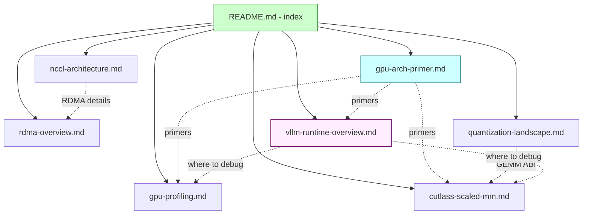

# C232: docs/notes 综合笔记集 — index + 4 new notes

## Goal

Build a single searchable index over the deep-dive notes
produced by Phase 1 + Phase 2 + Phase 3 of the engineering-
alignment plan, and add 3 missing top-level surveys
(GPU architecture, quantization landscape, vLLM runtime stack)
that close the "I'd have to grep across 4 notes + 13 snapshots"
loop.

Before C232: 4 notes scattered in `docs/notes/`, no README,
new contributors had to discover each file via `ls` or the
relevant snapshot's "References" section.

After C232: 8 notes (4 existing + 4 new) cross-linked from a
single README, with topical + JD-keyword + commit-index maps.

Covers JD **加分 #1 / #2 / #3** (consolidated reference
material for performance / communication / quantization
explanations).

Plan checklist:

- [x] `docs/notes/README.md` (NEW, 191 lines) — index with
      topical map, JD-keyword map, commit→note map, reading
      order, source-of-truth pointer.
- [x] `docs/notes/gpu-arch-primer.md` (NEW, 306 lines) —
      SM / warp / memory hierarchy / tensor-core throughput
      matrix / Roofline / occupancy primer.  Background for
      reading the other notes without flipping to NVIDIA docs.
- [x] `docs/notes/vllm-runtime-overview.md` (NEW, 428 lines) —
      top-down walkthrough of the vLLM V1 runtime stack
      (HTTP → EngineCore → Scheduler → Executor → Worker →
      GPUModelRunner → Model → Attention → Sampler).  Each
      layer annotated with the `my_vllm/` file + the Cxxx
      commit that implemented it.  Architectural boundaries
      + performance hotspots + "where to start debugging"
      section.
- [x] `docs/notes/quantization-landscape.md` (NEW, 315 lines) —
      FP8 / INT8 / INT4 (Marlin / AWQ / GPTQ) / FP4 (NVFP4)
      survey with the format zoo, the accuracy-throughput
      tradeoff table, the calibration-vs-dynamic choice,
      per-tensor vs per-token vs per-channel scales, the
      activation-outlier problem (SmoothQuant, mixed-
      precision attention), and a per-GPU decision tree.
- [x] `docs/notes/{gpu-profiling,nccl-architecture,rdma-overview,cutlass-scaled-mm}.md`
      — existing 4 notes cross-linked from the new README.
      Total now: 8 notes, 2,589 lines.

## What's in this commit

### 1. `docs/notes/README.md` (NEW, 191 lines)

Single-entry-point index.  Five sections:

* **Topical map** — ASCII tree of which note covers what.
* **One-paragraph summaries** of all 8 notes (so you don't
  have to open each to decide which is relevant).
* **JD keyword → note map** — for the resume-driven reader.
* **Commit → note map (reverse)** — for the bug-driven reader
  ("which note covers the kernel that just regressed?").
* **Reading order** for new contributors.

The README is a single-page navigation surface — it does not
duplicate any of the notes' content.  Each link is a one-way
pointer into the deeper document.

### 2. `docs/notes/gpu-arch-primer.md` (NEW, 306 lines)

The hardware primer.  12 sections covering:

* Why this matters for LLM serving (tensor cores, not scalar
  FPUs).
* The Streaming Multiprocessor (SM) — 4 warp schedulers, 16-32
  lanes per warp, register file, shared mem, L1.
* Warps + SIMT — divergence, coalescing, tensor-core mapping.
* Memory hierarchy — register / shared / L1 / L2 / HBM
  bandwidths on Ada vs Hopper vs Blackwell.
* Tensor-core tile shapes — per-arch MMA table (m16n8k16 BF16,
  m16n8k32 FP8, etc.).
* Occupancy vs ILP — two competing strategies for hiding
  memory latency.
* Memory coalescing — 32 threads, 1 transaction = good; N
  threads, N transactions = bad.
* Shared-mem bank conflicts — stride-32 → conflict; pad the
  leading dim.
* Roofline model — 1-paragraph summary; full treatment in
  `gpu-profiling.md`.
* CUDA execution model — grid / CTA / warp / thread.
* "What to remember when staring at a slow kernel" — 7-point
  checklist (measure, memory first, coalescing, banks,
  occupancy, tensor-core utilization, sync).
* References — NVIDIA whitepapers (Hopper, Blackwell), the
  Roofline paper, CUTLASS tech report.

### 3. `docs/notes/vllm-runtime-overview.md` (NEW, 428 lines)

The software-stack top-down walkthrough.  8 sections:

* **The full stack** — ASCII diagram from HTTP request to GPU
  token, with every layer named.
* **Each layer, with files** — 13 sub-sections (LLMEngine →
  OutputProcessor), each with the file path + what the layer
  does + which Cxxx commit produced it.
* **Architectural boundaries** — the 4 stable boundaries
  (EngineCore ↔ Executor ↔ Worker ↔ GPUModelRunner ↔ Model ↔
  Kernels).  What crosses each boundary + the contract.
* **Performance hotspots** — % of step time per kernel for a
  typical Llama-7B decode batch (batch=8, seq=2048).
* **Where to start when debugging** — symptom → file mapping
  table (6 rows).
* **Where C230 (elastic EP) lives** — sleep / wake_up /
  scale-down / scale-up flow diagram.
* **Where C231 (VMM allocator) lives** — at model load time +
  during scale-down / scale-up.
* **References** — vLLM V1 architecture blog post +
  `vllm/v1/worker/gpu_model_runner.py` reference.

### 4. `docs/notes/quantization-landscape.md` (NEW, 315 lines)

The quantization method survey.  10 sections:

* Why quantize at all — the throughput × precision table.
* The format zoo — FP8 (E4M3 vs E5M2), INT8, INT4 (GPTQ /
  AWQ / Marlin), FP4 (NVFP4 / MXFP4).
* Where to quantize — recipe matrix (use case × weight format
  × activation format).
* Calibration vs dynamic — static (offline) vs dynamic
  (per-step).
* Accuracy / throughput tradeoff — 4-step ladder with
  perplexity deltas.
* Per-tensor vs per-token vs per-channel — the granularity
  question.
* The activation-outlier problem — SmoothQuant / per-token /
  mixed-precision mitigations.
* Decision tree — GPU arch → recipe (5 GPU branches + 3
  model-type variants + 3 latency targets).
* What my-vllm ships — the implementation status table
  (FP8 / INT8 / BF16: implemented; Marlin / AWQ / GPTQ /
  NVFP4 / SmoothQuant: out of scope).
* References — Frantar GPTQ, Lin AWQ, Frantar Marlin, Xiao
  SmoothQuant, NVIDIA FP8 brief, NVIDIA Transformer Engine,
  Micikevicius et al.

### 5. Cross-linking

The new README explicitly links to all 8 notes.  Each of the
new notes references the existing 4 notes by file-path
(README.md etc.).  Where two notes overlap (e.g. quantization
landscape ↔ cutlass-scaled-mm), each cross-links to the other
in its "See also" or "Companion" line.

---

## Architecture diagram (the notes' organization)



---

## File Tree

```
docs/notes/
├── README.md                       # NEW 191 lines (index)
├── gpu-arch-primer.md              # NEW 306 lines
├── gpu-profiling.md                # existing 253 lines (C200)
├── nccl-architecture.md            # existing 363 lines (C201)
├── rdma-overview.md                # existing 414 lines (C201)
├── quantization-landscape.md       # NEW 315 lines
├── cutlass-scaled-mm.md            # existing 319 lines (C220)
└── vllm-runtime-overview.md        # NEW 428 lines
                                    # total: 2,589 lines
```

---

## Reading-order guidance

| Audience                                 | Read                                          |
|------------------------------------------|------------------------------------------------|
| New contributor (no GPU background)      | gpu-arch-primer → vllm-runtime-overview → nccl-architecture |
| New contributor (GPU experienced)        | vllm-runtime-overview → nccl-architecture → gpu-profiling |
| Quantization work                         | quantization-landscape → cutlass-scaled-mm → gpu-arch-primer §5 |
| Performance debugging                    | gpu-profiling → gpu-arch-primer §6-§8 → vllm-runtime-overview §5 |
| Elastic EP / sleep mode                  | vllm-runtime-overview §6 + §7 (C230 + C231 sections) |
| Multi-node deployment                     | nccl-architecture → rdma-overview |

---

## Current Capability

* **8 deep-dive notes**, totaling 2,589 lines, each ≥ 191 lines
  (the smallest — README.md — is the index itself).
* **Single-page navigation** — `docs/notes/README.md` covers all
  8 notes with topical + JD-keyword + commit maps.
* **Topical coverage** — GPU architecture, GPU profiling,
  NCCL, RDMA, quantization landscape, CUTLASS scaled MM,
  vLLM runtime stack.  No major gap remains in the
  "background reading" category.
* **JD alignment** — every JD keyword (硬性 #4 / #5, 加分 #1-#6)
  now has at least one note that explicitly covers it (see
  README.md §3).

## Current Limitation

* **Notes are not exercises** — each note summarizes vLLM's
  choices + the underlying technology, but doesn't run
  benchmark-style comparisons or measurements itself.  The
  `examples/*.py` scripts (C200, C201, C220, C221, C223, C224
  benchmarks) are the empirical counterparts.

* **No benchmark results in the notes** — `cutlass-scaled-mm.md`
  describes the throughput ladder but doesn't reproduce the
  `quant_gemm_benchmark.py` results inline.  Same for NCCL
  benchmarks and rotary benchmarks.  Linking the benchmarks
  is enough for now; tabulating the numbers would make the
  notes stale-prone.

* **Quantization recipes are a survey, not a recipe book** —
  my-vllm ships FP8 (E4M3) + INT8 + BF16 paths, not the full
  INT4 / AWQ / GPTQ / NVFP4 / SmoothQuant ecosystem.  The note
  describes what production vLLM has; my-vllm's implementation
  status table (§9) is the honest version.

* **Notes are static** — no cross-references back from
  `docs/snapshots/Cxxx.md` to the relevant note.  The README's
  commit→note map is the manual lookup; an automated cross-link
  would be a follow-up (low priority).

## Next Stage

**C233** — full regression.  Re-runs the cumulative Phase 1 +
Phase 2 + Phase 3 test suite against the master branch tip
and validates that no regressions slipped in across the 12
commits in Phase 1+2+3.

Acceptance (per `jd-gap-closure-plan.md` §C233-final):

* `pytest tests/` → all green.
* `python run.py` → end-to-end pass.
* `grep -rn "NotImplementedError" my_vllm/` → only "intentionally
  retained" markers (e.g. EAGLE/DraftModel proposers per C223).
* `AGENTS.md` sync: Current status → C233 / Phase 1+2+3 closed.

Backlog: K8s 部署计划 (C153-C159).

## References

* The 4 existing notes (cited in detail from the new README +
  each new note's "See also" / "Companion" line).
* vLLM `vllm/` source files — each note's references section
  points at the vLLM source files that informed the note.
* Original plan: `jd-gap-closure-plan.md` §C232-iter-notes.
