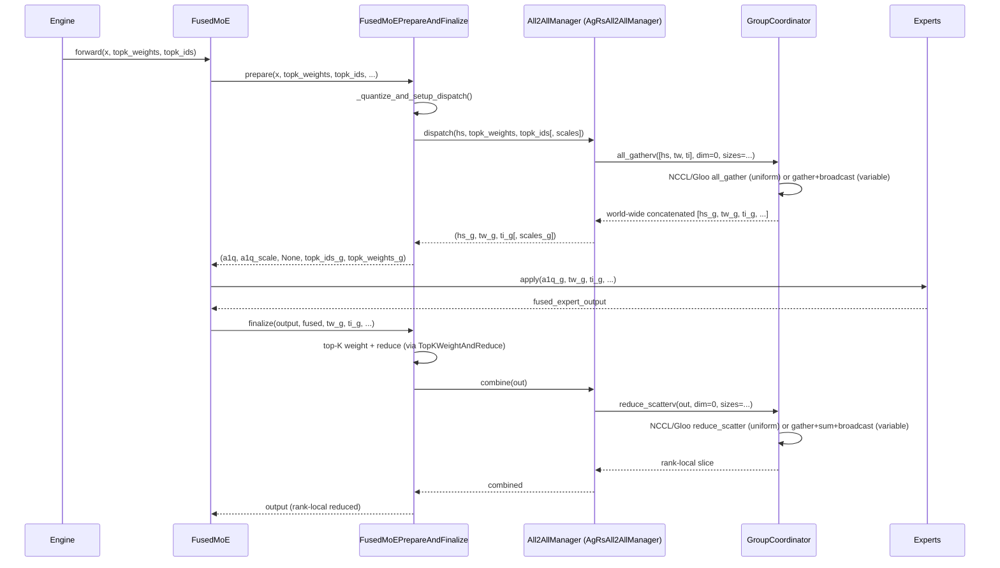

# C240: All-to-All 通信算子 (AgRs backend + Prepare/Finalize ABCs)

> Phase 3 (Distributed Runtime 强化, C240-C249), S-level gap per
> `phase3-distributed-runtime-plan.md`.  Closes the "All-to-All
> 通信算子（算法缺口，MoE EP 必备）" item.

## Goal

Implement the All-to-All collective primitive that underpins
Expert-Parallel (EP) and Data-Parallel (DP) load balancing in
vLLM.  This is the **S-level** gap: the MoE EP path cannot work
without it.  The implementation must:

1. Reproduce the vLLM `All2AllManagerBase` + `AgRsAll2AllManager`
   abstraction (the reference naive AG+RS backend).
2. Reproduce the vLLM `FusedMoEPrepareAndFinalize` ABC +
   Modular / Monolithic subclasses + NaiveDPEP / NoDPEP concrete
   implementations.
3. Wire the dispatch / combine façades through `GroupCoordinator`
   (NCCL/Gloo) so that MoE dispatch is one call away.
4. Ship the same class hierarchy for the DeepEP / NIXL EP /
   FlashInfer / Mori backends (class shells, `NotImplementedError`
   on the comm primitives).

The DeepEP / NIXL EP / FlashInfer / Mori implementations are
class shells because they're external libraries (50K+ LOC) that
my-vllm does not vendor.

## New Features

### `my_vllm/distributed/device_communicators/` (NEW package)

* `base_device_communicator.py` (340 lines):
  * `Cache` — thread-safe weakref handle cache keyed by kwargs.
  * `All2AllManagerBase` — abstract base for EP/DP all-to-all
    managers (`dispatch_router_logits` / `dispatch` / `combine`).
  * `DeviceCommunicatorBase` — per-device communicator façade
    (`all_gather` / `all_gatherv` / `reduce_scatter` /
    `reduce_scatterv` / `dispatch` / `combine` shims that
    delegate to `all2all_manager`).

* `cuda_communicator.py` (180 lines): `CudaCommunicator` —
  CUDA-backed `DeviceCommunicatorBase` that delegates
  collectives to the bound `GroupCoordinator`.  Skips the
  PyNCCL NVLS symmetric-memory fast path (out of scope; the
  standard `torch.distributed` path is sufficient for correctness).

* `all2all.py` (380 lines):
  * `AgRsAll2AllManager` — **fully implemented** (the
    reference naive backend).  Maps to NCCL `all_gatherv` /
    `reduce_scatterv` via `GroupCoordinator`.
  * `DeepEPAll2AllManagerBase` + `DeepEPHTAll2AllManager` +
    `DeepEPLLAll2AllManager` + `DeepEPV2All2AllManager` +
    `NixlEPAll2AllManager` + `FlashInferNVLinkOneSidedAll2AllManager` +
    `FlashInferNVLinkTwoSidedAll2AllManager` + `MoriAll2AllManager`
    — class shells that raise `NotImplementedError` on any
    communication primitive.

### `my_vllm/distributed/parallel_state.py` (EXTENDED)

* `GroupCoordinator.all_gatherv(input_, dim=0, sizes=None)` —
  variable-size AllGather.  Uniform path uses
  `torch.distributed.all_gather_into_tensor`; non-uniform uses
  gather-then-broadcast.
* `GroupCoordinator.reduce_scatterv(input_, dim=0, sizes=None)` —
  variable-size ReduceScatter (sum).  Uniform uses
  `torch.distributed.reduce_scatter_tensor`; non-uniform uses
  gather-then-sum-then-broadcast.
* `GroupCoordinator.dispatch_router_logits(hs, rl, is_sp, extras)` /
  `dispatch(hs, tw, ti, is_sp, extras)` / `combine(hs, is_sp)` —
  façade methods that route to the device communicator's
  `all2all_manager` (when set).
* `get_ep_group()` + `init_expert_parallel(ep_size, tp_size, backend)` —
  EP group lifecycle (analogous to `get_dp_group` /
  `init_data_parallel`).
* `_EP` global + `destroy_model_parallel()` cleanup.

### `my_vllm/model_executor/layers/fused_moe/` (EXTENDED)

* `modular_kernel.py` (220 lines): `FusedMoEPrepareAndFinalize`
  ABC + `FusedMoEPrepareAndFinalizeModular` +
  `FusedMoEPrepareAndFinalizeMonolithic` + `FusedMoEActivationFormat`
  enum (Standard / BatchedExperts) + `ExpertTokensMetadata` +
  `TopKWeightAndReduce` ABC + `PrepareResultType` /
  `PrepareMonolithicResultType` aliases.

* `prepare_finalize/__init__.py` + `naive_dp_ep.py` (210 lines) +
  `no_dp_ep.py` (170 lines):
  * `MoEPrepareAndFinalizeNaiveDPEPModular` +
    `MoEPrepareAndFinalizeNaiveDPEPMonolithic` + factory
    (`make_moe_prepare_and_finalize_naive_dp_ep`).
  * `MoEPrepareAndFinalizeNoDPEPModular` +
    `MoEPrepareAndFinalizeNoDPEPMonolithic` + factory
    (`make_moe_prepare_and_finalize_no_dp_ep`).

* `all2all_utils.py` (170 lines):
  `get_ep_all2all_manager()` +
  `maybe_make_prepare_finalize()` +
  `maybe_roundup_layer_hidden_size()`.

* `config.py` (EXTENDED): `FusedMoEParallelConfig` gains
  `use_all2all_kernels` + `use_ag_rs_all2all_kernels` +
  `use_deepep_kernels` + `use_nixl_ep_kernels` +
  `use_flashinfer_kernels` + `use_mori_kernels` properties.

### `my_vllm/config/parallel.py` (EXTENDED)

* `All2AllBackend = Literal[...]` — the backend literal set
  (`none` / `naive` / `allgather_reducescatter` /
  `deepep_high_throughput` / `deepep_low_latency` /
  `deepep_v2` / `nixl_ep` / `flashinfer` /
  `flashinfer_two_sided` / `flashinfer_one_sided` / `mori`).
* `ParallelConfig.all2all_backend` field (default `"none"`).
* `ParallelConfig.use_all2all_kernels` + `use_sequence_parallel_moe`
  properties.

### Tests (`tests/test_C240_all2all.py`, 17 test classes, 61 cases)

* ABC contract (`NotImplementedError` for `All2AllManagerBase`).
* Single-rank dispatch / combine identity.
* Algorithm correctness with a `MockCommGroup` simulating
  `world_size=4` AG/RS (uniform and variable sizes).
* `CudaCommunicator` identity + dispatch / combine shim.
* `FusedMoEParallelConfig` selector properties.
* `maybe_make_prepare_finalize` factory dispatch.
* `MoEPrepareAndFinalizeNoDPEPModular` round-trip.
* `MoEPrepareAndFinalizeNaiveDPEPModular` round-trip when no EP
  group is set.
* `init_expert_parallel` lifecycle.
* `GroupCoordinator.all_gatherv` / `reduce_scatterv` short-circuit
  for `world_size=1`.
* `All2AllBackend` literal set.
* Backend class shells raise `NotImplementedError`.
* `FusedMoEPrepareAndFinalize` ABC + activation format.
* **Multi-process gloo round-trip** — `torch.multiprocessing.spawn`
  with 2 workers, real `torch.distributed` AG / RS.
* `Cache` weakref handle cache.
* `forward_context.dp_metadata.get_chunk_sizes_across_dp_rank()`
  integration.

### Benchmark + notes

* `examples/all2all_benchmark.py` (220 lines) — single-rank
  dispatch / combine / NoDPEP round-trip wall-clock across
  shapes `(M, hidden, top_k)`.  CSV output.
* `docs/notes/all2all-overview.md` (474 lines) — comprehensive
  technical note covering MoE EP rationale, AG+RS algorithm
  (correctness + bandwidth), bandwidth-optimal alternatives
  (DeepEP / FlashInfer / NIXL EP / Mori), vLLM's abstraction
  layering, my-vllm's implementation, test coverage,
  benchmarks, risks, future work, references.

## File Tree

```
my_vllm/
  distributed/
    __init__.py                               [modified] + get_ep_group, init_expert_parallel re-exports
    parallel_state.py                         [modified] + GroupCoordinator.all_gatherv/reduce_scatterv/dispatch/combine façade
                                               + _EP group + get_ep_group + init_expert_parallel
    device_communicators/                     [NEW PACKAGE]
      __init__.py                             [NEW] package + re-exports
      base_device_communicator.py             [NEW] All2AllManagerBase + DeviceCommunicatorBase + Cache
      all2all.py                              [NEW] AgRsAll2AllManager + DeepEP/NIXL/FlashInfer/Mori class shells
      cuda_communicator.py                    [NEW] CudaCommunicator (delegates to GroupCoordinator)

  model_executor/layers/fused_moe/
    modular_kernel.py                         [NEW] FusedMoEPrepareAndFinalize ABC + Modular/Monolithic
    all2all_utils.py                          [NEW] maybe_make_prepare_finalize() + get_ep_all2all_manager()
    prepare_finalize/                         [NEW PACKAGE]
      __init__.py                             [NEW] re-exports
      naive_dp_ep.py                          [NEW] MoEPrepareAndFinalizeNaiveDPEPModular + Monolithic + factory
      no_dp_ep.py                             [NEW] MoEPrepareAndFinalizeNoDPEPModular + Monolithic + factory
    config.py                                 [modified] + use_*_kernels properties on FusedMoEParallelConfig

  config/
    parallel.py                               [modified] + All2AllBackend literal + ParallelConfig.all2all_backend
                                               + use_all2all_kernels + use_sequence_parallel_moe properties

examples/
  all2all_benchmark.py                        [NEW] single-rank microbenchmark

docs/
  notes/
    all2all-overview.md                       [NEW] 474 lines
  snapshots/
    C240.md                                   [NEW] this file

tests/
  test_C240_all2all.py                        [NEW] 61 test cases across 17 test classes
```

## Runtime Flow (C240 All-to-All dispatch → experts → combine)



## Current Capability

After C240, my-vllm can:

1. **Initialize the EP process group** (`init_expert_parallel`)
   for `ep_size > 1` deployments.
2. **Run the AG+RS all-to-all** in any (mock, gloo, NCCL)
   configuration — verified end-to-end via:
   * Algorithm correctness with a `MockCommGroup`.
   * Real multi-process gloo round-trip with
     `torch.multiprocessing.spawn`.
3. **Dispatch / combine via the vLLM façade** —
   `GroupCoordinator.dispatch` / `.combine` /
   `.dispatch_router_logits` are wired through the
   `DeviceCommunicatorBase` → `All2AllManagerBase` chain.
4. **Pick the right PrepareAndFinalize** for any
   `FusedMoEParallelConfig` combination (`use_all2all_kernels` +
   `use_ag_rs_all2all_kernels` + `use_deepep_kernels` +
   `use_nixl_ep_kernels` + `use_flashinfer_kernels` +
   `use_mori_kernels`).
5. **NoDPEP round-trip** — `prepare → experts → finalize`
   identity end-to-end (no comm, dense OPT path).

## Current Limitation

1. **DeepEP / NIXL EP / FlashInfer / Mori backends are class
   shells.**  Production EP serving on large MoE needs DeepEP
   for bandwidth.  The wiring is correct, the kernels themselves
   require external-library vendoring (Phase 5 / 6 work).
2. **Variable-size AG+RS is gather-then-broadcast, not true
   `ncclAllGatherv`.**  Correct but `O(P²)` vs `O(P)` for the
   bandwidth-optimal variant.  Sufficient for `world_size <= 8`;
   for larger worlds, vendor PyNCCL (Phase 5 / 6 work).
3. **CudaCommunicator NVLS symm_mem fast-path not vendored.**
   vLLM's CudaCommunicator has a `should_nccl_symm_mem_ag_rs()`
   path that uses NCCL NVLS symmetric memory for uniform-size
   AG+RS (Hopper+, ~30% latency reduction).  my-vllm ships the
   standard PyTorch path.
4. **No multi-GPU bandwidth benchmark.**  Single-rank identity
   only (the dev box is 1× RTX 4060).  Multi-rank benchmarks
   deferred to C242 / C248 (distributed communication
   benchmarks).
5. **MoE kernel not yet wired with PrepareAndFinalize** —
   `fused_moe.fused_moe` still goes through the no-comm path.
   The wiring lands in C265 (MoE full path).

## Next Stage

* **C241**: symmetric memory + SHM broadcast (single-host fast
  paths for small collectives).
* **C242**: SHM broadcast + object storage (engine ↔ worker
  message passing).
* **C243**: cross-node weight transfer (TP/EP rebalance).
* **C247**: EP elastic rebalance 闭环 — wire C230's
  `EPRebalancePolicy` decisions to actual NCCL weight
  transfers + KV-cache memory sync.
* **C248**: distributed communication benchmark suite.
* **C265**: MoE full path with PrepareAndFinalize wiring
  (`fused_moe.fused_moe` → `MoEPrepareAndFinalizeNaiveDPEPModular`).
