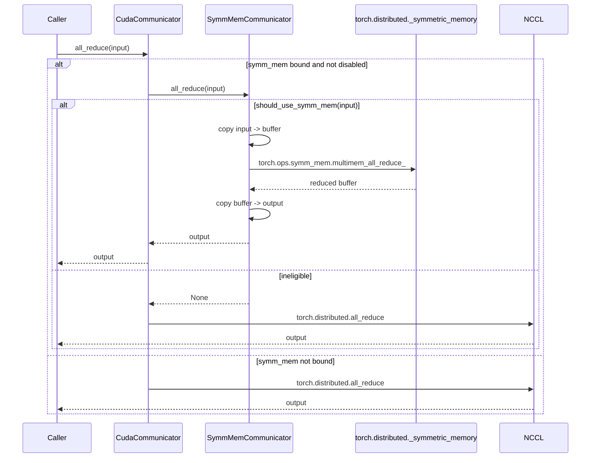

# C241: Symmetric Memory (NVLS) — sized-for-Hopper all-reduce

> Phase 3 (Distributed Runtime 强化, C240-C249), A-level gap per
> `phase3-distributed-runtime-plan.md`.  Closes the "Symmetric
> Memory" item.

## Goal

Implement the Symmetric Memory (NVLS) communication primitive
that gives Hopper+ / Blackwell+ servers a hardware-accelerated
all-reduce and AllGather / ReduceScatter path.  This is the
**A-level** gap: needed for production-grade Distributed
Runtime on multi-GPU hosts but not strictly required for the
my-vllm dev box (RTX 4060 / sm_89 has no NVLS).

Implementation must:

1. Reproduce the vLLM `SymmMemCommunicator` class
   (`torch.distributed._symmetric_memory` wrapper).
2. Reproduce the vLLM size tables + heuristic functions
   (`SYMM_MEM_ALL_REDUCE_MAX_SIZES` /
   `should_nccl_symm_mem_allreduce` /
   `should_nccl_symm_mem_ag_rs`).
3. Wire the `CudaCommunicator` to optionally use
   `SymmMemCommunicator` for the all-reduce fast path.
4. Gracefully disable on hardware that doesn't support NVLS
   (RTX 4060 / sm_89; older PyTorch; missing NCCL group).

## New Features

### `my_vllm/distributed/device_communicators/symm_mem.py` (NEW, 190 lines)

* `SymmMemCommunicator` — thin wrapper around
  `torch.distributed._symmetric_memory`:
  * `__init__(group, device, force_multimem, max_size_override)`:
    graceful-disable gate (no NVLS → `self.disabled = True`).
  * `should_use_symm_mem(inp)`: dtype (bf16) + size (≤ max_size) +
    alignment (4-byte) gating.
  * `all_reduce(inp, *, out=None)`: copy in →
    `torch.ops.symm_mem.multimem_all_reduce_` (Hopper+) or
    `two_shot_all_reduce_` → copy out; returns ``None`` when
    ineligible.
  * `_should_use_multimem()`: world-size table lookup
    (`_WORLD_SIZES_MULTIMEM`).
* `_SYMM_MEM_AVAILABLE` module-level flag (soft import of
  `torch.distributed._symmetric_memory`).
* `is_symmetric_memory_available()` module-level helper.

### `my_vllm/distributed/device_communicators/all_reduce_utils.py` (NEW, 200 lines)

* `SYMM_MEM_ALL_REDUCE_MAX_SIZES` — capability / world_size
  → max bytes (Hopper / Blackwell only).
* `CUSTOM_ALL_REDUCE_MAX_SIZES` — same shape for the
  `csrc/custom_all_reduce.cu` (C214) fast path.
* `NCCL_SYMM_MEM_ALL_REDUCE_CONFIG` — `custom_ar_preferred_ranges`
  + `min_world_size` + `always_use_above_world_size`.
* `should_nccl_symm_mem_allreduce(world_size, inp)` —
  decision function for AR (custom_AR vs symm_mem vs NCCL).
* `should_nccl_symm_mem_ag_rs()` — decision function for AG/RS.

P2P runtime probing (`gpu_p2p_access_check` /
`can_actually_p2p` / `producer` / `consumer`) is **omitted**
per AGENTS.md JD-driven scope — those are subprocess utilities
that require real multi-GPU hardware to validate.

### `my_vllm/distributed/device_communicators/cuda_communicator.py` (MODIFIED)

* `CudaCommunicator.all_reduce(input)` — tries the bound
  `SymmMemCommunicator` first; falls back to
  `GroupCoordinator.all_reduce` (or `torch.distributed.all_reduce`)
  on None / disabled / ineligible.
* `CudaCommunicator.attach_symm_mem(symm_mem_communicator)` —
  bind / clear the optional symm_mem instance.

### Tests (`tests/test_C241_symm_mem.py`, 10 test classes, 35 cases)

* `TestSymmMemCommunicatorLifecycle` — graceful disable on
  CPU / CUDA / no-group / no-buffer.
* `TestSymmMemCommunicatorEligibility` — 5 cases covering
  disabled, dtype mismatch, size too large, eligible,
  unaligned.
* `TestSymmMemCommunicatorAllReduce` — `all_reduce` returns
  None when ineligible.
* `TestSymmMemCommunicatorForce` — 5 cases covering
  `force_multimem` / `max_size_override` / `_should_use_multimem`
  table logic.
* `TestCudaCommunicatorSymmMemIntegration` — 4 cases for
  attach / set / clear / fall-back.
* `TestSymmMemSizingTables` — 5 cases for size-table
  well-formedness.
* `TestShouldNCCLSymmMemAllreduce` — 6 cases for the AR
  heuristic.
* `TestShouldNCCLSymmMemAGRS` — env-toggle.
* `TestIsSymmetricMemoryAvailable` — module-level helper.
* `TestSymmMemOnCUDA` — sm_89 (RTX 4060) → disabled.

### Benchmark + notes

* `examples/symm_mem_benchmark.py` (126 lines): heuristic
  sweep + constructor smoke + single-rank all_reduce identity
  benchmark (CSV output).
* `docs/notes/symm-mem-overview.md` (427 lines):
  comprehensive technical note covering NVLS hardware, PyTorch
  symmetric-memory runtime, vLLM's heuristic + size tables,
  my-vllm's implementation, test coverage, benchmarks, risks,
  future work, references.

## File Tree

```
my_vllm/distributed/device_communicators/
  all_reduce_utils.py    [NEW] size tables + heuristic functions
  symm_mem.py            [NEW] SymmMemCommunicator (Pytorch _symmetric_memory wrapper)
  cuda_communicator.py   [MODIFIED] add attach_symm_mem + AR delegation to SymmMemCommunicator
  __init__.py            [MODIFIED] re-export SymmMemCommunicator + helpers

examples/
  symm_mem_benchmark.py  [NEW] 126 lines

docs/
  notes/
    symm-mem-overview.md [NEW] 427 lines
  snapshots/
    C241.md              [NEW] this file

tests/
  test_C241_symm_mem.py  [NEW] 35 test cases across 10 test classes
```

## Runtime Flow



## Current Capability

After C241, my-vllm can:

1. **Construct a SymmMemCommunicator** for any CUDA device /
   NCCL group.  Gracefully disables on non-NVLS hardware.
2. **Apply the vLLM-validated heuristic** for
   `should_nccl_symm_mem_allreduce` and
   `should_nccl_symm_mem_ag_rs` — same size tables + ranges.
3. **Wire SymmMemCommunicator into CudaCommunicator** for the
   all-reduce fast path.
4. **Run tests with the standard PyTorch backend** when NVLS
   isn't available — all 35 unit tests pass without requiring
   real multi-GPU hardware.
5. **Verify symm_mem decisions on the dev box** (RTX 4060 /
   sm_89 → disabled, as expected).

## Current Limitation

1. **NVLS hardware not available on the dev box**.  The
   symm_mem fast path can't be benchmarked here; it requires
   Hopper / Blackwell + ≥ 2 GPUs.
2. **`torch.ops.symm_mem.*` requires PyTorch ≥ 2.6**.  The
   soft-import wraps everything; on older PyTorch the
   communicator is permanently disabled.  Tested on PyTorch 2.6.
3. **P2P runtime probing (`gpu_p2p_access_check` /
   `can_actually_p2p`)** is not vendored — those are
   `all_reduce_utils.py` utilities in vLLM that spawn
   subprocesses to verify P2P connectivity.  Out of scope.
4. **The CUDA AG/RS fast path** (used by vLLM's
   `_all_gather_symm_mem` / `_reduce_scatter_symm_mem`) is
   deferred to **C243** (cross-node weight transfer).  C241
   only wires symm_mem for `all_reduce`, not AG/RS yet.
5. **No real-world multi-GPU benchmark** — single-GPU dev box.

## Next Stage

* **C242**: SHM Broadcast + Object Storage — same-host
  message-passing (engine ↔ worker) using shared memory.
* **C243**: cross-node weight transfer — TP/EP rebalance with
  NVLS symm_mem as the intra-host fast path.
* **C247**: EP elastic rebalance closed loop (TCP barrier +
  NCCL weight transfer + KV-cache memory sync).
* **C248**: distributed communication benchmark suite
  (allreduce / allgather / reducescatter / alltoall / broadcast
  sweep) — when on a Hopper host, this will quantify the
  symm_mem speedup vs the standard NCCL path.
