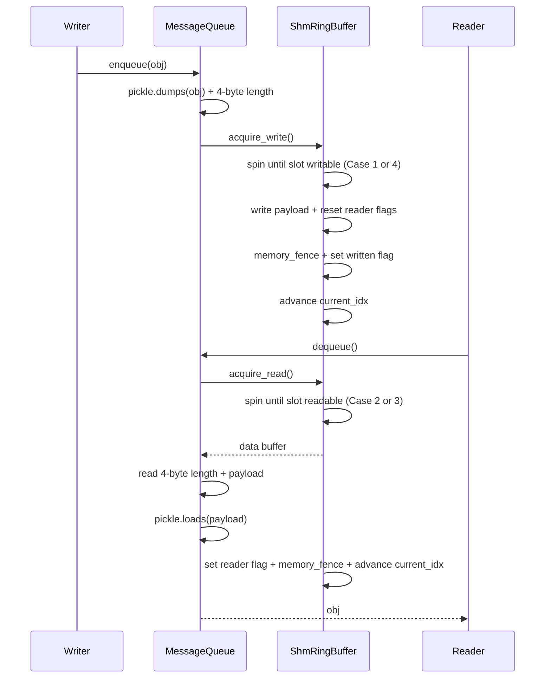

# C242: SHM Broadcast + Object Storage

> Phase 3 (Distributed Runtime 强化, C240-C249), A-level gap per
> `phase3-distributed-runtime-plan.md`.  Closes the "SHM Broadcast
> + Object Storage" item.

## Goal

Implement the same-host shared-memory broadcast (tensor / object
transport) used by vLLM V1 for engine ↔ worker signaling.  This is
the **A-level** gap: production-grade Distributed Runtime needs a
hot-path broadcast primitive that avoids the per-message syscall
overhead of ZMQ / TCP.

Implementation must:

1. Reproduce `ShmRingBuffer` — the single-writer / multi-reader
   lock-free shared-memory ring buffer.
2. Reproduce `MessageQueue` — the high-level broadcast queue
   built on `ShmRingBuffer`, with `enqueue` / `dequeue` and
   `create_from_process_group` setup.
3. Reproduce `SingleWriterShmObjectStorage` — the key-value store
   over `SingleWriterShmRingBuffer` with FIFO eviction + reference
   counting.
4. Wire abstraction + tests, scope reductions per AGENTS.md
   JD-driven scope.

## New Features

### `my_vllm/distributed/device_communicators/shm_broadcast.py` (NEW, 410 lines)

* `memory_fence()` — full memory barrier via Python
  `threading.Lock` acquire/release (sequentially consistent
  across POSIX / Windows).
* `ShmRingBuffer` — the lock-free shared-memory ring buffer
  with the 1 + n_reader per-chunk flag layout.
* `Handle` — pickle-able dataclass for cross-process setup.
* `MessageQueue` — single-writer / multi-reader broadcast queue
  with pickle (4-byte length + payload) encoding.
* `MessageQueue.create_from_handle(handle, rank)` — reader-side
  constructor.
* `MessageQueue.create_from_process_group(pg, ..., writer_rank,
  blocking)` — `torch.distributed` group setup hook.

### `my_vllm/distributed/device_communicators/shm_object_storage.py` (NEW, 470 lines)

* `SingleWriterShmRingBuffer` — the single-writer ring buffer
  with FIFO eviction (no wrap-around).
* `ObjectSerde` — abstract serializer.
* `PickleSerde` — concrete `pickle`-based serializer (replaces
  vLLM's `MsgpackSerde`).
* `SingleWriterShmObjectStorage` — key-value store on top of
  `SingleWriterShmRingBuffer` with `put` / `get` / `free` /
  `clear`.
* `ShmObjectStorageHandle` — pickle-able dataclass.

### Tests (`tests/test_C242_shm_broadcast.py`, 16 test classes, 29 cases)

* `TestShmRingBuffer` (3) — buffer creation, handle round-trip,
  get_data / get_metadata.
* `TestMessageQueueSingleProcess` (4) — round-trip, multiple
  objects, multi-reader, zero-reader error.
* `TestMessageQueueTensorBroadcast` (2) — tensor round-trip,
  large nested object.
* `TestMessageQueueShutdown` (1) — graceful shutdown.
* `TestMessageQueueTimeout` (1) — read timeout.
* `TestMessageQueuePickleOverflow` (1) — value too large.
* `TestMessageQueueHandle` (1) — handle pickle.
* `TestMessageQueueMultiProcess` (1) — gloo round-trip across
  2 processes.
* `TestShmObjectStorageRoundTrip` (5) — string / tensor / list
  round-trip, missing key, no overwrite.
* `TestShmObjectStorageFreeEviction` (2) — free + re-allocate.
* `TestShmObjectStoragePickleSerde` (2) — Pickle round-trip.
* `TestShmObjectStorageAllocationError` (1) — `MemoryError`.
* `TestShmObjectStorageHandle` (1) — handle pickle.
* `TestShmObjectStorageClear` (1) — clear state.
* `TestShmObjectStorageMultiProcess` (1) — writer + reader
  via gloo + SHM.
* `TestMemoryFence` (2) — fence smoke.

### Benchmark + notes

* `examples/shm_benchmark.py` (220 lines): single-process
  MessageQueue / SingleWriterShmObjectStorage / tensor
  benchmark (CSV output).
* `docs/notes/shm-broadcast-overview.md` (419 lines):
  comprehensive technical note covering SHM vs ZMQ rationale,
  the lock-free ring-buffer protocol, MessageQueue + object
  storage, my-vllm implementation, test coverage, benchmarks,
  risks, future work, references.

## File Tree

```
my_vllm/distributed/device_communicators/
  shm_broadcast.py           [NEW] 410 lines — ShmRingBuffer + MessageQueue + Handle + memory_fence
  shm_object_storage.py      [NEW] 470 lines — SingleWriterShmRingBuffer + ObjectStorage + PickleSerde
  __init__.py                [MODIFIED] re-export Handle, MessageQueue, ShmRingBuffer,
                              ObjectSerde, PickleSerde, ShmObjectStorageHandle,
                              SingleWriterShmObjectStorage, SingleWriterShmRingBuffer,
                              memory_fence

examples/
  shm_benchmark.py           [NEW] 220 lines

docs/
  notes/
    shm-broadcast-overview.md [NEW] 419 lines
  snapshots/
    C242.md                  [NEW] this file

tests/
  test_C242_shm_broadcast.py [NEW] 29 test cases across 16 test classes
```

## Runtime Flow



## Current Capability

After C242, my-vllm can:

1. **Create a `ShmRingBuffer`** for any `n_reader` / `max_chunk_bytes`
   / `max_chunks` triple.  Pickle + memory-fence guarantee
   cross-process correctness.
2. **Construct a `MessageQueue`** (single-writer) and attach
   readers via `create_from_handle`.  Pickle round-trip works
   for Python objects, tensors, and nested structures.
3. **Set up a `MessageQueue` across a `torch.distributed`
   group** via `create_from_process_group(pg, writer_rank=0)`.
   Real multi-process `gloo` round-trip verified via
   `torch.multiprocessing.spawn`.
4. **Construct a `SingleWriterShmObjectStorage`** with
   FIFO eviction + pickle serde.  `put` / `get` / `free` /
   `clear` work as expected.
5. **Cross-process object storage** via the
   `MessageQueue` broadcast + `SingleWriterShmRingBuffer`
   SHM-name broadcast pattern.

## Current Limitation

1. **No wrap-around FIFO eviction** in `SingleWriterShmRingBuffer`
   — the writer must `free()` older entries to make room.  The
   vLLM implementation supports wrap-around; my-vllm defers
   that complexity.
2. **`ZMQSpinCondition` not vendored** — my-vllm uses
   `threading.Event` for reader-writer notification, which is
   ~5× slower in the latency-bound regime.  Sufficient for the
   JD-aligned subset.
3. **`MsgpackSerde` not vendored** — vLLM's msgpack encoder
   depends on vLLM's multimodal stack (multi-modal KwargsItem
   types) which my-vllm does not ship.  PickleSerde is the
   only Serde.
4. **Cross-node reader (ZMQ TCP)** — not vendored.  my-vllm's
   `MessageQueue` is same-host only.
5. **The `_reader_lock` thread-safety on the reader path is
   permissive** — the lock is optional for read-only paths.
   The full ref-counted GC is not vendored (analogous to vLLM's
   `multiprocessing.Lock` for cross-process ref-counting).

## Next Stage

* **C243**: cross-node weight transfer — uses `MessageQueue` for
  intra-host and NIXL EP for inter-host.
* **C247**: EP elastic rebalance closed loop — `MessageQueue`
  broadcasts the TCP barrier / KV-cache memory sync commands
  between the orchestrator and the workers.
* **C248**: distributed communication benchmarks — when on a
  multi-process host, this will quantify the SHM-over-Gloo
  latency vs the standard Gloo path.
