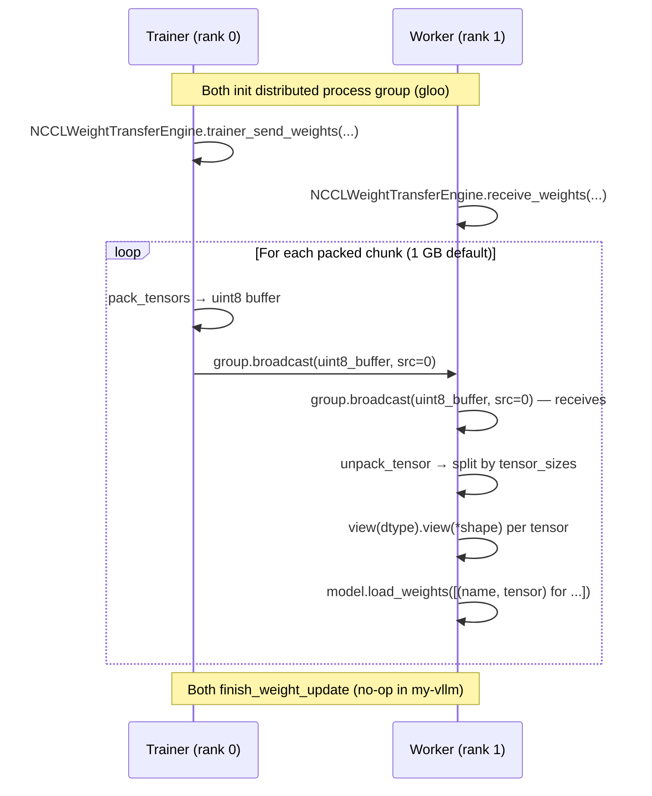

# C243 — 跨节点 Weight Transfer

> Closes the A-level "跨节点 Weight Transfer" gap from
> `phase3-distributed-runtime-plan.md` § Phase 3.
>
> Three backends (NCCL / sparse-NCCL / IPC) + packed-tensor efficiency
> + factory registry + `VLLMWeightSyncClient` Protocol + in-process
> client.  Real vLLM wire-compatible minus pyncsl/StatelessProcessGroup/
> Ray/HTTP/layerwise-reload (all not vendored).

## Goal

Reproduce vLLM's `vllm/distributed/weight_transfer/` package as a
faithful engineering subset, exercising the canonical RLHF trainer→
worker weight sync path on a single RTX 4060 + gloo backend.

Specific deliverables:

1. `WeightTransferConfig` (mirrors `vllm/config/weight_transfer.py`).
2. `WeightTransferEngine` ABC + `TrainerWeightTransferEngine` ABC +
   `VLLMWeightSyncClient` Protocol (`base.py`).
3. Three concrete engines — `NCCLWeightTransferEngine`,
   `SparseNCCLWeightTransferEngine`, `IPCWeightTransferEngine` —
   each implementing `init_transfer_engine` / `receive_weights` /
   `trainer_send_weights` lifecycle.
4. `packed_tensor.py` — pack/unpack + double-buffered NCCL/IPC
   producer/consumer.
5. `factory.py` — `WeightTransferEngineFactory` (lazy-loaded registry,
   3 backends) + `WeightTransferTrainerFactory` (empty, forward-compat).
6. `clients.py` — `InProcessVLLMWeightSyncClient` (the only concrete
   client in my-vllm; Ray/HTTP not vendored).
7. End-to-end multi-process test simulating a TP-rank switch (trainer
   rank 0 + worker rank 1 over gloo).

## New Features

| File | Lines | What |
|---|---|---|
| `my_vllm/config/weight_transfer.py` | 25 | `WeightTransferConfig` dataclass (mirror `vllm/config/weight_transfer.py:9`). |
| `my_vllm/distributed/weight_transfer/__init__.py` | 75 | Re-exports + side-effect registration of 3 engines. |
| `my_vllm/distributed/weight_transfer/base.py` | 350 | `ParamMeta`, `WeightSource`, `ModuleSource`, `materialize_full_tensor`, `WeightTransferInitInfo`, `TrainerInitInfo`, `WeightTransferUpdateInfo`, `WeightTransferEngine` ABC, `TrainerWeightTransferEngine` ABC, `VLLMWeightSyncClient` Protocol. |
| `my_vllm/distributed/weight_transfer/nccl_common.py` | 110 | `NCCLWeightTransferInitInfo`, `stateless_init_process_group` (gloo by default), `worker_init_process_group` (rank calc via `rank_offset`), `trainer_init`. |
| `my_vllm/distributed/weight_transfer/nccl_engine.py` | 295 | `NCCLTrainerSendWeightsArgs`, `NCCLWeightTransferUpdateInfo`, `NCCLWeightTransferEngine`, `_broadcast` adapter (PyNcclCommunicator-style → vanilla fallback). |
| `my_vllm/distributed/weight_transfer/sparse_nccl_engine.py` | 200 | `SparseWeightPatch`, `SparseNCCLWeightTransferUpdateInfo`, `SparseNCCLWeightTransferEngine` (in-place `index_copy_` patches). |
| `my_vllm/distributed/weight_transfer/ipc_engine.py` | 380 | `IPCTrainerSendWeightsArgs` (callable send_mode only), `IPCWeightTransferInitInfo`, `IPCWeightTransferUpdateInfo`, `IPCWeightTransferEngine` (CUDA IPC handle transfer, packed + unpacked modes, multi-rank all-gather-merge). |
| `my_vllm/distributed/weight_transfer/packed_tensor.py` | 345 | `DEFAULT_PACKED_BUFFER_SIZE_BYTES`, `unpack_tensor`, `pack_tensors`, `packed_nccl_broadcast_producer/consumer` (double/triple-buffered), `packed_ipc_producer/consumer` (single reusable IPC buffer + clone-to-break-alias). |
| `my_vllm/distributed/weight_transfer/factory.py` | 130 | `WeightTransferEngineFactory` + `WeightTransferTrainerFactory`, lazy-loaded registry, 3 engine registrations. |
| `my_vllm/distributed/weight_transfer/clients.py` | 60 | `InProcessVLLMWeightSyncClient` (the only concrete client). |
| `tests/test_C243_weight_transfer.py` | 1300 | 16 test classes / 43 cases. |
| `docs/notes/weight-transfer-overview.md` | 569 | Engineering deep-dive (RLHF topology, 3 backends, packed-tensor mechanics, scope reductions, risks, references). |

**Total**: 11 new files (~2,400 lines of code, ~1,300 lines of tests, 569 lines of docs).

## File Tree (post-C243)

```
my_vllm/
├── config/
│   └── weight_transfer.py                [NEW, 25 lines]
├── distributed/
│   ├── weight_transfer/                  [NEW PACKAGE]
│   │   ├── __init__.py                   [NEW, 75 lines]
│   │   ├── base.py                       [NEW, 350 lines]
│   │   ├── nccl_common.py                [NEW, 110 lines]
│   │   ├── nccl_engine.py                [NEW, 295 lines]
│   │   ├── sparse_nccl_engine.py         [NEW, 200 lines]
│   │   ├── ipc_engine.py                 [NEW, 380 lines]
│   │   ├── packed_tensor.py              [NEW, 345 lines]
│   │   ├── factory.py                    [NEW, 130 lines]
│   │   └── clients.py                    [NEW, 60 lines]
│   ├── device_communicators/             [existing — C240/241/242]
│   ├── elastic_ep/                       [existing — C230]
│   ├── kv_transfer/                      [existing]
│   ├── custom_all_reduce.py              [existing — C214]
│   └── parallel_state.py                 [existing]
└── ...

tests/
└── test_C243_weight_transfer.py          [NEW, 1300 lines, 43 cases]

docs/
├── notes/
│   └── weight-transfer-overview.md       [NEW, 569 lines]
└── snapshots/
    └── C243.md                           [NEW — this file]
```

## Runtime Flow



For the sparse backend, the flow is per-parameter
`(indices, values)` broadcast → `flat_param.index_copy_`.

For the IPC backend, the flow is `reduce_tensor` (trainer) →
`rebuild_cuda_tensor` (worker) with packed mode reusing one IPC
buffer across chunks.

## Current Capability

* **3 backends** wireable via `WeightTransferConfig(backend=...)`.
* **Packed mode** for both NCCL and IPC (1 GB double/triple-buffered).
* **Sparse mode** for in-place flat-index patches (RLHF delta sync).
* **Multi-rank IPC** — handles all-gathered across trainer ranks,
  merged per-GPU-UUID so each worker finds its own handle.
* **Multi-process gloo round-trip** — verified end-to-end via
  `torch.multiprocessing.spawn` (TP-rank-switch simulation).
* **In-process client** for tests / co-located deployment.
* **Factory pattern** with lazy loading (CUDA IPC machinery only
  imported when `backend="ipc"`).
* **All 43 tests pass** (16 test classes):
  - config + dataclass semantics (3)
  - `ParamMeta` + `materialize_full_tensor` + `ModuleSource` (6)
  - packed tensor utilities (3)
  - NCCL init info + rank math (3)
  - NCCL receive — unpacked/packed/round-trip/mock-broadcast (3)
  - sparse engine — patch / skip / TP-reject / validation (4)
  - IPC engine — trainer send packed/unpacked/rejection/init/shutdown (5)
  - IPC update info validation (3)
  - factory registry (5)
  - in-process client (1)
  - shutdown (2)
  - multi-process TP-rank-switch end-to-end (1)

## Current Limitation

* **No pynccl / StatelessProcessGroup vendored.** Uses vanilla
  `torch.distributed.broadcast` (no `stream=` parameter).  The
  `_broadcast` helper prefers the PyNcclCommunicator signature when
  available, so future vendoring is a drop-in upgrade.
* **No layerwise reload.** `start_weight_update` /
  `finish_weight_update` are no-ops (would need
  `vllm/model_executor/model_loader/reload`, not vendored).  For
  OPT-125m-sized models the no-op is correct.
* **No Ray / HTTP clients.** my-vllm has no RLHF API server (deleted
  C151).  `IPCTrainerSendWeightsArgs.send_mode` accepts only
  `callable`.
* **No concrete trainer engine.** `TrainerWeightTransferEngine`
  exists as an ABC for API completeness; would need an FSDP /
  Megatron integration to register a concrete subclass.
* **Sparse requires TP=1 / PP=1.** Indices are flat into a single
  full parameter; sharded params would need parallel-aware offsets.
* **TP-rank-switch test is single-node.** The `torch.multiprocessing.spawn`
  test uses 2 ranks over gloo on one host.  Real cross-node switch
  (C247) requires `ElasticEPScalingState` integration.

## Next Stage

Per `phase3-distributed-runtime-plan.md`:

* **C244** — Quick AllReduce + FlashInfer AllReduce notes (B-level).
* **C245** — Async Scheduler (A-level).
* **C246** — Scheduler 资源感知 / KV-aware scheduling (A-level).
* **C247** — EP 弹性 rebalance 闭环 (A-level) — will wire
  `NCCLWeightTransferEngine` into the TCP-barrier + state-machine
  flow currently stubbed in `elastic_ep/rebalance.py`.
* **C248** — Distributed communication全景 benchmark + 笔记.
* **C249** — Phase 3 综合回归 + 笔记增量.

## Phase 4 progress (C240-C249)

| Commit | Status |
|---|---|
| C240 — All-to-All 通信算子 (S) | ✅ |
| C241 — Symmetric Memory (NVLS) (A) | ✅ |
| C242 — SHM Broadcast + Object Storage (A) | ✅ |
| **C243 — 跨节点 Weight Transfer (A)** | ✅ |
| C244 — Quick AllReduce + FlashInfer AllReduce 笔记 (B) | ⏳ |
| C245 — Async Scheduler (A) | ⏳ |
| C246 — Scheduler KV-aware (A) | ⏳ |
| C247 — EP 弹性 rebalance 闭环 (A) | ⏳ |
| C248 — Distributed comm benchmark + 笔记 (A) | ⏳ |
| C249 — Phase 3 综合回归 + 笔记 | ⏳ |
